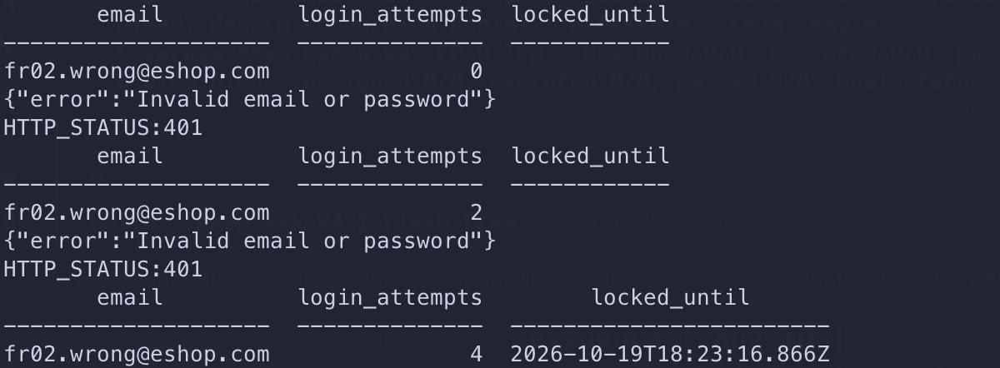
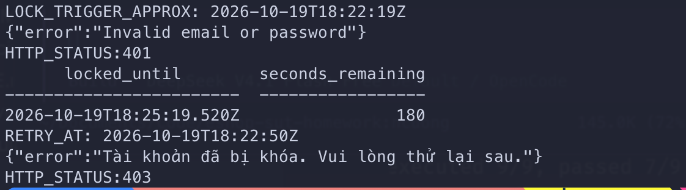

# FR02 — Test results

- **Run dùng để tổng hợp:** 15 ca gốc từ `run-20261020-fr02`; ba ca bổ sung `DT-09`–`DT-11` từ `run-20261021-fr02-gap-api` và `run-20261021-fr02-gap-ui`. Mỗi T-ID chỉ tính một lần; không coi đây là một run duy nhất.
- **Build/commit SUT:** run gốc ở `f3162660d5c4f9005cbb15910290adb4b58ef2c7`; run bổ sung ở HEAD `2010a50344e8b94fa19fba48335963de2cb55c7a` (source backend/frontend không sửa cho test).
- **Môi trường:** macOS, Node v26.9.0, backend Node/Express + SQLite; instance cách ly trong thư mục tạm (`server.js`/`database.js` là bản sao, `database.sqlite` riêng, `node_modules` symlink). Interface: `POST http://localhost:3000/api/login` (và `GET /api/users/me` để xác nhận token).
- **Reset trạng thái:** mỗi ca dùng tài khoản fixture riêng; trạng thái bộ đếm/khóa chuẩn bị bằng `sqlite3` trên DB test. DB làm việc `backend/database.sqlite` giữ nguyên checksum `c63f0054…` (không bị sửa).
- **Run bổ sung:** backend/SQLite bản sao cách ly trên cổng 3000; Firefox 158 headless với profile test tạm, Vite ở `127.0.0.1:5173`; DB làm việc trước run SHA-256 `c63f00544180ba1fbb1427a9b9dd3f1784842698809972f33ce90482e7420ba6`. File thô `evidence/ev-gap-api.json`, `evidence/ev-gap-ui.json`; screenshot trong `screenshots/`. Token trong log đã thay bằng dấu hiện diện/redacted.
- **Chi tiết thô:** `evidence/FR02-evidence.md` + các file `evidence/*.log`/`*.json`.

## Kết quả theo run

| T-ID | Run ID | Actual | Status | EV-ID / evidence | Bug ID |
| --- | --- | --- | --- | --- | --- |
| DT-01 | run-20261020-fr02 | Thân phản hồi success + `token`; `GET /api/users/me` trả 200 với token | PASS | EV-FR02-001, EV-FR02-002 (`ev-DT-01.log`, `ev-DT-01-token-check.log`) | — |
| DT-02 | run-20261020-fr02 | Thất bại (401, không token); `login_attempts` = **2** sau 1 lần sai (kỳ vọng 1) | FAIL | EV-FR02-003, EV-FR02-004 (`ev-DT-02.log`, `ev-DT-02-rerun.log`) | BUG-FR02-01 |
| DT-03 | run-20261020-fr02 | Thất bại (401, không token); số user khớp email = 0 | PASS | EV-FR02-005 (`ev-DT-03.log`) | — |
| DT-04 | run-20261020-fr02 | Mật khẩu rỗng → 401, không token | PASS | EV-FR02-006 (`ev-DT-04-05.log`) | — |
| DT-05 | run-20261020-fr02 | Email rỗng và body `{}` → 401, không token | PASS | EV-FR02-007 (`ev-DT-04-05.log`) | — |
| DT-06 | run-20261020-fr02 | Email `not-an-email` → 401, không token (đặc tả không định nghĩa kết quả ở API) | INCONCLUSIVE (Quan sát) | EV-FR02-008 (`ev-DT-06.log`) | — |
| DT-07 | run-20261020-fr02 | Tài khoản khóa + mật khẩu đúng → 403 thông báo khóa, không token; `login_attempts=3`, `locked_until` giữ nguyên | PASS | EV-FR02-009 (`ev-DT-07-08.log`) | — |
| DT-08 | run-20261020-fr02 | Tài khoản khóa + mật khẩu sai → 403 thông báo khóa; bộ đếm không đổi | PASS | EV-FR02-010 (`ev-DT-07-08.log`) | — |
| BVA-02 | run-20261020-fr02 | Sau 2 lần sai: `login_attempts=4` **và** đã khóa (`locked_until` ≈ now+180 s) | FAIL | EV-FR02-011 (`ev-BVA-02.log`) | BUG-FR02-01, BUG-FR02-02 |
| BVA-03 | run-20261020-fr02 | Từ `login_attempts=2` (chưa khóa), sai lần 3 → tài khoản bị khóa (`locked_until` được đặt) | PASS | EV-FR02-012 (`ev-BVA-03-04.log`) | — (bộ đếm/thời lượng thuộc DT-02/BVA-06) |
| BVA-04 | run-20261020-fr02 | Gửi thêm khi đang khóa → 403 thông báo khóa; bộ đếm/khóa không đổi | PASS | EV-FR02-013 (`ev-BVA-03-04.log`) | — |
| BVA-05 | run-20261020-fr02 | Tại `t0+29 s`, mật khẩu đúng → vẫn 403 (đang trong cửa sổ khóa) | PASS | EV-FR02-014 (`ev-BVA-05-06.log`) | — |
| BVA-06 | run-20261020-fr02 | Tại `t0+31 s`, mật khẩu đúng → vẫn 403 (chưa hết khóa) | FAIL | EV-FR02-015 (`ev-BVA-05-06.log`) | BUG-FR02-02 |
| BVA-07 | run-20261020-fr02 | 1 lần sai rồi đúng → 200 + token; `login_attempts=0`, `locked_until=NULL` | PASS | EV-FR02-016 (`ev-BVA-07.log`) | — |
| BVA-08 | run-20261020-fr02 | `locked_until` quá khứ + mật khẩu đúng → 200 + token | PASS | EV-FR02-017 (`ev-BVA-08.log`) | — |
| DT-09 | run-20261021-fr02-gap-ui + API | Form email `type=text`, `not-an-email` có `typeMismatch=false`; bấm Sign In → trang chủ, token trong localStorage; API fixture cũng trả 200 + JWT | **FAIL** | EV-FR02-018 UI (`ev-gap-ui.json`), EV-FR02-019 API (`ev-gap-api.json`), `BUG-FR02-03-before/after.png` | BUG-FR02-03 |
| DT-10 | run-20261021-fr02-gap-api | Thiếu key `password` → 401, không token (đúng); `login_attempts: 0→2` (sai, phải tăng 1) | **FAIL** (side effect) | EV-FR02-020 (`ev-gap-api.json`) | BUG-FR02-01 (đã có) |
| DT-11 | run-20261021-fr02-gap-api | Account có password DB `NULL`; login `password:null` → 200 + JWT, lặp lại 2 tài khoản | **FAIL** | EV-FR02-021 (`ev-gap-api.json`), `BUG-FR02-04-api-evidence.png` | BUG-FR02-04 |

## Tổng hợp case duy nhất

| Phạm vi | Thiết kế | Đã chạy | PASS | FAIL | Quan sát | BLOCKED | Chưa chạy |
| --- | ---: | ---: | ---: | ---: | ---: | ---: | ---: |
| **Tất cả T-ID duy nhất** | 18 | 18 | 11 | 6 | 1 | 0 | 0 |

Đã chạy = PASS + FAIL + Quan sát = 11 + 6 + 1 = 18; Thiết kế = Đã chạy + BLOCKED + Chưa chạy = 18. `DT-06` là Quan sát/INCONCLUSIVE, không tính vào pass/fail. `DT-10` không tạo bug mới: 401/no-token đạt oracle xác thực, nhưng vi phạm side effect R2 của BUG-FR02-01.

- **Theo kỹ thuật (có thể chồng lấp, không cộng thành tổng):** EP/Domain 12 T-ID (P1–P12); BVA giữ 8 điểm biên trên 8 T-ID (BVA-01 gộp DT-02).
- Bằng chứng: `evidence/FR02-evidence.md`, `evidence/*.log`, `evidence/ev-gap-api.json`, `evidence/ev-gap-ui.json` và screenshot.

---

## Bug report

### Bảng tổng hợp

| Bug ID | Feature | Title | Severity | Priority | Related TC | Status | Evidence |
| --- | --- | --- | --- | --- | --- | --- | --- |
| BUG-FR02-01 | FR02 | Bộ đếm đăng nhập sai tăng 2 thay vì 1 → khóa tài khoản sau 2 lần sai | High | High | DT-02, BVA-02, BVA-03 | Đã tái hiện (2/2); SV đã xác nhận — Issue [#25](https://github.com/SoftwareTesting-Group13/eshop-sut-homework/issues/25) | `ev-DT-02.log`, `ev-DT-02-rerun.log`, `ev-BVA-02.log`, `screenshots/BUG-FR02-01.png` |
| BUG-FR02-02 | FR02 | Thời lượng khóa tài khoản là 180 giây thay vì 30 giây | Medium | High | BVA-02, BVA-06 | Đã tái hiện (2/2); SV đã xác nhận — Issue [#26](https://github.com/SoftwareTesting-Group13/eshop-sut-homework/issues/26) | `ev-BVA-02.log`, `ev-BVA-05-06.log`, `screenshots/BUG-FR02-02.png` |
| BUG-FR02-03 | FR02 | Form đăng nhập cho email sai định dạng đi qua và đăng nhập thành công | Medium | Medium | DT-09 | Đã xác nhận UI + API; Issue đang chuẩn bị | `ev-gap-api.json`, `ev-gap-ui.json`, `screenshots/BUG-FR02-03-before.png`, `BUG-FR02-03-after.png` |
| BUG-FR02-04 | FR02 | Đăng nhập bằng `password:null` vẫn nhận JWT nếu account có password `NULL` | High | High | DT-11 | Đã tái hiện API 2/2; Issue đang chuẩn bị | `ev-gap-api.json`, `screenshots/BUG-FR02-04-api-evidence.png` |

### Thống kê severity

| Critical | High | Medium | Low | Tổng |
| ---: | ---: | ---: | ---: | ---: |
| 0 | 2 | 2 | 0 | **4** |

### Tiêu chí phân loại

| Severity | Tiêu chí |
| --- | --- |
| **Critical** | Lộ/mất dữ liệu nhạy cảm hoặc lỗi bảo mật nghiêm trọng. |
| **High** | Luồng cốt lõi hoặc business rule quan trọng sai, ảnh hưởng lớn tới người dùng. |
| **Medium** | Quy tắc/validation sai với ảnh hưởng giới hạn hơn High. |
| **Low** | Sai lệch hiển thị/nội dung nhỏ, ít ảnh hưởng đến việc hoàn thành tác vụ. |

Priority là mức ưu tiên xử lý, đánh giá riêng theo mức ảnh hưởng và tính cấp bách.

### Chi tiết (manual reproduction)

> **Môi trường chung:** commit `f3162660…`; backend Node/Express + SQLite chạy cách ly; base URL `http://localhost:3000`. **Cả hai bug đã được người kiểm thử xác nhận; screenshot đã đính và GitHub Issue đã mở:** BUG-FR02-01 → [#25](https://github.com/SoftwareTesting-Group13/eshop-sut-homework/issues/25), BUG-FR02-02 → [#26](https://github.com/SoftwareTesting-Group13/eshop-sut-homework/issues/26). Nội dung issue đầy đủ lưu tại `issues/BUG-FR02-01.md`, `issues/BUG-FR02-02.md`.

#### BUG-FR02-01 — Bộ đếm đăng nhập sai tăng 2 thay vì 1 → khóa tài khoản sau 2 lần sai

| Trường | Giá trị |
| --- | --- |
| Feature | FR02 — Đăng nhập & Khóa tài khoản |
| Test case liên quan | DT-02 (đồng thời BVA-01), BVA-02 |
| Requirement | README §2 FR-02 (R2, R3) |
| Severity / Priority | High / High |
| Trạng thái | Đã tái hiện 2/2; **người kiểm thử đã xác nhận**; đã mở GitHub Issue |
| Evidence | `evidence/ev-DT-02.log`, `evidence/ev-DT-02-rerun.log`, `evidence/ev-BVA-02.log` |
| Screenshot | `screenshots/BUG-FR02-01.png` (đã đính vào Issue #23) |
| GitHub Issue | [#25](https://github.com/SoftwareTesting-Group13/eshop-sut-homework/issues/25) |

**Tiền điều kiện:** tài khoản `fr02.wrong@eshop.com` / `Passw0rd!` tồn tại, DB test có `login_attempts = 0`, `locked_until = NULL`.

**Các bước tái hiện:**
1. Gửi `POST /api/login` với `{"email":"fr02.wrong@eshop.com","password":"WrongPass1!"}`.
2. Đọc `login_attempts` của tài khoản trong DB.
3. (Mô phỏng 2 lần sai liên tiếp) lặp bước 1 một lần nữa và đọc lại `login_attempts`, `locked_until`.

| Bước | Input / hành động | Quan sát |
| --- | --- | --- |
| 1 | sai lần 1 | `HTTP 401` `Invalid email or password`; `login_attempts = 2` (kỳ vọng 1) |
| 3 | sai lần 2 | `login_attempts = 4`; `locked_until` bị đặt ⇒ **khóa ngay ở lần sai thứ 2** (kỳ vọng chưa khóa) |

**Expected:** sau lần sai thứ nhất `login_attempts = 1`; chỉ khi sai **từ 3 lần trở lên liên tiếp** mới khóa (R2, R3). **Actual:** mỗi lần sai cộng 2, nên chỉ sau 2 lần sai bộ đếm đã = 4 ≥ 3 và tài khoản bị khóa sớm hơn đặc tả.
**Độ lặp lại:** 2/2 (chạy lại trên tài khoản `fr02.rerun@eshop.com` cho cùng kết quả `login_attempts = 2`). **Root cause (theo code):** `backend/server.js:54` dùng `user.login_attempts + 2`.
**Reproduce nhanh (API):**
```bash
curl -s -X POST http://localhost:3000/api/login \
  -H 'Content-Type: application/json' \
  --data-raw '{"email":"fr02.wrong@eshop.com","password":"WrongPass1!"}'
sqlite3 backend/database.sqlite "SELECT login_attempts,locked_until FROM users WHERE email='fr02.wrong@eshop.com';"
```
**Screenshot xác nhận:** `screenshots/BUG-FR02-01.png` — 
**GitHub Issue:** [#25](https://github.com/SoftwareTesting-Group13/eshop-sut-homework/issues/25) (đã mở, kèm screenshot).

---

#### BUG-FR02-02 — Thời lượng khóa tài khoản là 180 giây thay vì 30 giây

| Trường | Giá trị |
| --- | --- |
| Feature | FR02 — Đăng nhập & Khóa tài khoản |
| Test case liên quan | BVA-02 (đo `locked_until`), BVA-06 |
| Requirement | README §2 FR-02 (R3) |
| Severity / Priority | Medium / High |
| Trạng thái | Đã tái hiện 2/2; **người kiểm thử đã xác nhận**; đã mở GitHub Issue |
| Evidence | `evidence/ev-BVA-02.log`, `evidence/ev-BVA-05-06.log` |
| Screenshot | `screenshots/BUG-FR02-02.png` (đã đính vào Issue #24) |
| GitHub Issue | [#26](https://github.com/SoftwareTesting-Group13/eshop-sut-homework/issues/26) |

**Tiền điều kiện:** tài khoản chưa khóa; kích hoạt khóa bằng lần sai đưa bộ đếm qua ngưỡng; ghi lại thời điểm khóa `t0`.

**Các bước tái hiện:**
1. Kích hoạt khóa tài khoản (chuẩn bị `login_attempts = 2` rồi gửi 1 lần sai).
2. Đọc `locked_until`; so với `t0`.
3. Chờ tới `t0 + 31 s`, gửi `POST /api/login` với mật khẩu **đúng**.

| Bước | Input / hành động | Quan sát |
| --- | --- | --- |
| 1–2 | đọc `locked_until` sau khóa | `locked_until − now ≈ 180.014 s` (kỳ vọng 30 s) |
| 3 | tại `t0+31 s`, mật khẩu đúng | `HTTP 403` `Tài khoản đã bị khóa. Vui lòng thử lại sau.` (kỳ vọng 200 + token) |

**Expected:** khóa tạm **30 giây**, hết 30 s thì đăng nhập lại được (R3). **Actual:** khóa 180 s, vẫn bị từ chối ở `t0+31 s`.
**Độ lặp lại:** 2/2 (đo tại BVA-02 và quan sát tại BVA-06). **Root cause (theo code):** `backend/server.js:57` dùng `Date.now() + 180000`.
**Reproduce nhanh (API):**
```bash
sleep 31
curl -s -X POST http://localhost:3000/api/login \
  -H 'Content-Type: application/json' \
  --data-raw '{"email":"fr02.thr@eshop.com","password":"Passw0rd!"}'
```
**Screenshot xác nhận:** `screenshots/BUG-FR02-02.png` — 
**GitHub Issue:** [#26](https://github.com/SoftwareTesting-Group13/eshop-sut-homework/issues/26) (đã mở, kèm screenshot).

---

#### BUG-FR02-03 — Form đăng nhập chấp nhận email sai định dạng

| Trường | Giá trị |
| --- | --- |
| Feature / rule | FR-02 R4 — ô email phải dùng `type="email"` và HTML5 format validation; FR-01 là dependency tạo fixture |
| Test case | DT-09, P10 |
| Build / run | `2010a503…`; `run-20261021-fr02-gap-ui` (Firefox 158) + `run-20261021-fr02-gap-api` |
| Severity / Priority | Medium / Medium — bỏ qua kiểm tra định dạng bắt buộc ở form |
| Evidence | `evidence/ev-gap-ui.json`, `evidence/ev-gap-api.json`, [ảnh trước](screenshots/BUG-FR02-03-before.png), [ảnh sau](screenshots/BUG-FR02-03-after.png) |

**Tiền điều kiện:** trên DB test riêng, `POST /api/register` với `{"name":"FR02 Gap Malformed","email":"not-an-email","password":"Passw0rd!"}` trả 200 và tạo account. Đây là vi phạm riêng của FR-01, nhưng chỉ là fixture để kiểm thử FR-02; không cộng thêm T-ID FR-01.

**Đường UI đã chạy:** mở `http://127.0.0.1:5173/login`; nhập `not-an-email` và `Passw0rd!`; bấm **Sign In**. Expected: input `type="email"`, trình duyệt chặn email sai format trước khi gửi login. Actual: DOM là `type="text"`, `validity.typeMismatch=false`, form coi là hợp lệ; sau submit điều hướng về trang chủ, header hiện “Chào, FR02 Gap Malformed”, localStorage có token. API `POST /api/login` cùng dữ liệu cũng trả 200 + JWT; account thứ hai `plainsecond` tái hiện API tương tự. **Kết luận:** R4 không được thực thi ở form đăng nhập. Ảnh trước/sau là screenshot UI thật, không lấy kết quả API làm verdict UI.

**Root cause xác minh:** `frontend-web/src/pages/Login.jsx:30` đặt email input `type="text"`; backend `server.js:32-38` tìm đúng chuỗi email, không validate format. Điểm FR-01 liên quan: `server.js:18-27` lưu email nhận được mà không kiểm định.

---

#### BUG-FR02-04 — `password:null` được xem là đăng nhập thành công

| Trường | Giá trị |
| --- | --- |
| Feature / rule | FR-02 R8 — phải cung cấp mật khẩu sử dụng được; FR-01 yêu cầu mật khẩu mạnh khi tạo account |
| Test case | DT-11, P12 (mở rộng AI-GAP-FR02-03); **khác DT-10 thiếu key** |
| Build / run | `2010a503…`; `run-20261021-fr02-gap-api`, backend/SQLite cách ly |
| Severity / Priority | High / High — cấp JWT cho account không có mật khẩu hợp lệ |
| Evidence | `evidence/ev-gap-api.json`, [ảnh log API](screenshots/BUG-FR02-04-api-evidence.png) |

**Tiền điều kiện:** API đăng ký tạo `fr02.gap.null@eshop.com` với `password:null`; DB test lưu `users.password = NULL`. Đây là lỗi đầu vào liên quan FR-01; form đăng ký thông thường có `required` và không gửi JSON `null`.

**Đường API đã chạy:** gửi `POST /api/login` với `{"email":"fr02.gap.null@eshop.com","password":null}`. Expected: từ chối và không cấp JWT vì không có mật khẩu hợp lệ. Actual: HTTP 200 `Login successful` và JWT. Lặp lại độc lập với `fr02.gap.null2@eshop.com` cho cùng kết quả (2/2). **Đường UI thông thường không thể gửi cùng input:** ô password `required` gửi chuỗi, không gửi `null`; ảnh đính là ảnh chụp bản trình bày log API thật, không phải screenshot app.

**Phân biệt ca thiếu key:** DT-10 body chỉ có email trả 401 và **không** cấp token. Side effect `login_attempts=0→2` của DT-10 thuộc BUG-FR02-01 đã báo trước đó; không tạo issue mới cho nó. **Root cause xác minh:** đăng ký lưu `NULL`; `server.js:44` so sánh `user.password === password`, nên `null === null` đi vào nhánh phát JWT.

---

## Coverage & gaps

| Tiêu chí coverage | Nghĩa vụ đủ điều kiện | Thiết kế | Đã chạy | PASS | Chưa phủ |
| --- | ---: | ---: | ---: | ---: | ---: |
| Lớp tương đương EP (P1–P12) | 12 | 12 | 12 | 7 | 0 (P2, P10–P12 FAIL; P6 Quan sát) |
| Điểm biên BVA (B1–B4) | 8 | 8 | 8 | 5 | 0 (3 điểm FAIL) |

- **Coverage theo nghĩa vụ:** EP designed 12/12, executed 12/12, passed 7/12. BVA designed 8/8, executed 8/8, passed 5/8. Gộp T-ID: 18 thiết kế / 18 đã chạy / 11 PASS / 6 FAIL / 1 Quan sát.
- **Mục tiêu đề xuất (chưa được duyệt):** thiết kế và thực thi 100% nghĩa vụ đủ điều kiện; đạt oracle theo từng nghĩa vụ. **Goal status:** designed `GOAL_MET`, executed `GOAL_MET`, passed `GOAL_NOT_MET` (EP 7/12, BVA 5/8). Coverage đạt không đồng nghĩa feature không còn lỗi.
- **Chưa bao phủ:** không có nghĩa vụ EP/BVA đã chọn nào bị bỏ trống. Điểm chưa rõ: Q1 — reset bộ đếm sau khi hết khóa; Q2 — tiêu chí "không lộ chi tiết nguyên nhân"; Q3 — chuẩn hóa email; Q4 — hành vi API với email sai định dạng chưa đăng ký (DT-06 vẫn Quan sát). P10 chấm theo rule UI `type=email`, không thay verdict API của DT-06.
- **Infeasible/khó:** BVA-03 phải chuẩn bị `login_attempts = 2` bằng DB test vì SUT khóa sớm (BUG-FR02-01) khiến không thể tạo "lần sai thứ 3" một cách tuần tự.
- **Ca BLOCKED:** không có.

## Ngoài phạm vi EP/BVA (không tính coverage)

- Thân phản hồi đăng nhập thành công và `GET /api/users/me` trả về trường `password` dạng plaintext; mật khẩu lưu plaintext trong DB (liên quan SEC-01). Ghi tại `../../supporting-materials/fr02-observations.md`.
- Ô mật khẩu web cũng dùng `type="text"` thay vì `type="password"` của FR-22; là quan sát ngoài phạm vi FR-02. Ô email `type="text"` đã được kiểm tra như P10/DT-09, **không** còn xếp ngoài coverage FR-02.

## AI Gap Analysis

Hai gap do người kiểm thử nêu đã được đưa vào catalog và chạy bổ sung. `password` **thiếu key** khác `password:null`; bảng dưới giữ riêng kết quả và bug tương ứng, không nhận ca 401 là lỗi cấp quyền.

| Gap ID | AI output/source | Test case/bug tôi phát hiện thêm | Cách tôi phát hiện | Vì sao AI bỏ sót (nhận định của tôi) | Bổ sung/sửa chữa |
| --- | --- | --- | --- | --- | --- |
| AI-GAP-FR02-01 | `DT-06` ban đầu chỉ gửi `not-an-email` chưa đăng ký đến API, nhận 401; không kiểm tra form. | `DT-09`: tạo tài khoản `not-an-email` qua API FR-01 rồi đăng nhập trên web; form chấp nhận và cấp session, **BUG-FR02-03**. | Tôi đối chiếu yêu cầu FR-02 `type="email"` với form, chuẩn bị fixture qua FR-01 rồi chạy UI; ảnh trước/sau và log API/UI đã lưu. | AI chỉ nhìn phản hồi 401 của email chưa tồn tại và bỏ qua tương tác giữa tính hợp lệ của email với trạng thái **đã đăng ký**. | Đã bổ sung P10/DT-09, evidence UI + API và bug report/Issue riêng. |
| AI-GAP-FR02-03 | `DT-04` thử mật khẩu rỗng; `DT-05` body `{}` làm thiếu cả email lẫn password. | `DT-10` cô lập **key password vắng**: 401/no-token đúng, nhưng bộ đếm +2 thuộc BUG-FR02-01. Mở rộng lớp này thành `DT-11` với `password:null` và account DB `NULL`: nhận 200 + JWT, **BUG-FR02-04**. | Tôi tách ba giá trị rỗng / thiếu key / `null` để kiểm từng nhánh; tạo fixture `NULL` qua API FR-01, chạy lại trên hai tài khoản và xem log/ảnh API. | AI gộp các biến thể "không có mật khẩu sử dụng được" và chỉ thử body `{}` với hai trường cùng vắng, nên không phát hiện so sánh `null === null`. | Đã bổ sung P11/DT-10 và P12/DT-11; không mở bug trùng cho DT-10, báo lỗi cấp JWT ở DT-11 bằng Issue riêng. |

## Việc còn lại

1. ~~Người kiểm thử review và xác nhận 2 bug; chụp screenshot và mở GitHub Issue kèm ảnh.~~ **Đã xong:** xác nhận + screenshot + Issue [#25](https://github.com/SoftwareTesting-Group13/eshop-sut-homework/issues/25), [#26](https://github.com/SoftwareTesting-Group13/eshop-sut-homework/issues/26).
2. Hai ca gap và biến thể `null` đã chạy; bổ sung link Issue mới sau khi publish, viết AI Critique (phần của sinh viên).
3. Hoàn tất bàn giao HW02: PDF `main-report`, `ai-audit`, `ai-critique`; `git-commit-log.txt`; video demo.
