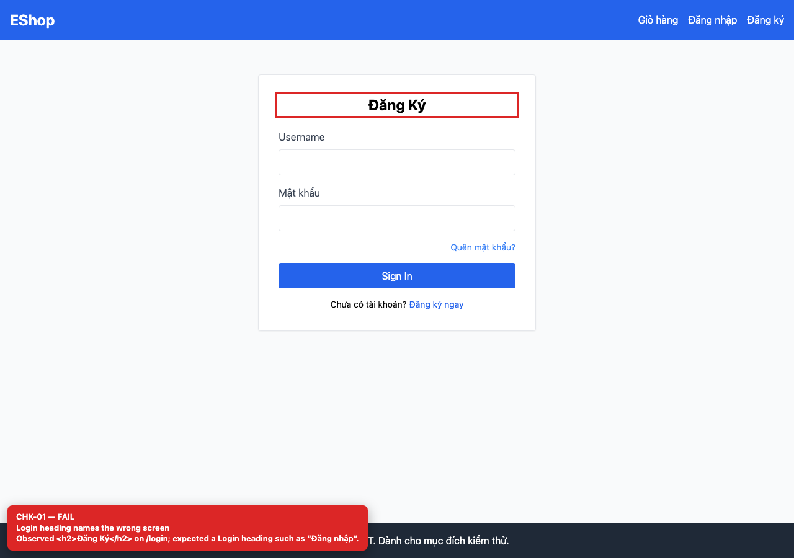

# BUG-GUI-01 — Login page heading says “Đăng Ký” instead of “Đăng nhập”

| Field | Value |
| --- | --- |
| Severity | **Minor** |
| FR | FR-02 |
| Interface aspect | IA-01 |
| Screen | Login |
| Checklist IDs | CHK-01 |
| Environment | Chromium 158 (Playwright 1.65), 1280×900; backend http://localhost:3000, web http://localhost:5173 |
| Status | Draft — student review and GitHub publication pending |

## Steps to reproduce

1. Open http://localhost:5173/login.
2. Read the card heading above the form.

## Expected result

The heading identifies the Login screen (for example “Đăng nhập”).

## Actual result

The heading is “Đăng Ký” (Register), so users can believe they are on the registration screen.

## Evidence

## Root cause

frontend-web/src/pages/Login.jsx:24 — hard-coded <h2>Đăng Ký</h2>.

## Suggested fix

Change the heading to “Đăng nhập” and add a page-title test to the auth-screen suite.

## GitHub issue

- Title: `[BUG-GUI-01] Login page heading says “Đăng Ký” instead of “Đăng nhập”`
- Labels: `bug`, `minor`, `ia-01`, `fr-02`
- Publishing is blocked in this environment because the GitHub CLI/token is not configured; the ready-to-publish body is in `issues/`.
