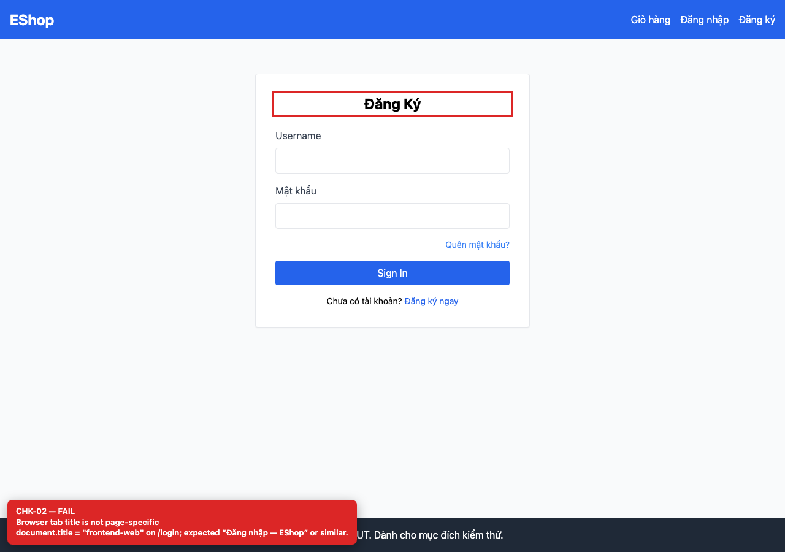
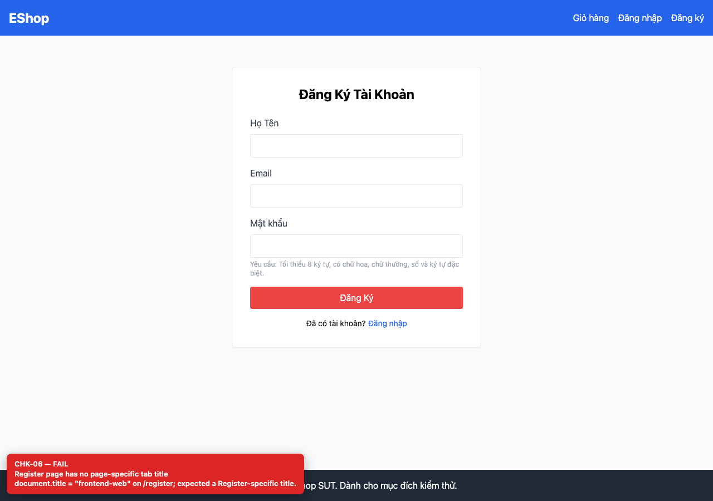
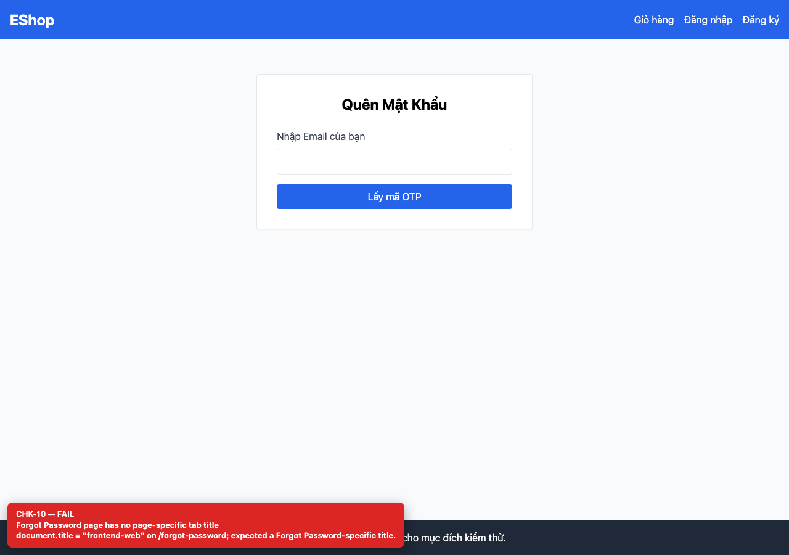
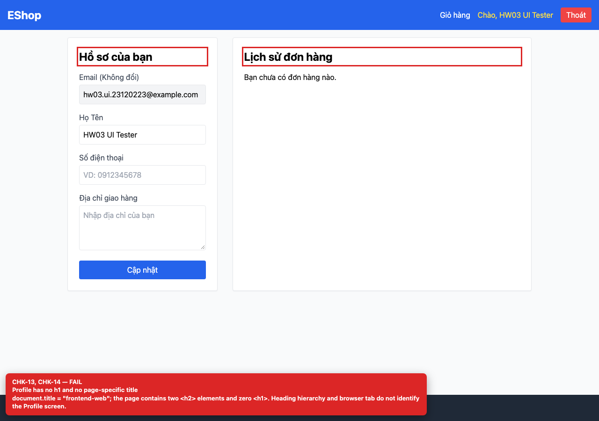

# BUG-GUI-02 — All pages share the browser tab title “frontend-web”

| Field | Value |
| --- | --- |
| Severity | **Minor** |
| FR | FR-01..04 |
| Interface aspect | IA-01 |
| Screen | All auth screens |
| Checklist IDs | CHK-02, CHK-06, CHK-10, CHK-14 |
| Environment | Chromium 158 (Playwright 1.65), 1280×900; backend http://localhost:3000, web http://localhost:5173 |
| Status | Draft — student review and GitHub publication pending |

## Steps to reproduce

1. Open /login, /register, /forgot-password and /profile in separate tabs.
2. Compare the browser tab titles.

## Expected result

Each tab has a unique, descriptive title (for example “Đăng nhập — EShop”).

## Actual result

Every tab is titled “frontend-web”; users with several tabs cannot tell them apart and bookmarks are indistinguishable.

## Evidence

## Root cause

frontend-web/index.html:7 static <title>; no per-route document.title update.

## Suggested fix

Set document.title in each page (or use react-helmet / a route-title hook).

## GitHub issue

- Title: `[BUG-GUI-02] All pages share the browser tab title “frontend-web”`
- Labels: `bug`, `minor`, `ia-01`, `fr-01..04`
- Publishing is blocked in this environment because the GitHub CLI/token is not configured; the ready-to-publish body is in `issues/`.
