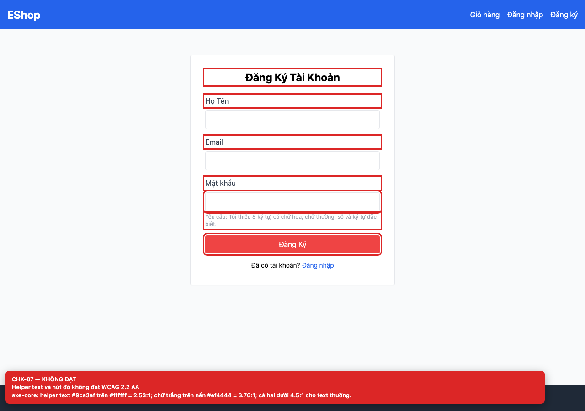
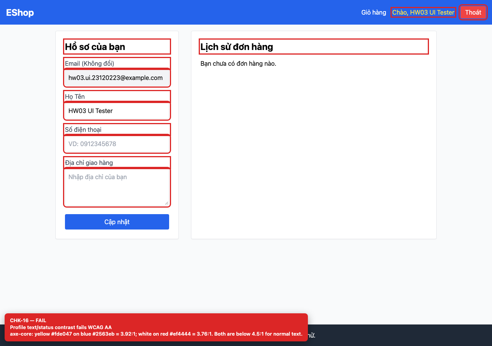

# BUG-GUI-03 — Text phụ và nút đỏ không đạt WCAG 2.2 AA về contrast

**GitHub Issue:** chưa publish — draft tại [`issues/BUG-GUI-03.md`](../issues/BUG-GUI-03.md)

## Tóm tắt

Text phụ và nút đỏ không đạt WCAG 2.2 AA về contrast. Bug được phát hiện khi thực thi checklist GUI Task 1 trên màn hình `/register, /profile`.

| Mục | Giá trị |
| --- | --- |
| Feature / rule | FR-21 — Tiêu chuẩn giao diện chung |
| Checklist | CHK-07, CHK-16 |
| Màn hình | `/register, /profile` |
| Môi trường | Chromium 158 / Playwright 1.65; backend `http://localhost:3000`; web `http://localhost:5173`; viewport 1280×900 (mobile 360×800 khi có kiểm tra responsive). |
| Severity / Priority | **Major** / High |
| Lặp lại | 1/1 trên build hiện tại |

## Các bước tái hiện

1. Mở `/register` và `/profile` (đã đăng nhập).
2. Chạy axe-core hoặc tính contrast của helper text, nút đỏ, username vàng và nút đăng xuất.

| Mốc | Expected | Actual |
| --- | --- | --- |
| Sau thao tác | Text thường đạt tối thiểu 4.5:1 so với nền; text lớn đạt 3:1. | axe-core báo helper text `#9ca3af` trên `#ffffff` = 2.53:1; trắng trên `#ef4444` = 3.76:1; vàng `#fde047` trên xanh `#2563eb` = 3.92:1; nút đăng xuất đỏ/trắng = 3.76:1. |

## Bằng chứng





## Nguyên nhân đối chiếu mã nguồn

**[`frontend-web/src/pages/Register.jsx:64`](https://github.com/SoftwareTesting-Group13/eshop-sut-homework/blob/85af3ba875c88283615e22cb108f13e2fccaf0e9/frontend-web/src/pages/Register.jsx#L64)–[L65](https://github.com/SoftwareTesting-Group13/eshop-sut-homework/blob/85af3ba875c88283615e22cb108f13e2fccaf0e9/frontend-web/src/pages/Register.jsx#L65)**

```jsx
          <p className="text-xs text-gray-400 mt-1">
            Yêu cầu: Tối thiểu 8 ký tự, có chữ hoa, chữ thường, số và ký tự đặc biệt.
```

Helper text dùng `text-gray-400` trên nền trắng.

**[`frontend-web/src/pages/Register.jsx:70`](https://github.com/SoftwareTesting-Group13/eshop-sut-homework/blob/85af3ba875c88283615e22cb108f13e2fccaf0e9/frontend-web/src/pages/Register.jsx#L70)–[L75](https://github.com/SoftwareTesting-Group13/eshop-sut-homework/blob/85af3ba875c88283615e22cb108f13e2fccaf0e9/frontend-web/src/pages/Register.jsx#L75)**

```jsx
        <button
          type="submit"
          className="w-full bg-red-500 text-white py-2 rounded hover:bg-red-600"
        >
          Đăng Ký
        </button>
```

Nút tích cực dùng `bg-red-500` với chữ trắng.

**[`frontend-web/src/App.jsx:26`](https://github.com/SoftwareTesting-Group13/eshop-sut-homework/blob/85af3ba875c88283615e22cb108f13e2fccaf0e9/frontend-web/src/App.jsx#L26)–[L29](https://github.com/SoftwareTesting-Group13/eshop-sut-homework/blob/85af3ba875c88283615e22cb108f13e2fccaf0e9/frontend-web/src/App.jsx#L29)**

```jsx
            <Link to="/profile" className="hover:underline text-yellow-300">
              <span dangerouslySetInnerHTML={{ __html: `Chào, ${user.name}` }} />
            </Link>
            <button onClick={logout} className="bg-red-500 px-3 py-1 rounded">Thoát</button>
```

Username dùng `text-yellow-300` trên nền xanh; nút đăng xuất dùng `bg-red-500` với chữ trắng.

## Đề xuất sửa

Dùng màu đậm hơn cho helper text và nút đỏ, hoặc đổi sang nền sáng/chữ tối; chạy lại axe-core sau khi sửa.

## Ghi chú

Screenshot được chụp trên SUT đang chạy tại `http://localhost:5173`; code block lấy trực tiếp từ source tại commit [`85af3ba`](https://github.com/SoftwareTesting-Group13/eshop-sut-homework/blob/85af3ba875c88283615e22cb108f13e2fccaf0e9).
