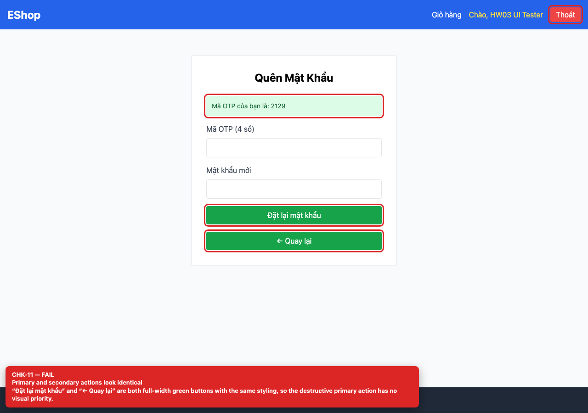

# BUG-GUI-04 — Hai nút ở bước 2 Quên mật khẩu trông giống hệt nhau

**GitHub Issue:** chưa publish — draft tại [`issues/BUG-GUI-04.md`](../issues/BUG-GUI-04.md)

## Tóm tắt

Hai nút ở bước 2 Quên mật khẩu trông giống hệt nhau. Bug được phát hiện khi thực thi checklist GUI Task 1 trên màn hình `/forgot-password`.

| Mục | Giá trị |
| --- | --- |
| Feature / rule | FR-03 — Quên mật khẩu |
| Checklist | CHK-11 |
| Màn hình | `/forgot-password` |
| Môi trường | Chromium 158 / Playwright 1.65; backend `http://localhost:3000`; web `http://localhost:5173`; viewport 1280×900 (mobile 360×800 khi có kiểm tra responsive). |
| Severity / Priority | **Minor** / Medium |
| Lặp lại | 1/1 trên build hiện tại |

## Các bước tái hiện

1. Mở `/forgot-password`, nhập email đã đăng ký và bấm “Lấy mã OTP”.
2. So sánh nút “Đặt lại mật khẩu” và nút “← Quay lại”.

| Mốc | Expected | Actual |
| --- | --- | --- |
| Sau thao tác | Primary action nổi bật, dùng màu xanh dương theo FR-21; secondary/back rõ ràng là hành động phụ. | Cả hai đều là nút xanh lá full-width (`bg-green-600`), cùng kích thước và kiểu chữ; người dùng dễ bấm nhầm. |

## Bằng chứng



## Nguyên nhân đối chiếu mã nguồn

**[`frontend-web/src/pages/ForgotPassword.jsx:89`](https://github.com/SoftwareTesting-Group13/eshop-sut-homework/blob/85af3ba875c88283615e22cb108f13e2fccaf0e9/frontend-web/src/pages/ForgotPassword.jsx#L89)–[L95](https://github.com/SoftwareTesting-Group13/eshop-sut-homework/blob/85af3ba875c88283615e22cb108f13e2fccaf0e9/frontend-web/src/pages/ForgotPassword.jsx#L95)**

```jsx
              
          <button type="submit" className="w-full bg-green-600 text-white py-2 rounded">
            Đặt lại mật khẩu
          </button>
          <button type="button" onClick={() => setStep(1)} className="w-full bg-green-600 text-white py-2 rounded">
            ← Quay lại
          </button>
```

Hai button dùng cùng class `w-full bg-green-600 text-white`.

## Đề xuất sửa

Render nút quay lại dạng text/outline và giữ primary action là nút filled màu xanh dương.

## Ghi chú

Screenshot được chụp trên SUT đang chạy tại `http://localhost:5173`; code block lấy trực tiếp từ source tại commit [`85af3ba`](https://github.com/SoftwareTesting-Group13/eshop-sut-homework/blob/85af3ba875c88283615e22cb108f13e2fccaf0e9).
