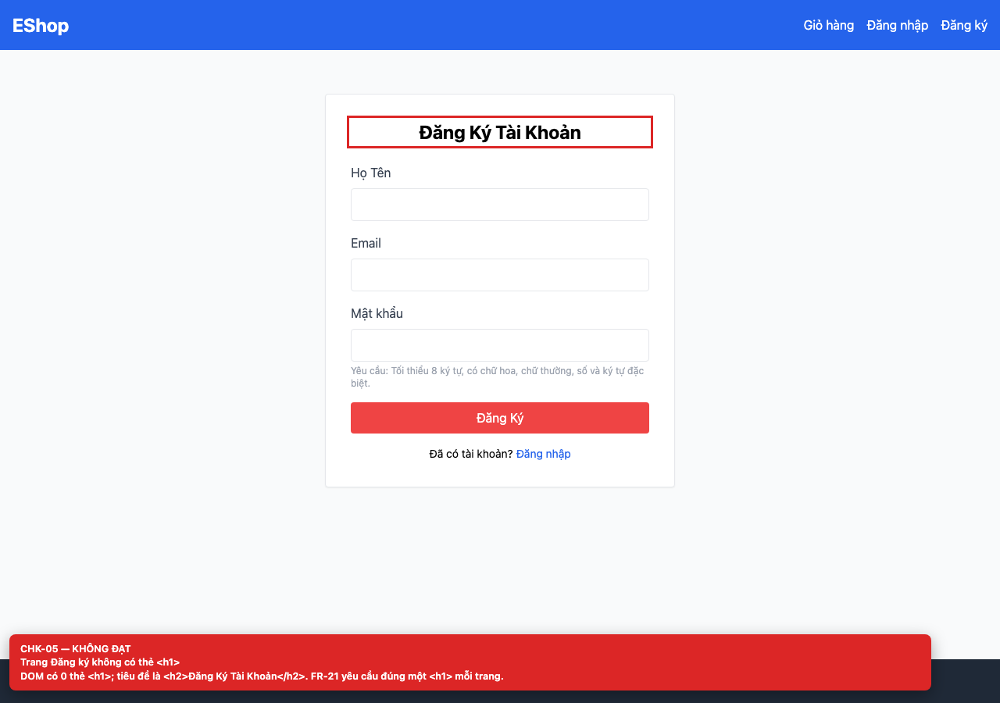
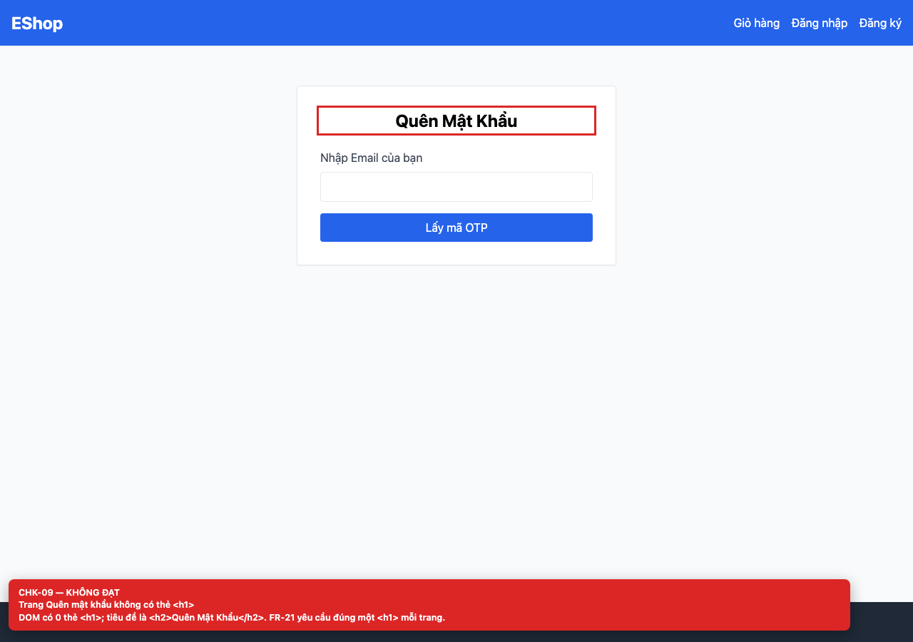
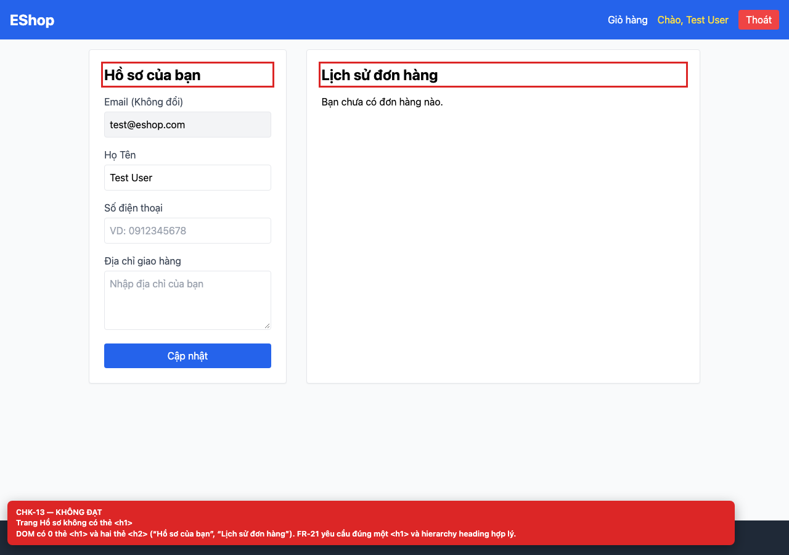

# BUG-GUI-05 — Ba màn hình Register, Forgot Password và Profile không có thẻ `<h1>`

**GitHub Issue:** [#92](https://github.com/SoftwareTesting-Group13/eshop-sut-homework/issues/92)

## Tóm tắt

Ba màn hình Register, Forgot Password và Profile không có thẻ `<h1>`. Bug được phát hiện khi thực thi checklist GUI Task 1 trên màn hình `/register, /forgot-password, /profile`.

| Mục | Giá trị |
| --- | --- |
| Feature / rule | FR-21 — Tiêu chuẩn giao diện chung |
| Checklist | CHK-05, CHK-09, CHK-13 |
| Màn hình | `/register, /forgot-password, /profile` |
| Môi trường | Chromium 158 / Playwright 1.65; backend `http://localhost:3000`; web `http://localhost:5173`; viewport 1280×900 (mobile 360×800 khi có kiểm tra responsive). |
| Severity / Priority | **Minor** / Medium |
| Lặp lại | 1/1 trên build hiện tại |

## Các bước tái hiện

1. Mở lần lượt `/register`, `/forgot-password`, `/profile`.
2. Đếm số thẻ `<h1>` trong DOM hoặc chạy axe-core.

| Mốc | Expected | Actual |
| --- | --- | --- |
| Sau thao tác | Mỗi trang có đúng một `<h1>` mô tả nội dung trang (FR-21). | Cả ba trang có 0 `<h1>`; tiêu đề được render bằng `<h2>` (Profile có hai `<h2>` cho hai section). |

## Bằng chứng







## Nguyên nhân đối chiếu mã nguồn

**[`frontend-web/src/pages/Register.jsx:31`](https://github.com/SoftwareTesting-Group13/eshop-sut-homework/blob/85af3ba875c88283615e22cb108f13e2fccaf0e9/frontend-web/src/pages/Register.jsx#L31)–[L33](https://github.com/SoftwareTesting-Group13/eshop-sut-homework/blob/85af3ba875c88283615e22cb108f13e2fccaf0e9/frontend-web/src/pages/Register.jsx#L33)**

```jsx
    <div className="max-w-md mx-auto mt-10 bg-white p-8 border rounded shadow-sm">
      <h2 className="text-2xl font-bold mb-6 text-center">Đăng Ký Tài Khoản</h2>
      {error && <div className="bg-red-100 text-red-700 p-3 mb-4 rounded">{error}</div>}
```

Tiêu đề Register là `<h2>`.

**[`frontend-web/src/pages/ForgotPassword.jsx:42`](https://github.com/SoftwareTesting-Group13/eshop-sut-homework/blob/85af3ba875c88283615e22cb108f13e2fccaf0e9/frontend-web/src/pages/ForgotPassword.jsx#L42)–[L44](https://github.com/SoftwareTesting-Group13/eshop-sut-homework/blob/85af3ba875c88283615e22cb108f13e2fccaf0e9/frontend-web/src/pages/ForgotPassword.jsx#L44)**

```jsx
    <div className="max-w-md mx-auto mt-10 bg-white p-8 border rounded shadow-sm">
      <h2 className="text-2xl font-bold mb-6 text-center">Quên Mật Khẩu</h2>
```

Tiêu đề Forgot Password là `<h2>`.

**[`frontend-web/src/pages/Profile.jsx:112`](https://github.com/SoftwareTesting-Group13/eshop-sut-homework/blob/85af3ba875c88283615e22cb108f13e2fccaf0e9/frontend-web/src/pages/Profile.jsx#L112)–[L114](https://github.com/SoftwareTesting-Group13/eshop-sut-homework/blob/85af3ba875c88283615e22cb108f13e2fccaf0e9/frontend-web/src/pages/Profile.jsx#L114)**

```jsx
      <div className="w-full md:w-1/3 bg-white p-6 border rounded shadow-sm">
        <h2 className="text-2xl font-bold mb-4">Hồ sơ của bạn</h2>
        <form onSubmit={handleUpdate} className="space-y-4">
```

Section hồ sơ dùng `<h2>`; section lịch sử đơn hàng cũng dùng `<h2>` tại dòng 167.

## Đề xuất sửa

Dùng `<h1>` cho tiêu đề trang và `<h2>` cho các section; thêm kiểm tra heading outline.

## Ghi chú

Screenshot được chụp trên SUT đang chạy tại `http://localhost:5173`; code block lấy trực tiếp từ source tại commit [`85af3ba`](https://github.com/SoftwareTesting-Group13/eshop-sut-homework/blob/85af3ba875c88283615e22cb108f13e2fccaf0e9).
