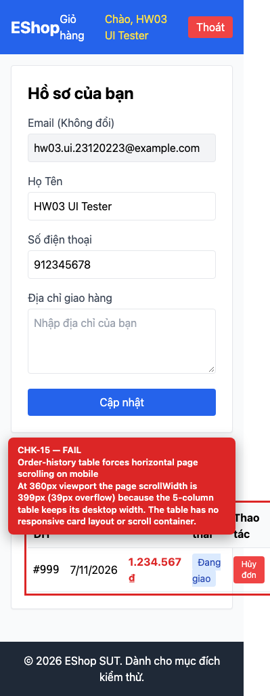

# BUG-GUI-06 — Order-history table forces horizontal page scrolling on mobile

| Field | Value |
| --- | --- |
| Severity | **Major** |
| FR | FR-04 |
| Interface aspect | IA-01 |
| Screen | Profile |
| Checklist IDs | CHK-15 |
| Environment | Chromium 158 (Playwright 1.65), 1280×900; backend http://localhost:3000, web http://localhost:5173 |
| Status | Draft — student review and GitHub publication pending |

## Steps to reproduce

1. Open /profile at a 360px viewport with at least one order.
2. Measure document.documentElement.scrollWidth.

## Expected result

The table adapts (scroll container or card layout) and the page has no horizontal scroll.

## Actual result

Page scrollWidth is 399px vs clientWidth 360px (39px overflow); the 5-column table keeps its desktop width and is clipped.

## Evidence

## Root cause

frontend-web/src/pages/Profile.jsx:171-212 — no responsive wrapper or card layout.

## Suggested fix

Wrap the table in overflow-x-auto with a min-width, or render order cards below the md breakpoint.

## GitHub issue

- Title: `[BUG-GUI-06] Order-history table forces horizontal page scrolling on mobile`
- Labels: `bug`, `major`, `ia-01`, `fr-04`
- Publishing is blocked in this environment because the GitHub CLI/token is not configured; the ready-to-publish body is in `issues/`.
