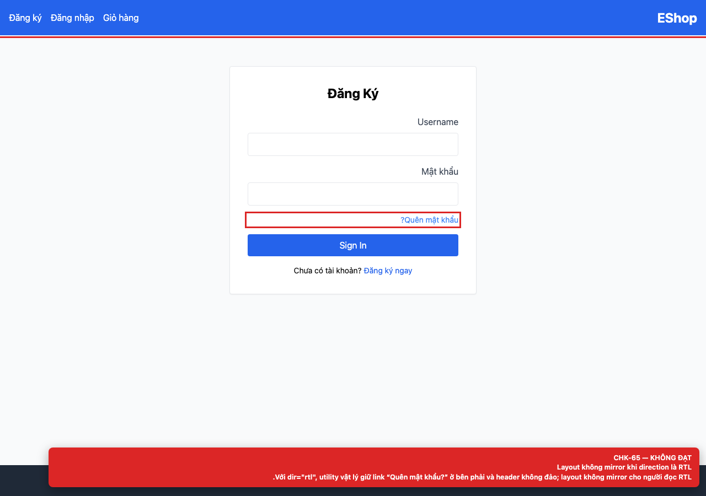

# BUG-GUI-07 — Layout không mirror khi document direction là RTL

**GitHub Issue:** chưa publish — draft tại [`issues/BUG-GUI-07.md`](../issues/BUG-GUI-07.md)

## Tóm tắt

Layout không mirror khi document direction là RTL. Bug được phát hiện khi thực thi checklist GUI Task 1 trên màn hình `/login, /register, /forgot-password, /profile`.

| Mục | Giá trị |
| --- | --- |
| Feature / rule | FR-21 — Tiêu chuẩn giao diện chung |
| Checklist | CHK-65 |
| Màn hình | `/login, /register, /forgot-password, /profile` |
| Môi trường | Chromium 158 / Playwright 1.65; backend `http://localhost:3000`; web `http://localhost:5173`; viewport 1280×900 (mobile 360×800 khi có kiểm tra responsive). |
| Severity / Priority | **Minor** / Low |
| Lặp lại | 1/1 trên build hiện tại |

## Các bước tái hiện

1. Mở `/login`.
2. Đặt `document.documentElement.dir = 'rtl'` và quan sát header, link “Quên mật khẩu?” và thứ tự các phần tử.

| Mốc | Expected | Actual |
| --- | --- | --- |
| Sau thao tác | Alignment, thứ tự và spacing được mirror cho người đọc RTL. | Utility vật lý giữ link “Quên mật khẩu?” ở bên phải và header không đảo; layout không mirror. |

## Bằng chứng



## Nguyên nhân đối chiếu mã nguồn

**[`frontend-web/src/pages/Login.jsx:48`](https://github.com/SoftwareTesting-Group13/eshop-sut-homework/blob/85af3ba875c88283615e22cb108f13e2fccaf0e9/frontend-web/src/pages/Login.jsx#L48)–[L51](https://github.com/SoftwareTesting-Group13/eshop-sut-homework/blob/85af3ba875c88283615e22cb108f13e2fccaf0e9/frontend-web/src/pages/Login.jsx#L51)**

```jsx
            
        <div className="text-right text-sm -mt-2">
          <a href="/forgot-password" className="text-blue-500 hover:underline">Quên mật khẩu?</a>
        </div>
```

Dùng `text-right` thay vì `text-end`.

**[`frontend-web/src/App.jsx:20`](https://github.com/SoftwareTesting-Group13/eshop-sut-homework/blob/85af3ba875c88283615e22cb108f13e2fccaf0e9/frontend-web/src/App.jsx#L20)–[L29](https://github.com/SoftwareTesting-Group13/eshop-sut-homework/blob/85af3ba875c88283615e22cb108f13e2fccaf0e9/frontend-web/src/App.jsx#L29)**

```jsx
    <header className="bg-blue-600 text-white p-4 flex justify-between items-center">
      <Link to="/" className="text-2xl font-bold">EShop</Link>
      <nav className="flex gap-4 items-center">
        <Link to="/cart" className="hover:underline">Giỏ hàng</Link>
        {user ? (
          <div className="flex gap-4 items-center">
            <Link to="/profile" className="hover:underline text-yellow-300">
              <span dangerouslySetInnerHTML={{ __html: `Chào, ${user.name}` }} />
            </Link>
            <button onClick={logout} className="bg-red-500 px-3 py-1 rounded">Thoát</button>
```

Header dùng `justify-between`, `gap-4` và thứ tự vật lý; không có logical property.

## Đề xuất sửa

Dùng logical utilities (`text-start`/`text-end`, `ms`/`me`) và thêm RTL smoke test.

## Ghi chú

Screenshot được chụp trên SUT đang chạy tại `http://localhost:5173`; code block lấy trực tiếp từ source tại commit [`85af3ba`](https://github.com/SoftwareTesting-Group13/eshop-sut-homework/blob/85af3ba875c88283615e22cb108f13e2fccaf0e9).
