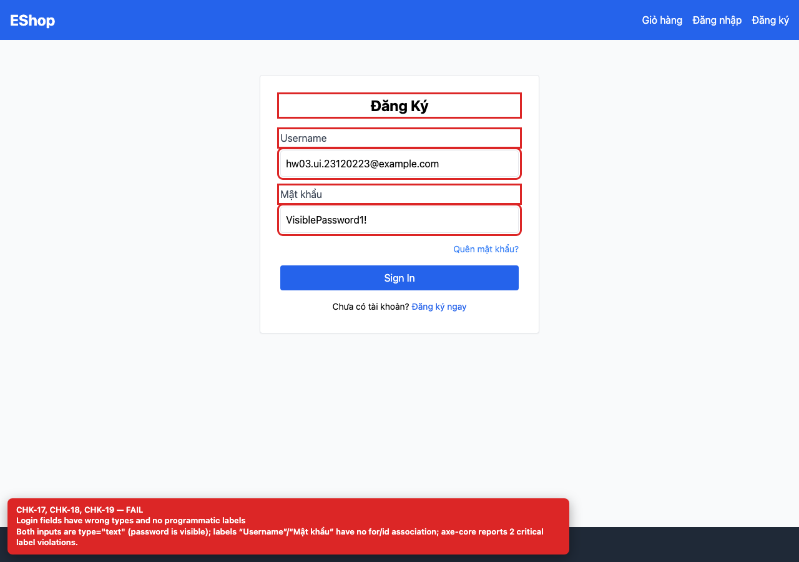

# BUG-GUI-08 — Login password is visible and the email field has no email semantics

| Field | Value |
| --- | --- |
| Severity | **Major** |
| FR | FR-02 |
| Interface aspect | IA-02 |
| Screen | Login |
| Checklist IDs | CHK-17, CHK-18 |
| Environment | Chromium 158 (Playwright 1.65), 1280×900; backend http://localhost:3000, web http://localhost:5173 |
| Status | Draft — student review and GitHub publication pending |

## Steps to reproduce

1. Open /login.
2. Type into both fields and inspect the input types.

## Expected result

The email field is type=email and the password field is type=password.

## Actual result

Both fields are type=text; the password is visible on screen and the label says “Username” although the backend expects an email.

## Evidence

## Root cause

frontend-web/src/pages/Login.jsx:29-45.

## Suggested fix

Use type=email, type=password and label the first field “Email”.

## GitHub issue

- Title: `[BUG-GUI-08] Login password is visible and the email field has no email semantics`
- Labels: `bug`, `major`, `ia-02`, `fr-02`
- Publishing is blocked in this environment because the GitHub CLI/token is not configured; the ready-to-publish body is in `issues/`.
