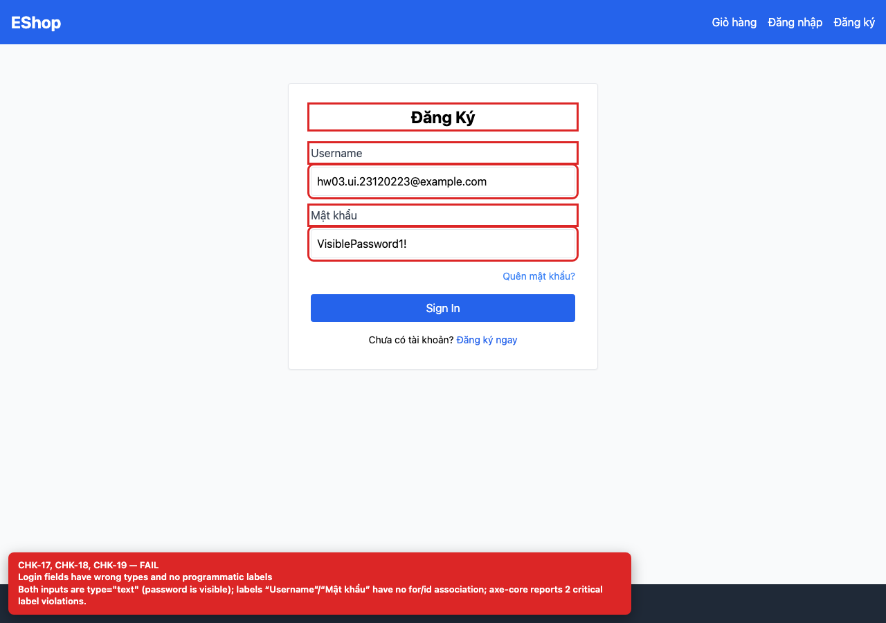
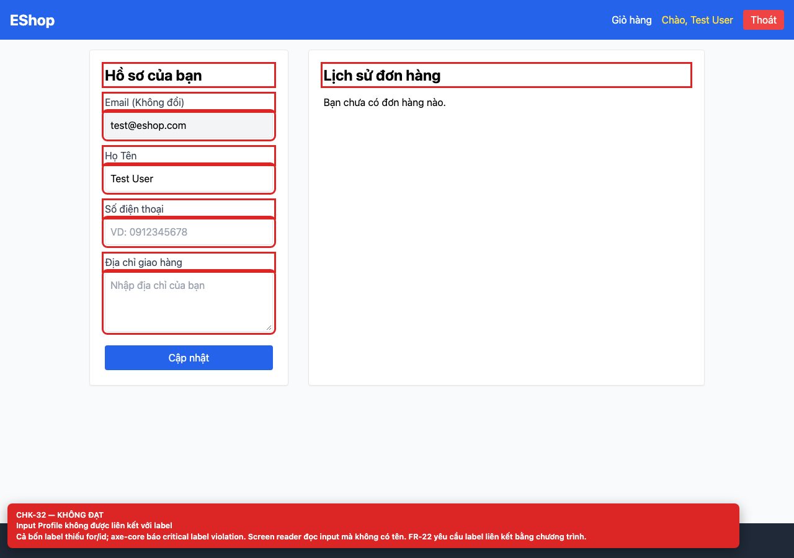

# BUG-GUI-09 — Input không có label liên kết bằng chương trình

**GitHub Issue:** chưa publish — draft tại [`issues/BUG-GUI-09.md`](../issues/BUG-GUI-09.md)

## Tóm tắt

Input không có label liên kết bằng chương trình. Bug được phát hiện khi thực thi checklist GUI Task 1 trên màn hình `/login, /register, /forgot-password, /profile`.

| Mục | Giá trị |
| --- | --- |
| Feature / rule | FR-22 — Form |
| Checklist | CHK-19, CHK-32 |
| Màn hình | `/login, /register, /forgot-password, /profile` |
| Môi trường | Chromium 158 / Playwright 1.65; backend `http://localhost:3000`; web `http://localhost:5173`; viewport 1280×900 (mobile 360×800 khi có kiểm tra responsive). |
| Severity / Priority | **Major** / High |
| Lặp lại | 1/1 trên build hiện tại |

## Các bước tái hiện

1. Mở từng màn hình auth.
2. Kiểm tra `label[for]`, `input#id` và `aria-label`; hoặc chạy axe-core.

| Mốc | Expected | Actual |
| --- | --- | --- |
| Sau thao tác | Mọi input có accessible name từ `label[for]`, `aria-label` hoặc `aria-labelledby`. | Không label nào có `for`, không input nào có `id`/`aria-label`; axe-core báo critical “label” violation trên cả bốn màn hình. |

## Bằng chứng





## Nguyên nhân đối chiếu mã nguồn

**[`frontend-web/src/pages/Login.jsx:28`](https://github.com/SoftwareTesting-Group13/eshop-sut-homework/blob/85af3ba875c88283615e22cb108f13e2fccaf0e9/frontend-web/src/pages/Login.jsx#L28)–[L45](https://github.com/SoftwareTesting-Group13/eshop-sut-homework/blob/85af3ba875c88283615e22cb108f13e2fccaf0e9/frontend-web/src/pages/Login.jsx#L45)**

```jsx
          <label className="block text-gray-700 mb-2">Username</label>
          <input
            type="text"
            value={email}
            onChange={(e) => setEmail(e.target.value)}
            className="w-full border p-2 rounded"
            required
          />
        </div>
        <div>
          <label className="block text-gray-700 mb-2">Mật khẩu</label>
          <input
            type="text"
            value={password}
            onChange={(e) => setPassword(e.target.value)}
            className="w-full border p-2 rounded"
            required
          />
```

Label là text thuần, không có `htmlFor`; input không có `id`.

**[`frontend-web/src/pages/Register.jsx:36`](https://github.com/SoftwareTesting-Group13/eshop-sut-homework/blob/85af3ba875c88283615e22cb108f13e2fccaf0e9/frontend-web/src/pages/Register.jsx#L36)–[L66](https://github.com/SoftwareTesting-Group13/eshop-sut-homework/blob/85af3ba875c88283615e22cb108f13e2fccaf0e9/frontend-web/src/pages/Register.jsx#L66)**

```jsx
          <label className="block text-gray-700 mb-2">Họ Tên</label>
          <input
            type="text"
            value={name}
            onChange={(e) => setName(e.target.value)}
            className="w-full border p-2 rounded"
            required
          />
        </div>
        <div>
          <label className="block text-gray-700 mb-2">Email</label>
          <input
            type="text"
            value={email}
            onChange={(e) => setEmail(e.target.value)}
            className="w-full border p-2 rounded"
            required
          />
        </div>
        <div>
          <label className="block text-gray-700 mb-2">Mật khẩu</label>
          <input
            type="password"
            value={password}
            onChange={(e) => setPassword(e.target.value)}
            className="w-full border p-2 rounded"
            required
          />
          <p className="text-xs text-gray-400 mt-1">
            Yêu cầu: Tối thiểu 8 ký tự, có chữ hoa, chữ thường, số và ký tự đặc biệt.
          </p>
```

Cùng pattern ở cả ba trường Register.

**[`frontend-web/src/pages/ForgotPassword.jsx:48`](https://github.com/SoftwareTesting-Group13/eshop-sut-homework/blob/85af3ba875c88283615e22cb108f13e2fccaf0e9/frontend-web/src/pages/ForgotPassword.jsx#L48)–[L86](https://github.com/SoftwareTesting-Group13/eshop-sut-homework/blob/85af3ba875c88283615e22cb108f13e2fccaf0e9/frontend-web/src/pages/ForgotPassword.jsx#L86)**

```jsx
            <label className="block text-gray-700 mb-2">Nhập Email của bạn</label>
            <input
              type="text"
              value={email}
              onChange={(e) => setEmail(e.target.value)}
              className="w-full border p-2 rounded"
              required
            />
          </div>
          <button type="submit" className="w-full bg-blue-600 text-white py-2 rounded">
            Lấy mã OTP
          </button>
        </form>
      )}

      {step === 2 && (
        <form onSubmit={handleReset} className="space-y-4">
          <div className="bg-green-100 text-green-800 p-3 rounded text-sm mb-4">
            {message}
          </div>
          <div>
            <label className="block text-gray-700 mb-2">Mã OTP (4 số)</label>
            <input
              type="text"
              value={resetToken}
              onChange={(e) => setResetToken(e.target.value)}
              className="w-full border p-2 rounded"
              required
            />
          </div>
          <div>
            <label className="block text-gray-700 mb-2">Mật khẩu mới</label>
            <input
              type="password"
              value={newPassword}
              onChange={(e) => setNewPassword(e.target.value)}
              className="w-full border p-2 rounded"
              required
            />
```

Cùng pattern ở bước 1 và bước 2.

**[`frontend-web/src/pages/Profile.jsx:116`](https://github.com/SoftwareTesting-Group13/eshop-sut-homework/blob/85af3ba875c88283615e22cb108f13e2fccaf0e9/frontend-web/src/pages/Profile.jsx#L116)–[L155](https://github.com/SoftwareTesting-Group13/eshop-sut-homework/blob/85af3ba875c88283615e22cb108f13e2fccaf0e9/frontend-web/src/pages/Profile.jsx#L155)**

```jsx
            <label className="block text-gray-700 mb-1">
              Email (Không đổi)
            </label>
            <input
              type="text"
              value={user.email}
              disabled
              className="w-full border p-2 rounded bg-gray-100"
            />
          </div>
          <div>
            <label className="block text-gray-700 mb-1">Họ Tên</label>
            <input
              type="text"
              value={name}
              onChange={(e) => setName(e.target.value)}
              className="w-full border p-2 rounded"
              required
            />
          </div>
          <div>
            <label className="block text-gray-700 mb-1">Số điện thoại</label>
            <input
              type="text"
              value={phone}
              onChange={(e) => setPhone(e.target.value)}
              className="w-full border p-2 rounded"
              placeholder="VD: 0912345678"
            />
          </div>
          <div>
            <label className="block text-gray-700 mb-1">
              Địa chỉ giao hàng
            </label>
            <textarea
              value={shippingAddress}
              onChange={(e) => setShippingAddress(e.target.value)}
              className="w-full border p-2 rounded h-24"
              placeholder="Nhập địa chỉ của bạn"
            />
```

Bốn label của Profile đều thiếu `htmlFor`/`id`.

## Đề xuất sửa

Thêm `id` cho từng input và `htmlFor` cho label tương ứng; dùng `aria-label` cho control icon-only.

## Ghi chú

Screenshot được chụp trên SUT đang chạy tại `http://localhost:5173`; code block lấy trực tiếp từ source tại commit [`85af3ba`](https://github.com/SoftwareTesting-Group13/eshop-sut-homework/blob/85af3ba875c88283615e22cb108f13e2fccaf0e9).
