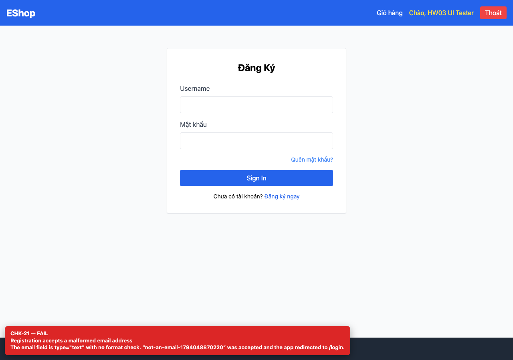
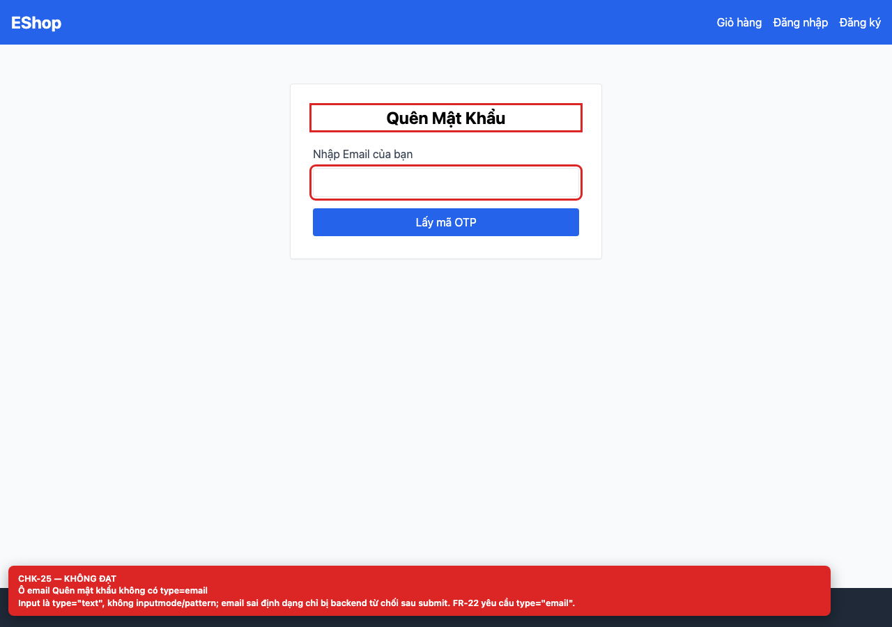
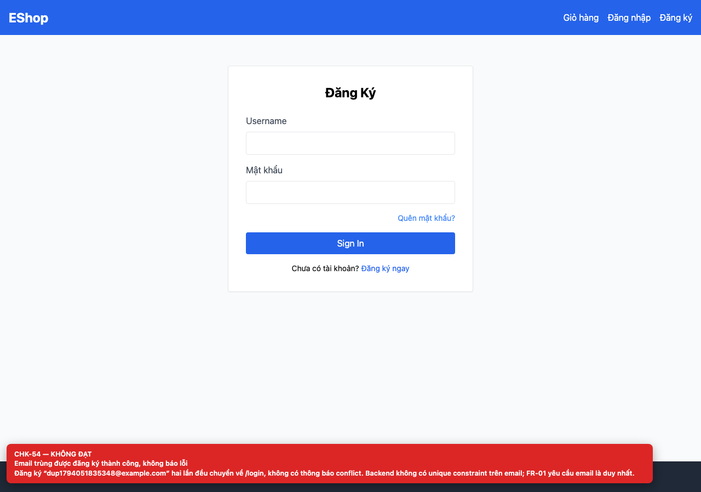

# BUG-GUI-10 — Email format and duplicate-email checks are missing

| Field | Value |
| --- | --- |
| Severity | **Major** |
| FR | FR-01, FR-03 |
| Interface aspect | IA-02, IA-04 |
| Screen | Register, Forgot Password |
| Checklist IDs | CHK-21, CHK-25, CHK-54 |
| Environment | Chromium 158 (Playwright 1.65), 1280×900; backend http://localhost:3000, web http://localhost:5173 |
| Status | Draft — student review and GitHub publication pending |

## Steps to reproduce

1. Register with “not-an-email-<timestamp>”.
2. Register the same valid email twice.
3. Request an OTP for a malformed email.

## Expected result

Malformed addresses are rejected inline and duplicate emails return a clear conflict message.

## Actual result

Malformed emails are accepted; registering the same email twice also succeeds and redirects to /login with no error. The backend has no unique constraint on email.

## Evidence

## Root cause

Register.jsx:47-53 (type=text); backend/server.js:20-30 (plain INSERT, no validation); database.js users.email is not UNIQUE.

## Suggested fix

Use type=email plus a format check; add UNIQUE(email) and return HTTP 409 with a human-readable message.

## GitHub issue

- Title: `[BUG-GUI-10] Email format and duplicate-email checks are missing`
- Labels: `bug`, `major`, `ia-02, ia-04`, `fr-01`
- Publishing is blocked in this environment because the GitHub CLI/token is not configured; the ready-to-publish body is in `issues/`.
