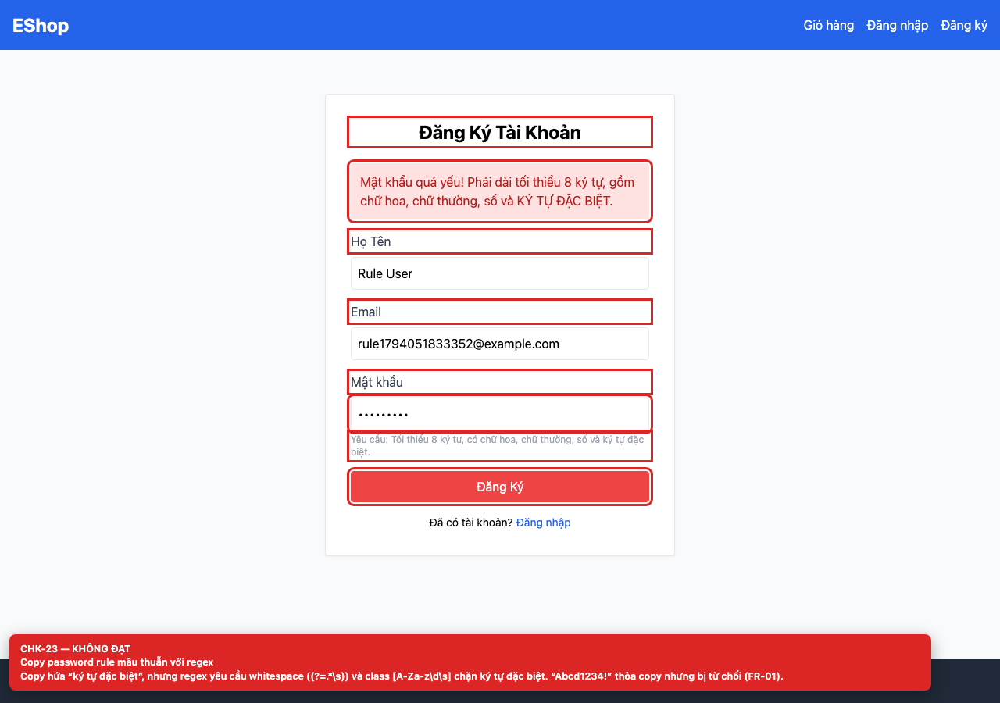

# BUG-GUI-11 — Nội dung mô tả password rule mâu thuẫn với regex thực tế

**GitHub Issue:** chưa publish — draft tại [`issues/BUG-GUI-11.md`](../issues/BUG-GUI-11.md)

## Tóm tắt

Nội dung mô tả password rule mâu thuẫn với regex thực tế. Bug được phát hiện khi thực thi checklist GUI Task 1 trên màn hình `/register, /forgot-password`.

| Mục | Giá trị |
| --- | --- |
| Feature / rule | FR-01 — Đăng ký; FR-03 — Đặt lại mật khẩu |
| Checklist | CHK-23 |
| Màn hình | `/register, /forgot-password` |
| Môi trường | Chromium 158 / Playwright 1.65; backend `http://localhost:3000`; web `http://localhost:5173`; viewport 1280×900 (mobile 360×800 khi có kiểm tra responsive). |
| Severity / Priority | **Major** / High |
| Lặp lại | 1/1 trên build hiện tại |

## Các bước tái hiện

1. Mở `/register`.
2. Nhập `Abcd1234!` (chữ hoa, chữ thường, số, ký tự đặc biệt, 9 ký tự) và submit.

| Mốc | Expected | Actual |
| --- | --- | --- |
| Sau thao tác | Mật khẩu được chấp nhận vì copy nói cần ký tự đặc biệt (FR-01). | Mật khẩu bị từ chối. Regex yêu cầu whitespace `(?=.*\s)` và character class `[A-Za-z\d\s]` chặn ký tự đặc biệt. Cùng regex được dùng ở màn hình reset. |

## Bằng chứng



## Nguyên nhân đối chiếu mã nguồn

**[`frontend-web/src/pages/Register.jsx:15`](https://github.com/SoftwareTesting-Group13/eshop-sut-homework/blob/85af3ba875c88283615e22cb108f13e2fccaf0e9/frontend-web/src/pages/Register.jsx#L15)–[L18](https://github.com/SoftwareTesting-Group13/eshop-sut-homework/blob/85af3ba875c88283615e22cb108f13e2fccaf0e9/frontend-web/src/pages/Register.jsx#L18)**

```jsx
    const flawedStrongPasswordRegex = /^(?=.*[a-z])(?=.*[A-Z])(?=.*\d)(?=.*\s)[A-Za-z\d\s]{8,}$/;

    if (!flawedStrongPasswordRegex.test(password)) {
      setError('Mật khẩu quá yếu! Phải dài tối thiểu 8 ký tự, gồm chữ hoa, chữ thường, số và KÝ TỰ ĐẶC BIỆT.');
```

Regex yêu cầu `\s` và chỉ cho phép chữ, số, whitespace.

**[`frontend-web/src/pages/ForgotPassword.jsx:26`](https://github.com/SoftwareTesting-Group13/eshop-sut-homework/blob/85af3ba875c88283615e22cb108f13e2fccaf0e9/frontend-web/src/pages/ForgotPassword.jsx#L26)–[L29](https://github.com/SoftwareTesting-Group13/eshop-sut-homework/blob/85af3ba875c88283615e22cb108f13e2fccaf0e9/frontend-web/src/pages/ForgotPassword.jsx#L29)**

```jsx
    const flawedStrongPasswordRegex = /^(?=.*[a-z])(?=.*[A-Z])(?=.*\d)(?=.*\s)[A-Za-z\d\s]{8,}$/;
    if (!flawedStrongPasswordRegex.test(newPassword)) {
      alert('Mật khẩu quá yếu! Phải dài tối thiểu 8 ký tự, gồm chữ hoa, chữ thường, số và KÝ TỰ ĐẶC BIỆT.');
      return;
```

Copy regex y nguyên sang màn hình đặt lại mật khẩu.

## Đề xuất sửa

Thay bằng regex đúng (ví dụ `/^(?=.*[a-z])(?=.*[A-Z])(?=.*\d)(?=.*[^A-Za-z0-9])\S{8,}$/`) và giữ copy đồng bộ.

## Ghi chú

Screenshot được chụp trên SUT đang chạy tại `http://localhost:5173`; code block lấy trực tiếp từ source tại commit [`85af3ba`](https://github.com/SoftwareTesting-Group13/eshop-sut-homework/blob/85af3ba875c88283615e22cb108f13e2fccaf0e9).
