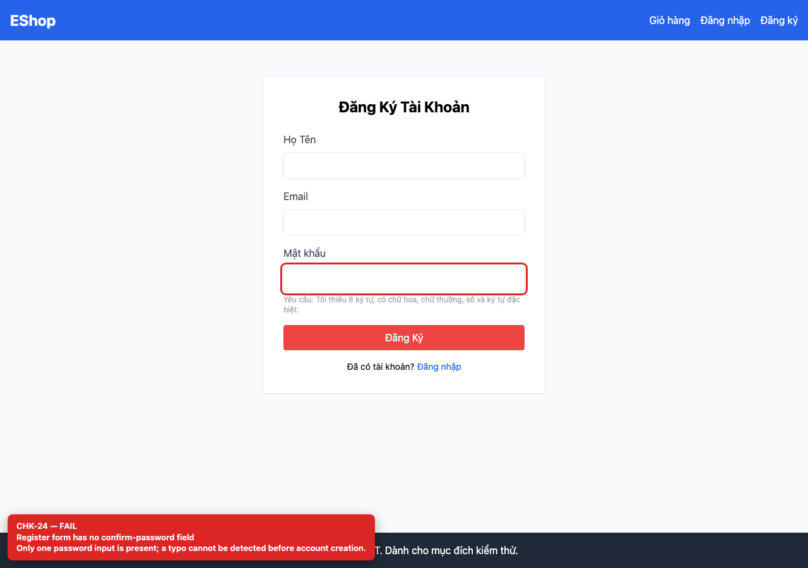
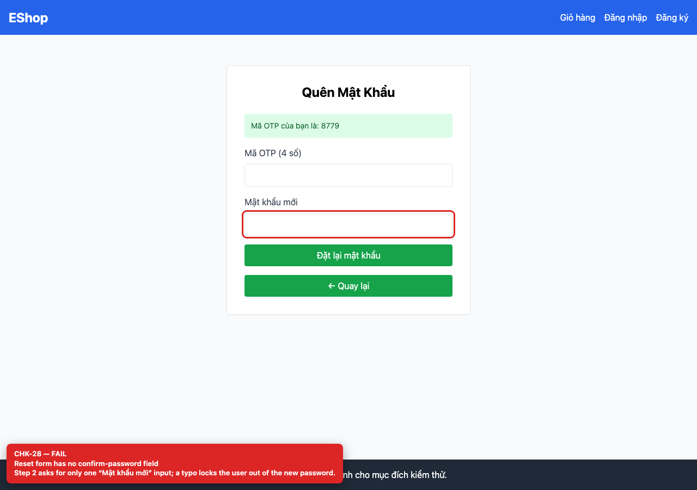

# BUG-GUI-12 — Registration and password reset have no confirm-password field

| Field | Value |
| --- | --- |
| Severity | **Minor** |
| FR | FR-01, FR-03 |
| Interface aspect | IA-02 |
| Screen | Register, Forgot Password |
| Checklist IDs | CHK-24, CHK-28 |
| Environment | Chromium 158 (Playwright 1.65), 1280×900; backend http://localhost:3000, web http://localhost:5173 |
| Status | Draft — student review and GitHub publication pending |

## Steps to reproduce

1. Open /register and the OTP step of /forgot-password.
2. Count the password inputs.

## Expected result

A confirm-password field with a match check.

## Actual result

Only one password input on each form; a typo creates an unusable account or locks the user out of the new password.

## Evidence

## Root cause

Register.jsx:55-67; ForgotPassword.jsx:78-87.

## Suggested fix

Add a confirm-password input and a match validation before submit.

## GitHub issue

- Title: `[BUG-GUI-12] Registration and password reset have no confirm-password field`
- Labels: `bug`, `minor`, `ia-02`, `fr-01`
- Publishing is blocked in this environment because the GitHub CLI/token is not configured; the ready-to-publish body is in `issues/`.
