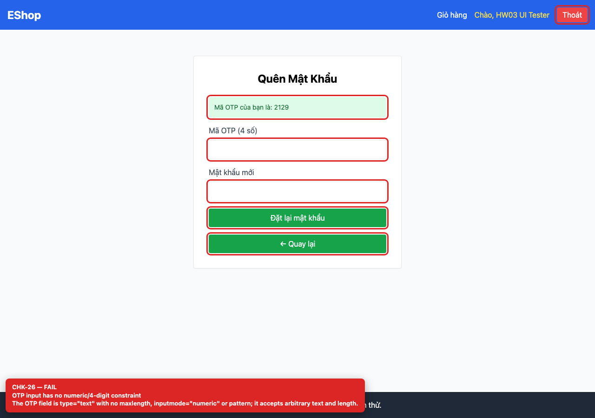
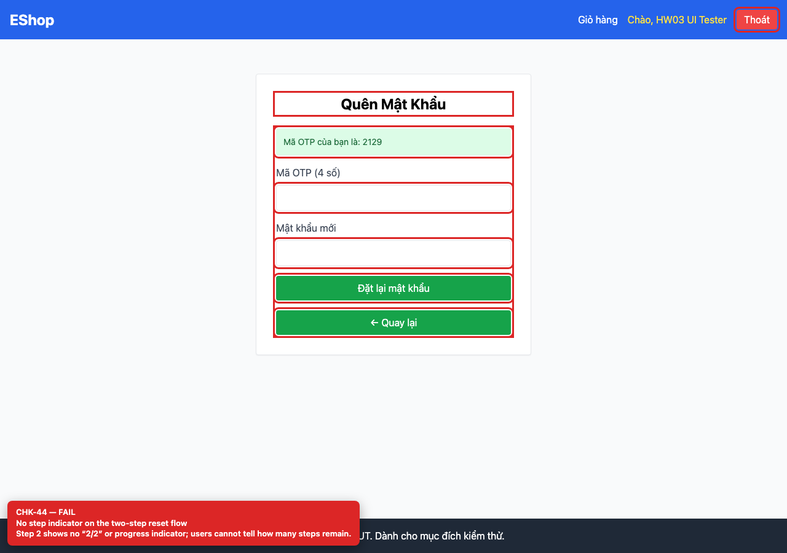

# BUG-GUI-13 — OTP input is unconstrained and step 2 has no step indicator

| Field | Value |
| --- | --- |
| Severity | **Minor** |
| FR | FR-03 |
| Interface aspect | IA-02, IA-03 |
| Screen | Forgot Password |
| Checklist IDs | CHK-26, CHK-44 |
| Environment | Chromium 158 (Playwright 1.65), 1280×900; backend http://localhost:3000, web http://localhost:5173 |
| Status | Draft — student review and GitHub publication pending |

## Steps to reproduce

1. Request an OTP.
2. Inspect the OTP input and the step-2 layout.

## Expected result

A 4-digit numeric input (inputmode=numeric, maxlength=4) and a step indicator such as “Bước 2/2”.

## Actual result

The OTP input is type=text with maxlength=-1 and no inputmode/pattern; there is no step indicator.

## Evidence

## Root cause

ForgotPassword.jsx:68-87.

## Suggested fix

Use inputmode=numeric, maxLength=4, pattern="[0-9]{4}" and add a 1/2–2/2 indicator.

## GitHub issue

- Title: `[BUG-GUI-13] OTP input is unconstrained and step 2 has no step indicator`
- Labels: `bug`, `minor`, `ia-02, ia-03`, `fr-03`
- Publishing is blocked in this environment because the GitHub CLI/token is not configured; the ready-to-publish body is in `issues/`.
