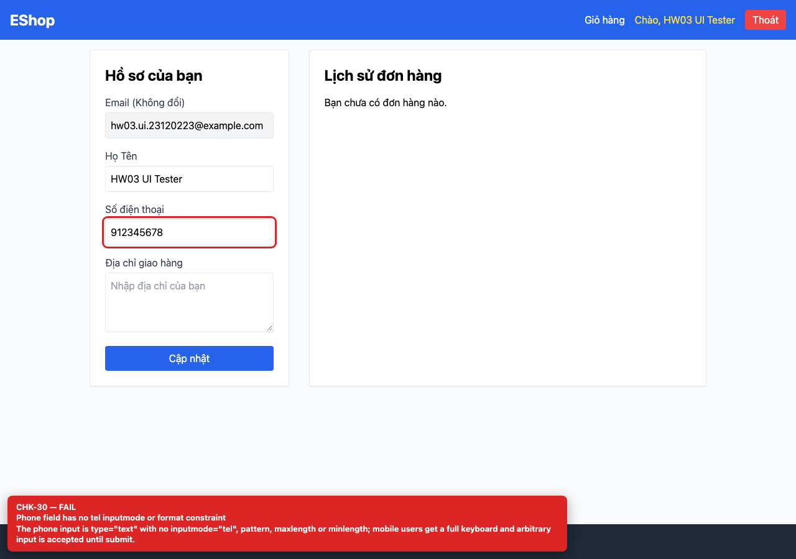
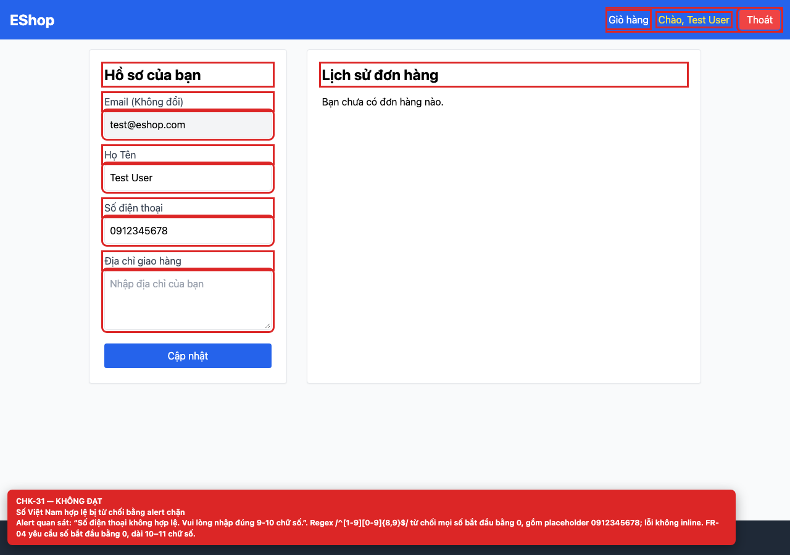

# BUG-GUI-14 — Phone validation rejects valid Vietnamese numbers and uses a blocking alert

| Field | Value |
| --- | --- |
| Severity | **Blocker** |
| FR | FR-04 |
| Interface aspect | IA-02 |
| Screen | Profile |
| Checklist IDs | CHK-30, CHK-31 |
| Environment | Chromium 158 (Playwright 1.65), 1280×900; backend http://localhost:3000, web http://localhost:5173 |
| Status | Draft — student review and GitHub publication pending |

## Steps to reproduce

1. Log in and open /profile.
2. Enter the placeholder value 0912345678 and click “Cập nhật”.

## Expected result

The phone number is accepted and the profile is saved.

## Actual result

An alert says “Số điện thoại không hợp lệ. Vui lòng nhập đúng 9-10 chữ số.” The regex /^[1-9][0-9]{8,9}$/ rejects every number starting with 0, which is the normal Vietnamese mobile prefix.

## Evidence

## Root cause

Profile.jsx:43-46.

## Suggested fix

Use a Vietnamese phone rule such as /^0\d{9,10}$/ (or a library), add inputmode=tel, and show an inline error instead of alert().

## GitHub issue

- Title: `[BUG-GUI-14] Phone validation rejects valid Vietnamese numbers and uses a blocking alert`
- Labels: `bug`, `blocker`, `ia-02`, `fr-04`
- Publishing is blocked in this environment because the GitHub CLI/token is not configured; the ready-to-publish body is in `issues/`.
