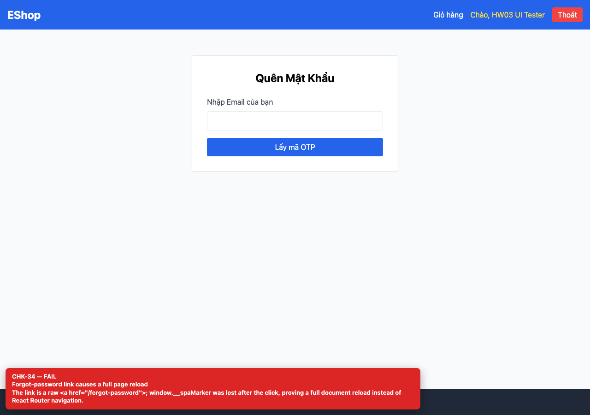

# BUG-GUI-15 — Forgot-password link performs a full page reload

| Field | Value |
| --- | --- |
| Severity | **Minor** |
| FR | FR-02 |
| Interface aspect | IA-03 |
| Screen | Login |
| Checklist IDs | CHK-34 |
| Environment | Chromium 158 (Playwright 1.65), 1280×900; backend http://localhost:3000, web http://localhost:5173 |
| Status | Draft — student review and GitHub publication pending |

## Steps to reproduce

1. Open /login.
2. Set window.__spaMarker = 'kept', click “Quên mật khẩu?” and inspect the marker.

## Expected result

React Router navigation without a document reload.

## Actual result

The marker is lost; the link is a raw <a href="/forgot-password"> and the whole SPA reloads.

## Evidence

## Root cause

Login.jsx:50.

## Suggested fix

Use <Link to="/forgot-password"> from react-router-dom.

## GitHub issue

- Title: `[BUG-GUI-15] Forgot-password link performs a full page reload`
- Labels: `bug`, `minor`, `ia-03`, `fr-02`
- Publishing is blocked in this environment because the GitHub CLI/token is not configured; the ready-to-publish body is in `issues/`.
