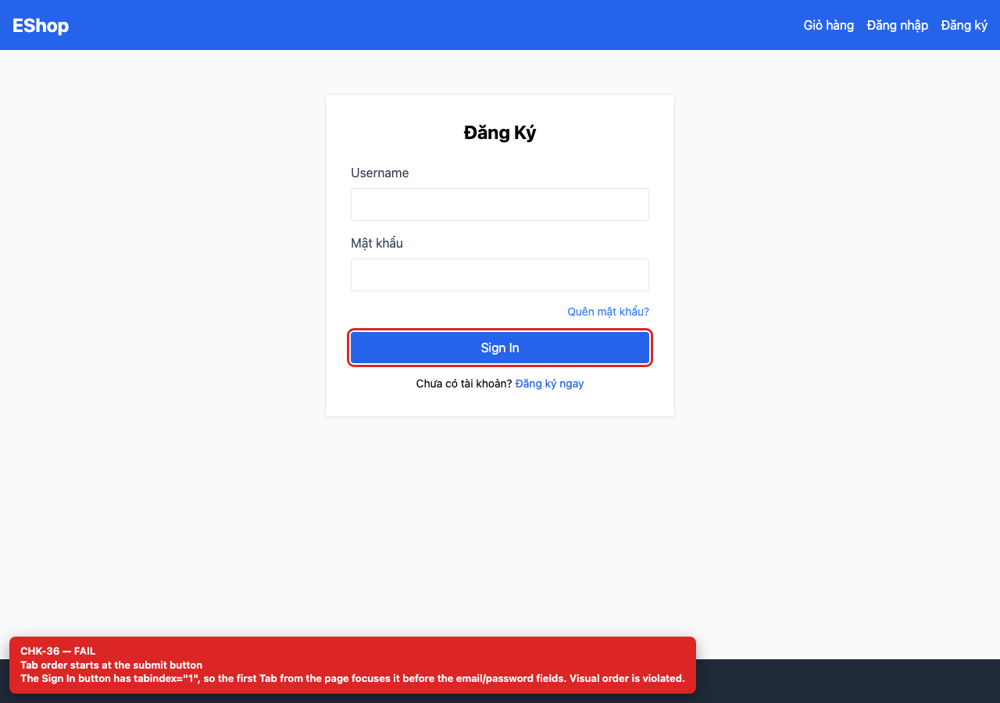

# BUG-GUI-16 — Tab order bắt đầu ở nút Sign In vì `tabIndex=1`

**GitHub Issue:** [#86](https://github.com/SoftwareTesting-Group13/eshop-sut-homework/issues/86)

## Tóm tắt

Tab order bắt đầu ở nút Sign In vì `tabIndex=1`. Bug được phát hiện khi thực thi checklist GUI Task 1 trên màn hình `/login`.

| Mục | Giá trị |
| --- | --- |
| Feature / rule | FR-21 — Tiêu chuẩn giao diện chung |
| Checklist | CHK-36 |
| Màn hình | `/login` |
| Môi trường | Chromium 158 / Playwright 1.65; backend `http://localhost:3000`; web `http://localhost:5173`; viewport 1280×900 (mobile 360×800 khi có kiểm tra responsive). |
| Severity / Priority | **Major** / High |
| Lặp lại | 1/1 trên build hiện tại |

## Các bước tái hiện

1. Mở `/login`.
2. Focus vào body và bấm Tab một lần; ghi lại phần tử được focus.

| Mốc | Expected | Actual |
| --- | --- | --- |
| Sau thao tác | Tab đầu tiên vào ô email, sau đó mật khẩu, link quên mật khẩu, nút submit, link đăng ký. | Tab đầu tiên focus vào nút “Sign In” vì nút có `tabIndex={1}`; người dùng bàn phím bỏ qua hai ô nhập và thứ tự thị giác bị đảo. |

## Bằng chứng



## Nguyên nhân đối chiếu mã nguồn

**[`frontend-web/src/pages/Login.jsx:53`](https://github.com/SoftwareTesting-Group13/eshop-sut-homework/blob/85af3ba875c88283615e22cb108f13e2fccaf0e9/frontend-web/src/pages/Login.jsx#L53)–[L59](https://github.com/SoftwareTesting-Group13/eshop-sut-homework/blob/85af3ba875c88283615e22cb108f13e2fccaf0e9/frontend-web/src/pages/Login.jsx#L59)**

```jsx
        <button
          type="submit"
          className="w-full bg-blue-600 text-white py-2 rounded hover:bg-blue-700"
          tabIndex={1}
        >
          Sign In
        </button>
```

`tabIndex={1}` trên button submit.

## Đề xuất sửa

Bỏ `tabIndex`; để DOM order quyết định tab order.

## Ghi chú

Screenshot được chụp trên SUT đang chạy tại `http://localhost:5173`; code block lấy trực tiếp từ source tại commit [`85af3ba`](https://github.com/SoftwareTesting-Group13/eshop-sut-homework/blob/85af3ba875c88283615e22cb108f13e2fccaf0e9).
