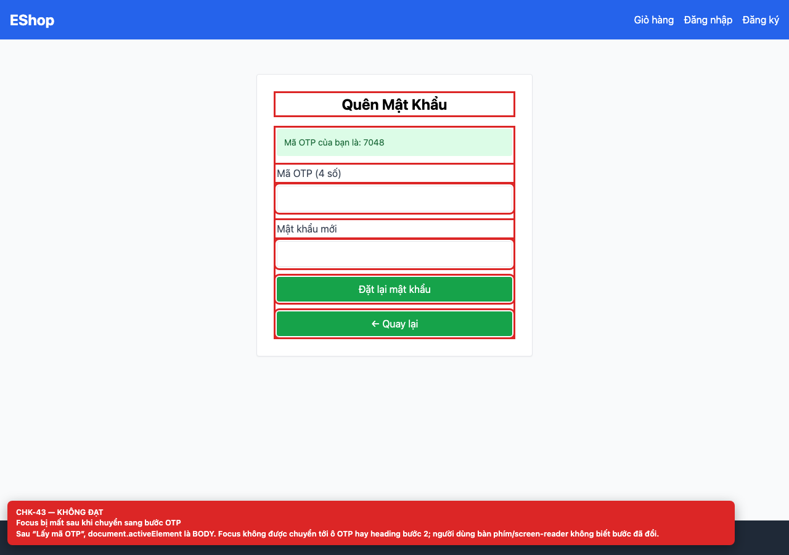

# BUG-GUI-17 — Focus is lost after switching to the OTP step

| Field | Value |
| --- | --- |
| Severity | **Minor** |
| FR | FR-03 |
| Interface aspect | IA-03 |
| Screen | Forgot Password |
| Checklist IDs | CHK-43 |
| Environment | Chromium 158 (Playwright 1.65), 1280×900; backend http://localhost:3000, web http://localhost:5173 |
| Status | Draft — student review and GitHub publication pending |

## Steps to reproduce

1. Request an OTP.
2. Inspect document.activeElement after step 2 renders.

## Expected result

Focus moves to the OTP field or the step-2 heading and the change is announced.

## Actual result

document.activeElement is BODY; screen-reader and keyboard users are not told that the step changed.

## Evidence

## Root cause

ForgotPassword.jsx:13-22 (setStep without focus management).

## Suggested fix

Focus the step-2 heading or first input in an effect and use aria-live for the status message.

## GitHub issue

- Title: `[BUG-GUI-17] Focus is lost after switching to the OTP step`
- Labels: `bug`, `minor`, `ia-03`, `fr-03`
- Publishing is blocked in this environment because the GitHub CLI/token is not configured; the ready-to-publish body is in `issues/`.
