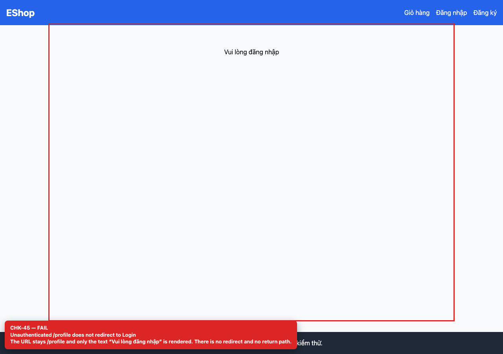
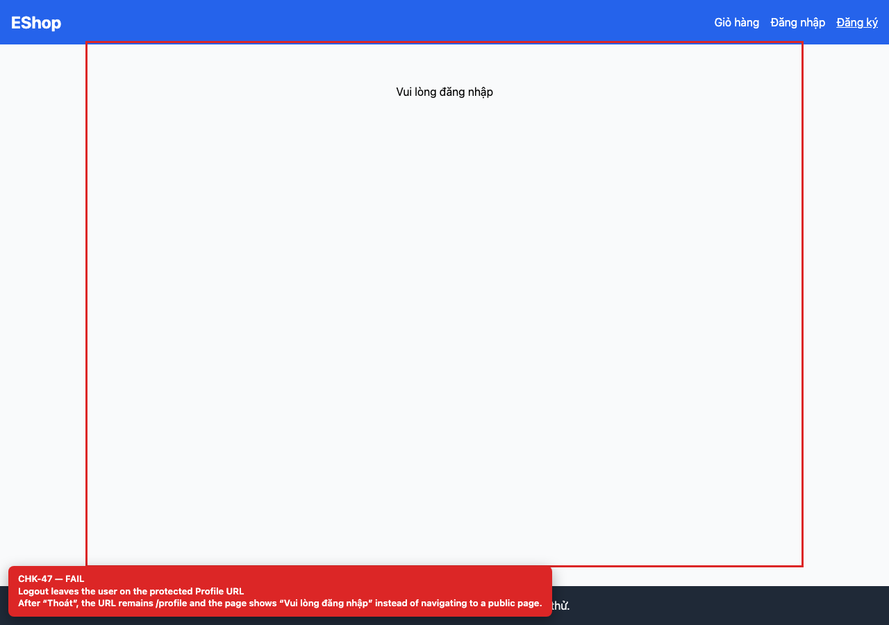
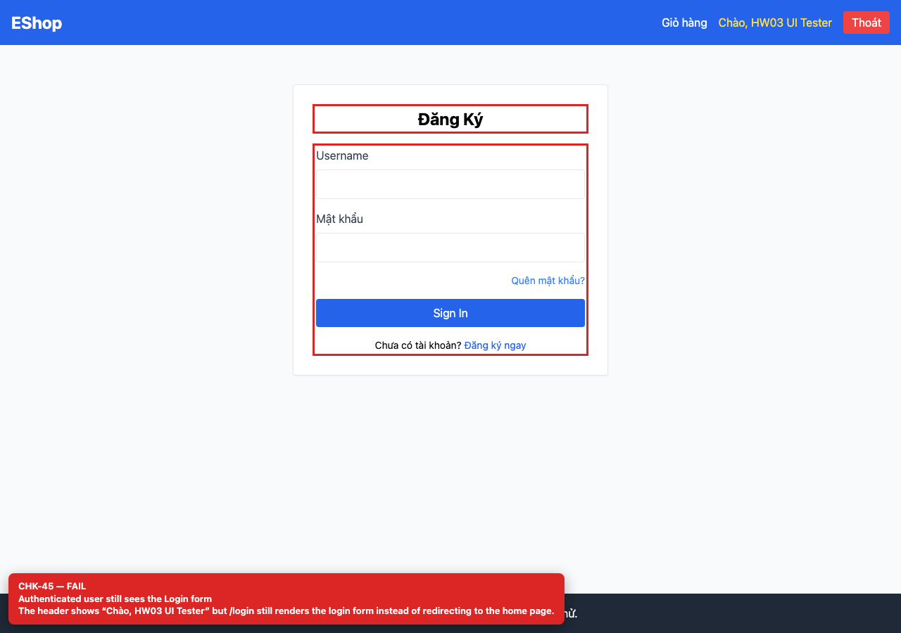

# BUG-GUI-18 — Auth route guards are missing (profile, login, logout)

| Field | Value |
| --- | --- |
| Severity | **Major** |
| FR | FR-02, FR-04 |
| Interface aspect | IA-03 |
| Screen | Login, Profile |
| Checklist IDs | CHK-45, CHK-47, CHK-69 |
| Environment | Chromium 158 (Playwright 1.65), 1280×900; backend http://localhost:3000, web http://localhost:5173 |
| Status | Draft — student review and GitHub publication pending |

## Steps to reproduce

1. Open /profile in a private window.
2. Log in, then open /login.
3. Log out and observe the URL.

## Expected result

Unauthenticated /profile redirects to /login?next=/profile; authenticated /login redirects home; logout navigates to a public page.

## Actual result

Unauthenticated /profile stays on /profile with “Vui lòng đăng nhập”; authenticated /login still renders the login form; after logout the URL remains /profile.

## Evidence

## Root cause

App.jsx:50-59 (no guards), Profile.jsx:108, AuthContext.jsx:37-41 (logout does not navigate).

## Suggested fix

Add ProtectedRoute/PublicRoute wrappers and navigate('/') or navigate('/login') on logout.

## GitHub issue

- Title: `[BUG-GUI-18] Auth route guards are missing (profile, login, logout)`
- Labels: `bug`, `major`, `ia-03`, `fr-02`
- Publishing is blocked in this environment because the GitHub CLI/token is not configured; the ready-to-publish body is in `issues/`.
