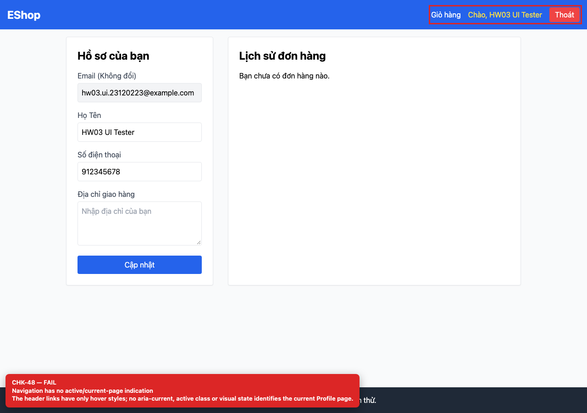

# BUG-GUI-19 — Navigation has no current-page indication

| Field | Value |
| --- | --- |
| Severity | **Minor** |
| FR | FR-04 |
| Interface aspect | IA-03 |
| Screen | Profile |
| Checklist IDs | CHK-48 |
| Environment | Chromium 158 (Playwright 1.65), 1280×900; backend http://localhost:3000, web http://localhost:5173 |
| Status | Draft — student review and GitHub publication pending |

## Steps to reproduce

1. Open /profile while logged in.
2. Inspect the header links for aria-current or an active class.

## Expected result

The current page is visually and programmatically indicated.

## Actual result

Only hover styles exist; no aria-current, active class or underline identifies /profile.

## Evidence

## Root cause

App.jsx:20-38.

## Suggested fix

Use NavLink and aria-current="page" plus an active style.

## GitHub issue

- Title: `[BUG-GUI-19] Navigation has no current-page indication`
- Labels: `bug`, `minor`, `ia-03`, `fr-04`
- Publishing is blocked in this environment because the GitHub CLI/token is not configured; the ready-to-publish body is in `issues/`.
