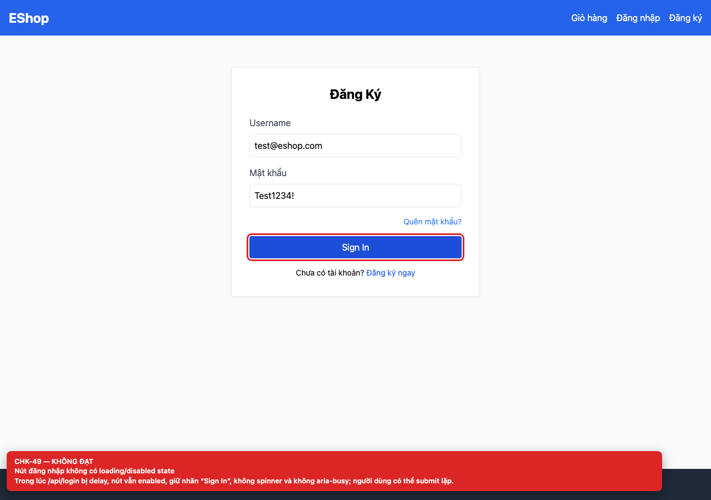
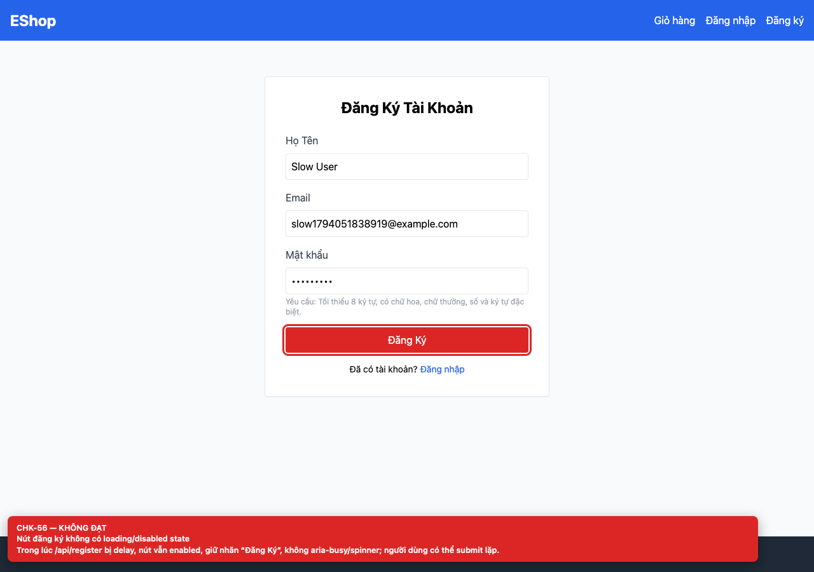

# BUG-GUI-20 — Login and Register buttons have no loading or disabled state

| Field | Value |
| --- | --- |
| Severity | **Minor** |
| FR | FR-01, FR-02 |
| Interface aspect | IA-04 |
| Screen | Login, Register |
| Checklist IDs | CHK-49, CHK-56 |
| Environment | Chromium 158 (Playwright 1.65), 1280×900; backend http://localhost:3000, web http://localhost:5173 |
| Status | Draft — student review and GitHub publication pending |

## Steps to reproduce

1. Delay /api/login or /api/register by 2 seconds.
2. Click the submit button and inspect it during the request.

## Expected result

The button is disabled, shows a spinner/label change and exposes aria-busy.

## Actual result

The button stays enabled with the same label; double submits are possible.

## Evidence

## Root cause

Login.jsx:12-20; Register.jsx:12-28.

## Suggested fix

Add a submitting state, disable the button and show a spinner or “Đang xử lý…” label.

## GitHub issue

- Title: `[BUG-GUI-20] Login and Register buttons have no loading or disabled state`
- Labels: `bug`, `minor`, `ia-04`, `fr-01`
- Publishing is blocked in this environment because the GitHub CLI/token is not configured; the ready-to-publish body is in `issues/`.
