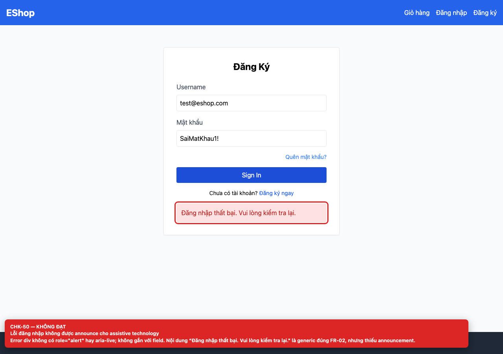
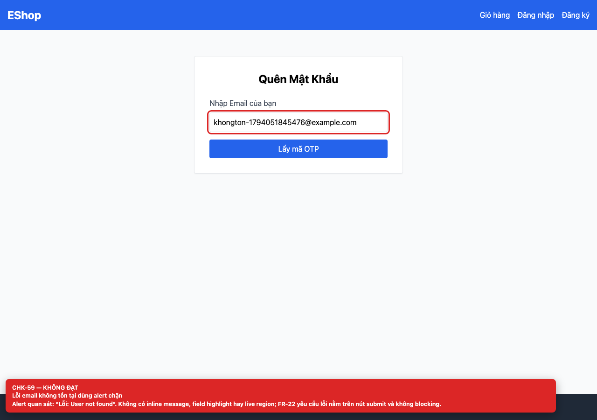
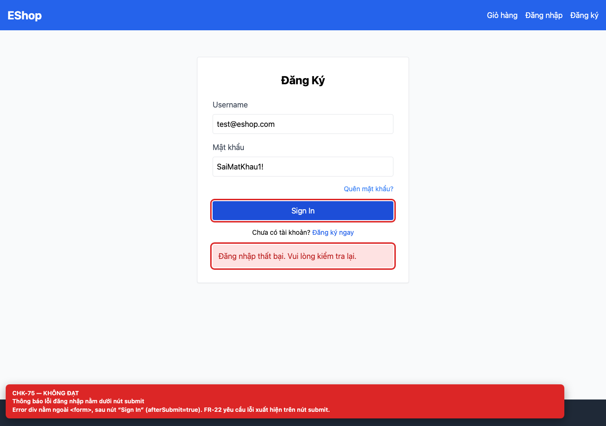

# BUG-GUI-21 — Thông báo lỗi nằm dưới nút submit hoặc dùng alert chặn

**GitHub Issue:** chưa publish — draft tại [`issues/BUG-GUI-21.md`](../issues/BUG-GUI-21.md)

## Tóm tắt

Thông báo lỗi nằm dưới nút submit hoặc dùng alert chặn. Bug được phát hiện khi thực thi checklist GUI Task 1 trên màn hình `/login, /forgot-password`.

| Mục | Giá trị |
| --- | --- |
| Feature / rule | FR-22 — Form; FR-24 — Feedback |
| Checklist | CHK-50, CHK-59, CHK-75 |
| Màn hình | `/login, /forgot-password` |
| Môi trường | Chromium 158 / Playwright 1.65; backend `http://localhost:3000`; web `http://localhost:5173`; viewport 1280×900 (mobile 360×800 khi có kiểm tra responsive). |
| Severity / Priority | **Major** / High |
| Lặp lại | 1/1 trên build hiện tại |

## Các bước tái hiện

1. Nhập sai mật khẩu trên `/login` và submit.
2. Yêu cầu OTP cho email không tồn tại trên `/forgot-password`.

| Mốc | Expected | Actual |
| --- | --- | --- |
| Sau thao tác | Lỗi hiển thị inline, nằm trên nút submit, gắn với field và được announce qua `role="alert"`/`aria-live` (FR-22). | Login render error div sau `</form>`, bên dưới nút “Sign In”, không có `role`/`aria-live`; Forgot Password dùng `alert("Lỗi: User not found")`, không có inline message hay field highlight. |

## Bằng chứng







## Nguyên nhân đối chiếu mã nguồn

**[`frontend-web/src/pages/Login.jsx:61`](https://github.com/SoftwareTesting-Group13/eshop-sut-homework/blob/85af3ba875c88283615e22cb108f13e2fccaf0e9/frontend-web/src/pages/Login.jsx#L61)–[L66](https://github.com/SoftwareTesting-Group13/eshop-sut-homework/blob/85af3ba875c88283615e22cb108f13e2fccaf0e9/frontend-web/src/pages/Login.jsx#L66)**

```jsx
        <div className="text-center text-sm mt-2">
          Chưa có tài khoản? <Link to="/register" className="text-blue-600 hover:underline">Đăng ký ngay</Link>
        </div>
      </form>

      {error && <div className="bg-red-100 text-red-700 p-3 mt-4 rounded">{error}</div>}
```

Error div nằm ngoài `<form>`, sau nút submit.

**[`frontend-web/src/pages/ForgotPassword.jsx:19`](https://github.com/SoftwareTesting-Group13/eshop-sut-homework/blob/85af3ba875c88283615e22cb108f13e2fccaf0e9/frontend-web/src/pages/ForgotPassword.jsx#L19)–[L21](https://github.com/SoftwareTesting-Group13/eshop-sut-homework/blob/85af3ba875c88283615e22cb108f13e2fccaf0e9/frontend-web/src/pages/ForgotPassword.jsx#L21)**

```jsx
    } catch (err) {
      alert("Lỗi: " + (err.response?.data?.error || err.message));
    }
```

Dùng `alert()` cho lỗi request OTP.

**[`frontend-web/src/pages/ForgotPassword.jsx:36`](https://github.com/SoftwareTesting-Group13/eshop-sut-homework/blob/85af3ba875c88283615e22cb108f13e2fccaf0e9/frontend-web/src/pages/ForgotPassword.jsx#L36)–[L38](https://github.com/SoftwareTesting-Group13/eshop-sut-homework/blob/85af3ba875c88283615e22cb108f13e2fccaf0e9/frontend-web/src/pages/ForgotPassword.jsx#L38)**

```jsx
    } catch (err) {
      alert("Mã OTP không đúng hoặc có lỗi xảy ra.");
    }
```

Dùng `alert()` cho lỗi reset.

## Đề xuất sửa

Tạo inline error region phía trên nút submit, dùng `role="alert"`/`aria-live`, `aria-invalid` và `aria-describedby` trên field.

## Ghi chú

Screenshot được chụp trên SUT đang chạy tại `http://localhost:5173`; code block lấy trực tiếp từ source tại commit [`85af3ba`](https://github.com/SoftwareTesting-Group13/eshop-sut-homework/blob/85af3ba875c88283615e22cb108f13e2fccaf0e9).
