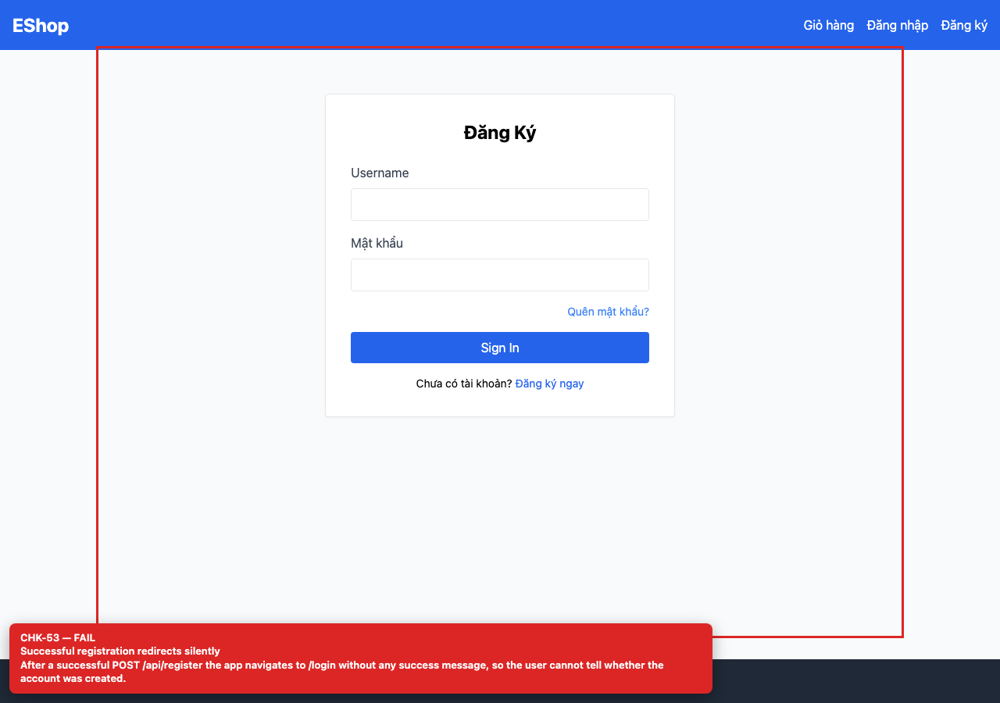

# BUG-GUI-22 — Successful registration redirects silently

| Field | Value |
| --- | --- |
| Severity | **Minor** |
| FR | FR-01 |
| Interface aspect | IA-04 |
| Screen | Register |
| Checklist IDs | CHK-53 |
| Environment | Chromium 158 (Playwright 1.65), 1280×900; backend http://localhost:3000, web http://localhost:5173 |
| Status | Draft — student review and GitHub publication pending |

## Steps to reproduce

1. Register a new valid account.
2. Observe the transition to /login.

## Expected result

A success message confirms the account was created before the redirect.

## Actual result

The app navigates to /login with no success feedback; users cannot tell whether registration succeeded.

## Evidence

## Root cause

Register.jsx:23-24.

## Suggested fix

Show a success toast/inline message and then navigate (or pass state to Login).

## GitHub issue

- Title: `[BUG-GUI-22] Successful registration redirects silently`
- Labels: `bug`, `minor`, `ia-04`, `fr-01`
- Publishing is blocked in this environment because the GitHub CLI/token is not configured; the ready-to-publish body is in `issues/`.
