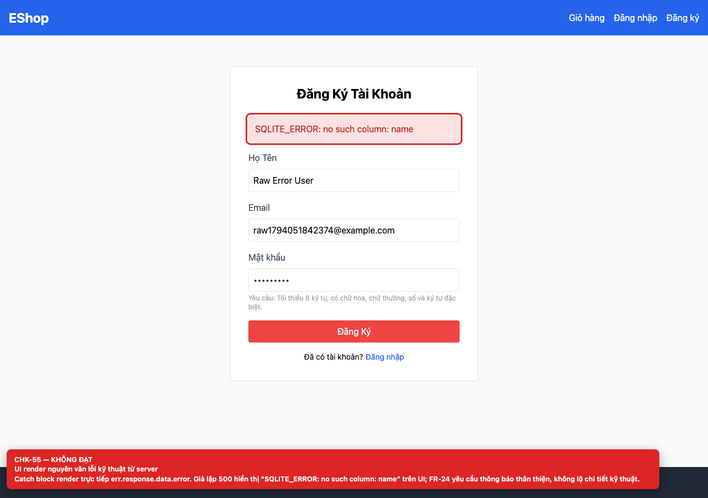

# BUG-GUI-23 — Server error text is rendered verbatim

| Field | Value |
| --- | --- |
| Severity | **Major** |
| FR | FR-01 |
| Interface aspect | IA-04 |
| Screen | Register |
| Checklist IDs | CHK-55 |
| Environment | Chromium 158 (Playwright 1.65), 1280×900; backend http://localhost:3000, web http://localhost:5173 |
| Status | Draft — student review and GitHub publication pending |

## Steps to reproduce

1. Simulate POST /api/register returning 500 with a SQLite error.
2. Submit the form.

## Expected result

A generic, human-readable error; technical details stay in server logs.

## Actual result

The UI renders “SQLITE_ERROR: no such column: name” because the catch block uses err.response.data.error directly.

## Evidence

## Root cause

Register.jsx:26.

## Suggested fix

Map known errors to friendly messages and log the raw error server-side; never render database messages.

## GitHub issue

- Title: `[BUG-GUI-23] Server error text is rendered verbatim`
- Labels: `bug`, `major`, `ia-04`, `fr-01`
- Publishing is blocked in this environment because the GitHub CLI/token is not configured; the ready-to-publish body is in `issues/`.
