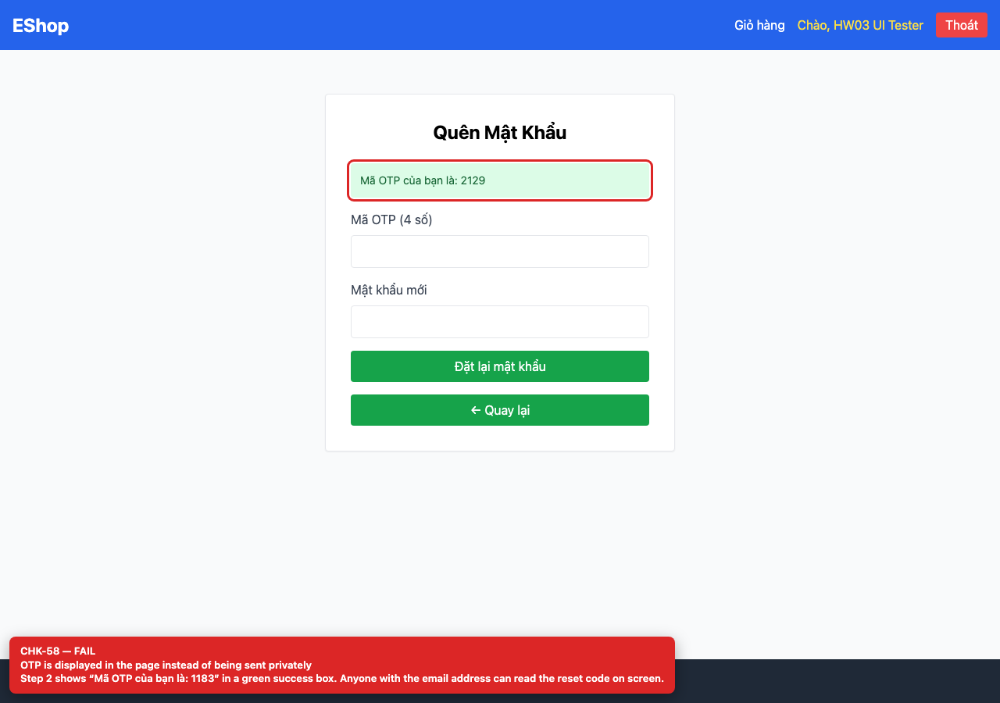

# BUG-GUI-24 — Password-reset OTP is displayed on screen

| Field | Value |
| --- | --- |
| Severity | **Blocker** |
| FR | FR-03 |
| Interface aspect | IA-04 |
| Screen | Forgot Password |
| Checklist IDs | CHK-58 |
| Environment | Chromium 158 (Playwright 1.65), 1280×900; backend http://localhost:3000, web http://localhost:5173 |
| Status | Draft — student review and GitHub publication pending |

## Steps to reproduce

1. Open /forgot-password.
2. Enter a registered email and request the OTP.

## Expected result

The OTP is sent out-of-band (email/SMS) and never shown in the UI.

## Actual result

Step 2 shows “Mã OTP của bạn là: 2129” in a green box; anyone with the email address can reset the password.

## Evidence

## Root cause

ForgotPassword.jsx:16-18; backend/server.js:68-85 returns resetToken in the response.

## Suggested fix

Remove resetToken from the API response and UI; send it through a real out-of-band channel with expiry and rate limiting.

## GitHub issue

- Title: `[BUG-GUI-24] Password-reset OTP is displayed on screen`
- Labels: `bug`, `blocker`, `ia-04`, `fr-03`
- Publishing is blocked in this environment because the GitHub CLI/token is not configured; the ready-to-publish body is in `issues/`.
