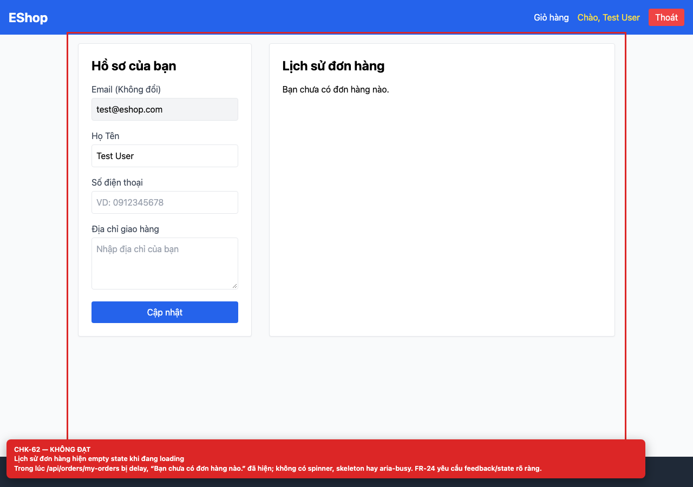
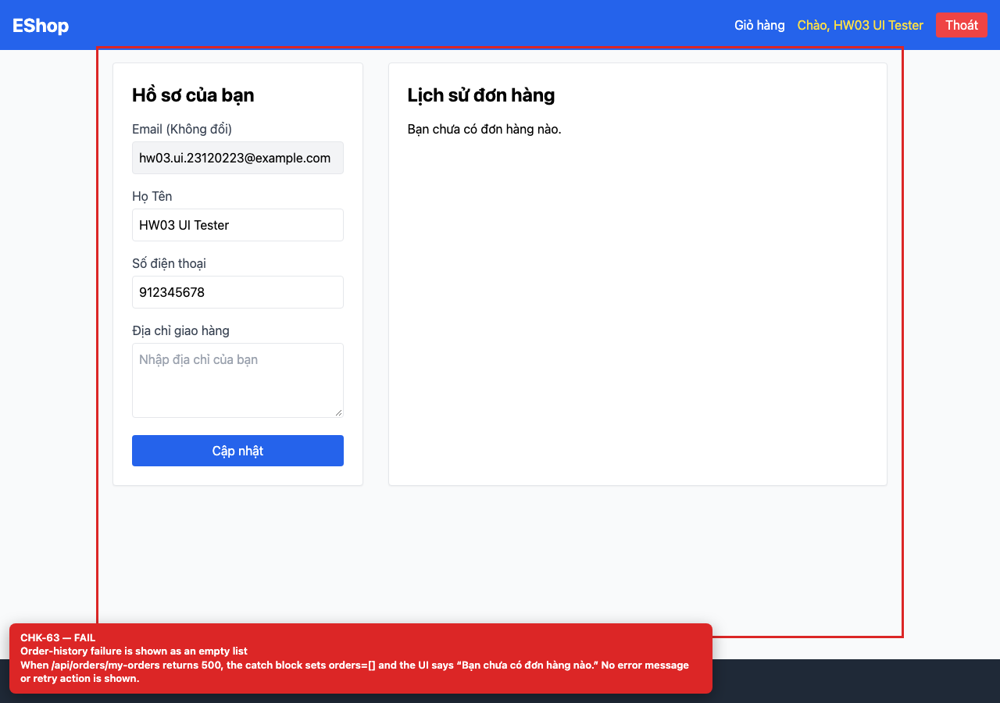

# BUG-GUI-25 — Order-history loading and error states are shown as an empty list

| Field | Value |
| --- | --- |
| Severity | **Major** |
| FR | FR-04 |
| Interface aspect | IA-04 |
| Screen | Profile |
| Checklist IDs | CHK-62, CHK-63 |
| Environment | Chromium 158 (Playwright 1.65), 1280×900; backend http://localhost:3000, web http://localhost:5173 |
| Status | Draft — student review and GitHub publication pending |

## Steps to reproduce

1. Delay /api/orders/my-orders and open /profile.
2. Repeat with a 500 response.

## Expected result

A loading state while fetching and a distinct error state with retry on failure.

## Actual result

“Bạn chưa có đơn hàng nào.” is shown during loading and after a 500 response; users cannot tell “no orders” from “request failed”.

## Evidence

## Root cause

Profile.jsx:14-29 (catch sets []), 168-169 (single empty state).

## Suggested fix

Add loading/error state variables and render three distinct branches; add a retry button.

## GitHub issue

- Title: `[BUG-GUI-25] Order-history loading and error states are shown as an empty list`
- Labels: `bug`, `major`, `ia-04`, `fr-04`
- Publishing is blocked in this environment because the GitHub CLI/token is not configured; the ready-to-publish body is in `issues/`.
