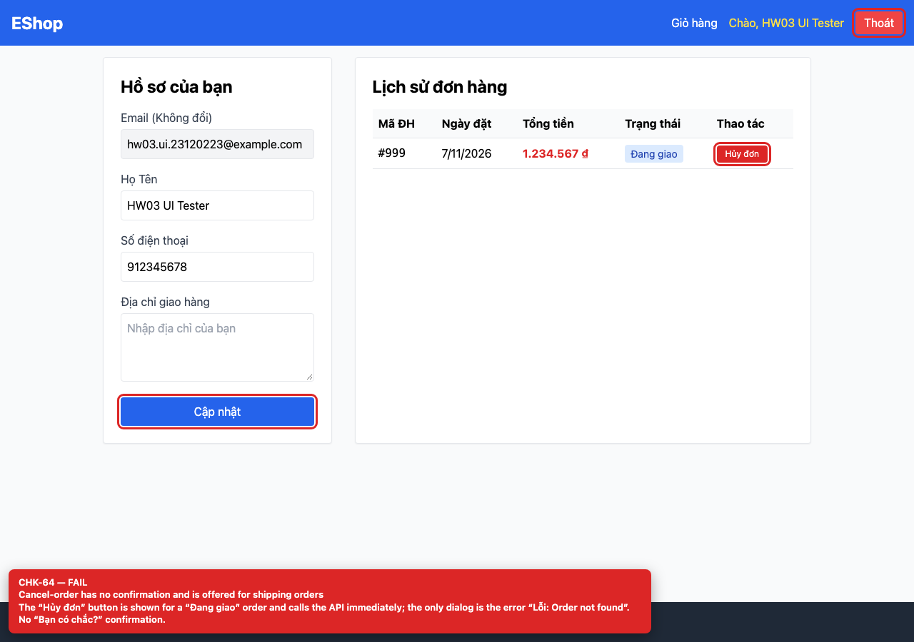

# BUG-GUI-26 — Cancel-order has no confirmation and is offered for shipping orders

| Field | Value |
| --- | --- |
| Severity | **Major** |
| FR | FR-04 |
| Interface aspect | IA-04 |
| Screen | Profile |
| Checklist IDs | CHK-64 |
| Environment | Chromium 158 (Playwright 1.65), 1280×900; backend http://localhost:3000, web http://localhost:5173 |
| Status | Draft — student review and GitHub publication pending |

## Steps to reproduce

1. Open /profile with an order whose status is “Đang giao”.
2. Click “Hủy đơn”.

## Expected result

A confirmation dialog before cancelling, and the action only for statuses that may be cancelled.

## Actual result

The button is rendered for shipping orders and calls PUT /api/orders/:id/cancel immediately; the only dialog is the API error. No “Bạn có chắc?” confirmation.

## Evidence

## Root cause

Profile.jsx:199-207 (condition allows shipping; no confirm).

## Suggested fix

Show the button only for pending/confirmed, and require an explicit confirmation dialog before the API call.

## GitHub issue

- Title: `[BUG-GUI-26] Cancel-order has no confirmation and is offered for shipping orders`
- Labels: `bug`, `major`, `ia-04`, `fr-04`
- Publishing is blocked in this environment because the GitHub CLI/token is not configured; the ready-to-publish body is in `issues/`.
