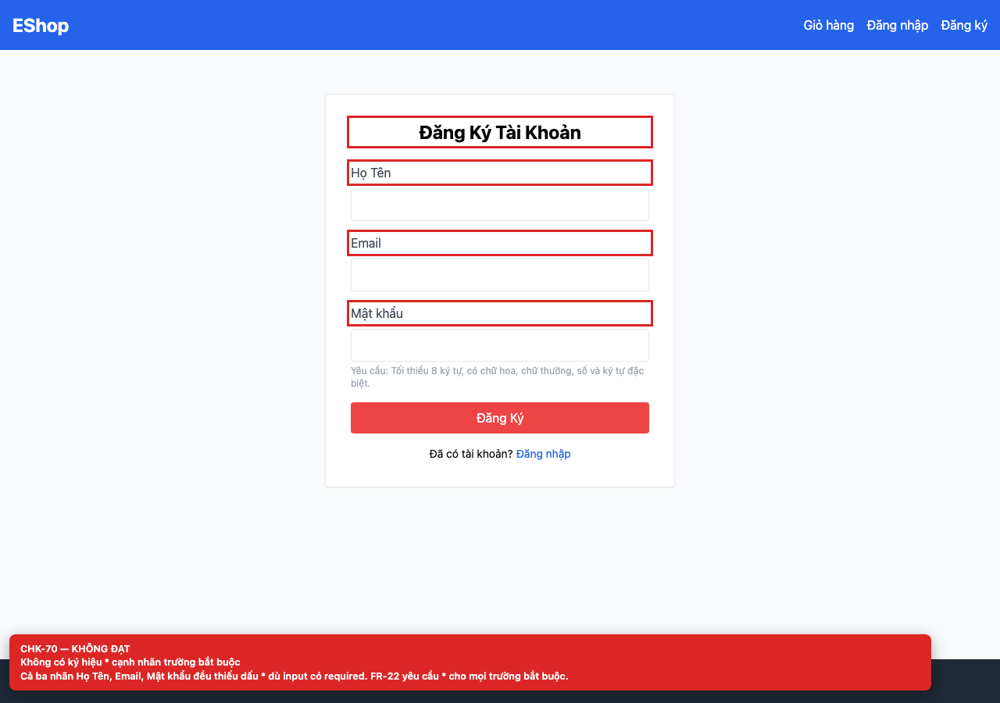

# BUG-GUI-27 — Không có ký hiệu `*` cạnh nhãn trường bắt buộc

**GitHub Issue:** chưa publish — draft tại [`issues/BUG-GUI-27.md`](../issues/BUG-GUI-27.md)

## Tóm tắt

Không có ký hiệu `*` cạnh nhãn trường bắt buộc. Bug được phát hiện khi thực thi checklist GUI Task 1 trên màn hình `/login, /register, /forgot-password, /profile`.

| Mục | Giá trị |
| --- | --- |
| Feature / rule | FR-22 — Form |
| Checklist | CHK-70 |
| Màn hình | `/login, /register, /forgot-password, /profile` |
| Môi trường | Chromium 158 / Playwright 1.65; backend `http://localhost:3000`; web `http://localhost:5173`; viewport 1280×900 (mobile 360×800 khi có kiểm tra responsive). |
| Severity / Priority | **Minor** / Medium |
| Lặp lại | 1/1 trên build hiện tại |

## Các bước tái hiện

1. Mở các màn hình auth.
2. So sánh nhãn với thuộc tính `required` của từng input.

| Mốc | Expected | Actual |
| --- | --- | --- |
| Sau thao tác | Mọi trường bắt buộc có ký hiệu `*` bên cạnh nhãn (FR-22). | Không nhãn nào có `*` dù tất cả input đều `required`. |

## Bằng chứng



## Nguyên nhân đối chiếu mã nguồn

**[`frontend-web/src/pages/Register.jsx:36`](https://github.com/SoftwareTesting-Group13/eshop-sut-homework/blob/85af3ba875c88283615e22cb108f13e2fccaf0e9/frontend-web/src/pages/Register.jsx#L36)–[L56](https://github.com/SoftwareTesting-Group13/eshop-sut-homework/blob/85af3ba875c88283615e22cb108f13e2fccaf0e9/frontend-web/src/pages/Register.jsx#L56)**

```jsx
          <label className="block text-gray-700 mb-2">Họ Tên</label>
          <input
            type="text"
            value={name}
            onChange={(e) => setName(e.target.value)}
            className="w-full border p-2 rounded"
            required
          />
        </div>
        <div>
          <label className="block text-gray-700 mb-2">Email</label>
          <input
            type="text"
            value={email}
            onChange={(e) => setEmail(e.target.value)}
            className="w-full border p-2 rounded"
            required
          />
        </div>
        <div>
          <label className="block text-gray-700 mb-2">Mật khẩu</label>
```

Label “Họ Tên”, “Email”, “Mật khẩu” không có `*`; input đều `required`.

**[`frontend-web/src/pages/Login.jsx:28`](https://github.com/SoftwareTesting-Group13/eshop-sut-homework/blob/85af3ba875c88283615e22cb108f13e2fccaf0e9/frontend-web/src/pages/Login.jsx#L28)–[L38](https://github.com/SoftwareTesting-Group13/eshop-sut-homework/blob/85af3ba875c88283615e22cb108f13e2fccaf0e9/frontend-web/src/pages/Login.jsx#L38)**

```jsx
          <label className="block text-gray-700 mb-2">Username</label>
          <input
            type="text"
            value={email}
            onChange={(e) => setEmail(e.target.value)}
            className="w-full border p-2 rounded"
            required
          />
        </div>
        <div>
          <label className="block text-gray-700 mb-2">Mật khẩu</label>
```

Label “Username”, “Mật khẩu” không có `*`.

## Đề xuất sửa

Thêm `*` (kèm text ẩn “bắt buộc” cho screen-reader) vào mọi label của trường required.

## Ghi chú

Screenshot được chụp trên SUT đang chạy tại `http://localhost:5173`; code block lấy trực tiếp từ source tại commit [`85af3ba`](https://github.com/SoftwareTesting-Group13/eshop-sut-homework/blob/85af3ba875c88283615e22cb108f13e2fccaf0e9).
