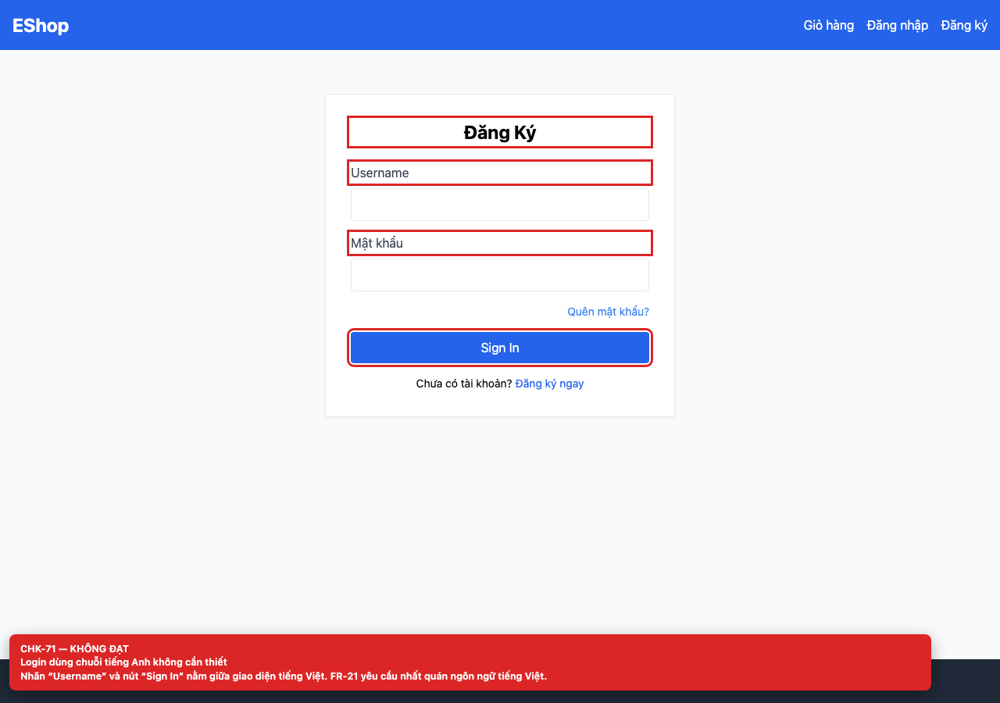

# BUG-GUI-28 — Login dùng “Username” và “Sign In” giữa giao diện tiếng Việt

**GitHub Issue:** chưa publish — draft tại [`issues/BUG-GUI-28.md`](../issues/BUG-GUI-28.md)

## Tóm tắt

Login dùng “Username” và “Sign In” giữa giao diện tiếng Việt. Bug được phát hiện khi thực thi checklist GUI Task 1 trên màn hình `/login`.

| Mục | Giá trị |
| --- | --- |
| Feature / rule | FR-21 — Tiêu chuẩn giao diện chung |
| Checklist | CHK-71 |
| Màn hình | `/login` |
| Môi trường | Chromium 158 / Playwright 1.65; backend `http://localhost:3000`; web `http://localhost:5173`; viewport 1280×900 (mobile 360×800 khi có kiểm tra responsive). |
| Severity / Priority | **Minor** / Medium |
| Lặp lại | 1/1 trên build hiện tại |

## Các bước tái hiện

1. Mở `/login`.
2. Đọc nhãn trường và nút submit; so sánh với các màn hình còn lại.

| Mốc | Expected | Actual |
| --- | --- | --- |
| Sau thao tác | Toàn bộ giao diện dùng tiếng Việt, trừ thuật ngữ kỹ thuật chuẩn (FR-21). | Nhãn “Username” và nút “Sign In” là tiếng Anh không cần thiết; các màn hình khác dùng tiếng Việt. |

## Bằng chứng



## Nguyên nhân đối chiếu mã nguồn

**[`frontend-web/src/pages/Login.jsx:28`](https://github.com/SoftwareTesting-Group13/eshop-sut-homework/blob/85af3ba875c88283615e22cb108f13e2fccaf0e9/frontend-web/src/pages/Login.jsx#L28)**

```jsx
          <label className="block text-gray-700 mb-2">Username</label>
```

Label “Username”.

**[`frontend-web/src/pages/Login.jsx:58`](https://github.com/SoftwareTesting-Group13/eshop-sut-homework/blob/85af3ba875c88283615e22cb108f13e2fccaf0e9/frontend-web/src/pages/Login.jsx#L58)**

```jsx
          Sign In
```

Nút “Sign In”.

## Đề xuất sửa

Đổi thành “Email” và “Đăng nhập”.

## Ghi chú

Screenshot được chụp trên SUT đang chạy tại `http://localhost:5173`; code block lấy trực tiếp từ source tại commit [`85af3ba`](https://github.com/SoftwareTesting-Group13/eshop-sut-homework/blob/85af3ba875c88283615e22cb108f13e2fccaf0e9).
