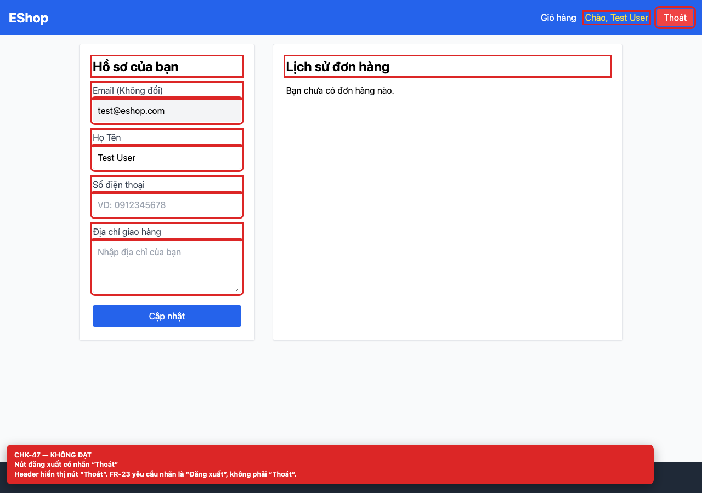

# BUG-GUI-29 — Nút đăng xuất có nhãn “Thoát” thay vì “Đăng xuất”

**GitHub Issue:** chưa publish — draft tại [`issues/BUG-GUI-29.md`](../issues/BUG-GUI-29.md)

## Tóm tắt

Nút đăng xuất có nhãn “Thoát” thay vì “Đăng xuất”. Bug được phát hiện khi thực thi checklist GUI Task 1 trên màn hình `/profile`.

| Mục | Giá trị |
| --- | --- |
| Feature / rule | FR-23 — Navigation |
| Checklist | CHK-47 |
| Màn hình | `/profile` |
| Môi trường | Chromium 158 / Playwright 1.65; backend `http://localhost:3000`; web `http://localhost:5173`; viewport 1280×900 (mobile 360×800 khi có kiểm tra responsive). |
| Severity / Priority | **Minor** / Medium |
| Lặp lại | 1/1 trên build hiện tại |

## Các bước tái hiện

1. Đăng nhập và quan sát header.
2. Đọc nhãn nút đăng xuất.

| Mốc | Expected | Actual |
| --- | --- | --- |
| Sau thao tác | Nhãn là “Đăng xuất” (FR-23). | Nhãn là “Thoát”. |

## Bằng chứng



## Nguyên nhân đối chiếu mã nguồn

**[`frontend-web/src/App.jsx:29`](https://github.com/SoftwareTesting-Group13/eshop-sut-homework/blob/85af3ba875c88283615e22cb108f13e2fccaf0e9/frontend-web/src/App.jsx#L29)**

```jsx
            <button onClick={logout} className="bg-red-500 px-3 py-1 rounded">Thoát</button>
```

Button logout hard-code “Thoát”.

## Đề xuất sửa

Đổi nhãn thành “Đăng xuất”.

## Ghi chú

Screenshot được chụp trên SUT đang chạy tại `http://localhost:5173`; code block lấy trực tiếp từ source tại commit [`85af3ba`](https://github.com/SoftwareTesting-Group13/eshop-sut-homework/blob/85af3ba875c88283615e22cb108f13e2fccaf0e9).
