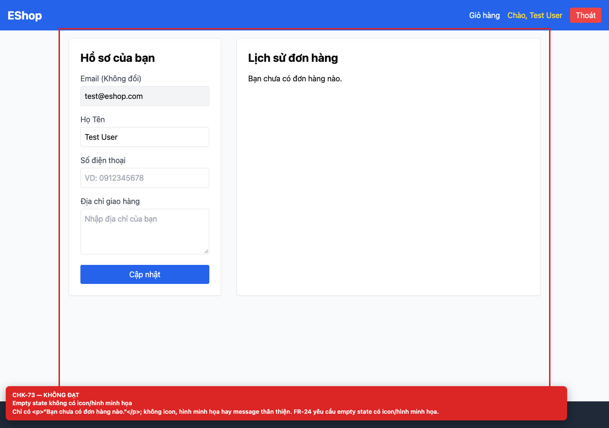

# BUG-GUI-30 — Empty state lịch sử đơn hàng không có icon/hình minh họa

**GitHub Issue:** [#101](https://github.com/SoftwareTesting-Group13/eshop-sut-homework/issues/101)

## Tóm tắt

Empty state lịch sử đơn hàng không có icon/hình minh họa. Bug được phát hiện khi thực thi checklist GUI Task 1 trên màn hình `/profile`.

| Mục | Giá trị |
| --- | --- |
| Feature / rule | FR-24 — Feedback & State |
| Checklist | CHK-73 |
| Màn hình | `/profile` |
| Môi trường | Chromium 158 / Playwright 1.65; backend `http://localhost:3000`; web `http://localhost:5173`; viewport 1280×900 (mobile 360×800 khi có kiểm tra responsive). |
| Severity / Priority | **Minor** / Low |
| Lặp lại | 1/1 trên build hiện tại |

## Các bước tái hiện

1. Đăng nhập bằng tài khoản chưa có đơn hàng.
2. Mở `/profile` và quan sát section “Lịch sử đơn hàng”.

| Mốc | Expected | Actual |
| --- | --- | --- |
| Sau thao tác | Empty state có icon/hình minh họa và message thân thiện (FR-24). | Chỉ có `<p>Bạn chưa có đơn hàng nào.</p>`; không icon, hình minh họa hay hướng dẫn tiếp theo. |

## Bằng chứng



## Nguyên nhân đối chiếu mã nguồn

**[`frontend-web/src/pages/Profile.jsx:168`](https://github.com/SoftwareTesting-Group13/eshop-sut-homework/blob/85af3ba875c88283615e22cb108f13e2fccaf0e9/frontend-web/src/pages/Profile.jsx#L168)–[L169](https://github.com/SoftwareTesting-Group13/eshop-sut-homework/blob/85af3ba875c88283615e22cb108f13e2fccaf0e9/frontend-web/src/pages/Profile.jsx#L169)**

```jsx
        {orders.length === 0 ? (
          <p>Bạn chưa có đơn hàng nào.</p>
```

Nhánh empty state chỉ render một đoạn text.

## Đề xuất sửa

Thêm icon/illustration và message thân thiện, ví dụ “Bạn chưa có đơn hàng nào. Hãy bắt đầu mua sắm!”.

## Ghi chú

Screenshot được chụp trên SUT đang chạy tại `http://localhost:5173`; code block lấy trực tiếp từ source tại commit [`85af3ba`](https://github.com/SoftwareTesting-Group13/eshop-sut-homework/blob/85af3ba875c88283615e22cb108f13e2fccaf0e9).
