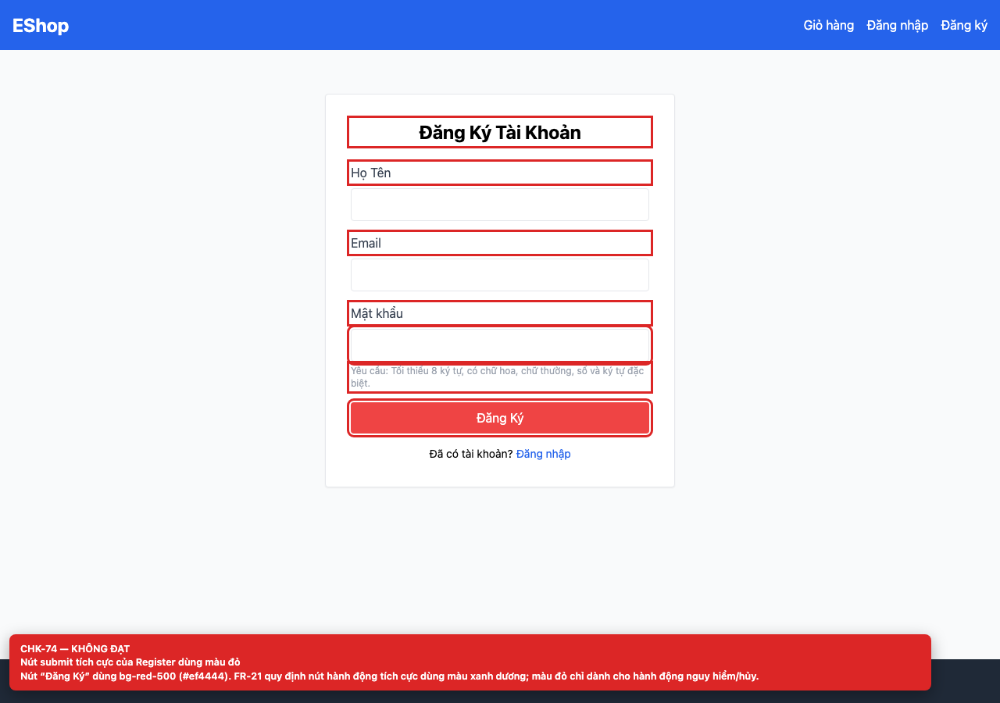
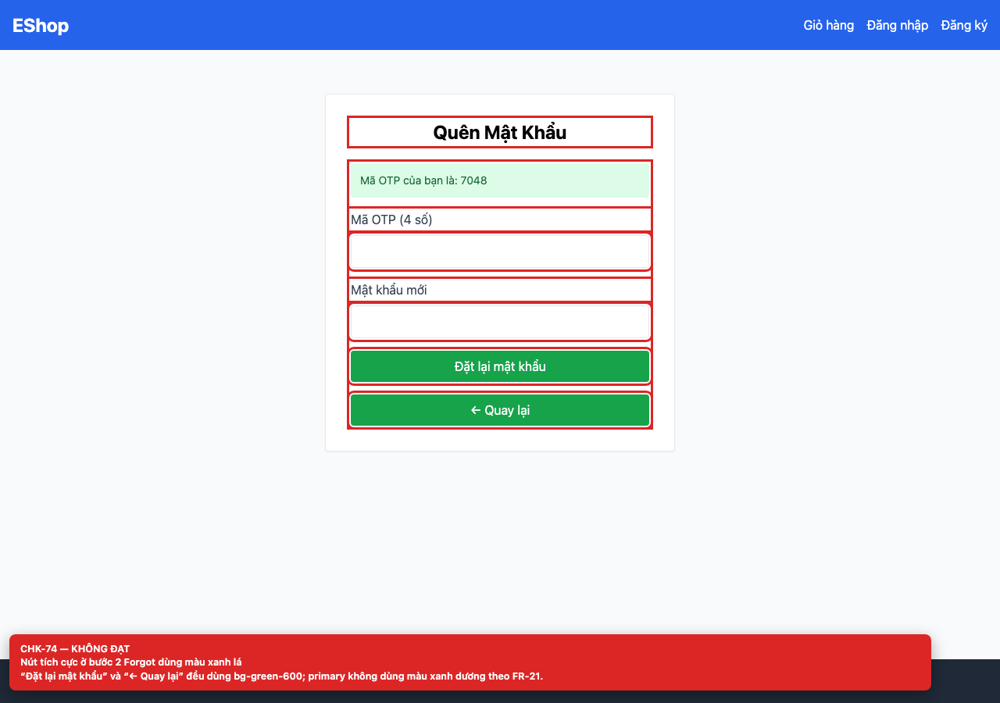

# BUG-GUI-31 — Nút hành động tích cực dùng màu đỏ/xanh lá thay vì xanh dương

**GitHub Issue:** chưa publish — draft tại [`issues/BUG-GUI-31.md`](../issues/BUG-GUI-31.md)

## Tóm tắt

Nút hành động tích cực dùng màu đỏ/xanh lá thay vì xanh dương. Bug được phát hiện khi thực thi checklist GUI Task 1 trên màn hình `/register, /forgot-password`.

| Mục | Giá trị |
| --- | --- |
| Feature / rule | FR-21 — Tiêu chuẩn giao diện chung |
| Checklist | CHK-74 |
| Màn hình | `/register, /forgot-password` |
| Môi trường | Chromium 158 / Playwright 1.65; backend `http://localhost:3000`; web `http://localhost:5173`; viewport 1280×900 (mobile 360×800 khi có kiểm tra responsive). |
| Severity / Priority | **Minor** / Medium |
| Lặp lại | 1/1 trên build hiện tại |

## Các bước tái hiện

1. Mở `/register` và quan sát nút “Đăng Ký”.
2. Lấy OTP trên `/forgot-password` và quan sát hai nút ở bước 2.

| Mốc | Expected | Actual |
| --- | --- | --- |
| Sau thao tác | Nút hành động tích cực dùng màu xanh dương (FR-21). | Register dùng `bg-red-500` (#ef4444); bước 2 Forgot dùng `bg-green-600` cho cả “Đặt lại mật khẩu” và “← Quay lại”; Login, Forgot bước 1 và Profile dùng xanh dương. |

## Bằng chứng





## Nguyên nhân đối chiếu mã nguồn

**[`frontend-web/src/pages/Register.jsx:70`](https://github.com/SoftwareTesting-Group13/eshop-sut-homework/blob/85af3ba875c88283615e22cb108f13e2fccaf0e9/frontend-web/src/pages/Register.jsx#L70)–[L75](https://github.com/SoftwareTesting-Group13/eshop-sut-homework/blob/85af3ba875c88283615e22cb108f13e2fccaf0e9/frontend-web/src/pages/Register.jsx#L75)**

```jsx
        <button
          type="submit"
          className="w-full bg-red-500 text-white py-2 rounded hover:bg-red-600"
        >
          Đăng Ký
        </button>
```

Nút submit dùng `bg-red-500`.

**[`frontend-web/src/pages/ForgotPassword.jsx:90`](https://github.com/SoftwareTesting-Group13/eshop-sut-homework/blob/85af3ba875c88283615e22cb108f13e2fccaf0e9/frontend-web/src/pages/ForgotPassword.jsx#L90)–[L95](https://github.com/SoftwareTesting-Group13/eshop-sut-homework/blob/85af3ba875c88283615e22cb108f13e2fccaf0e9/frontend-web/src/pages/ForgotPassword.jsx#L95)**

```jsx
          <button type="submit" className="w-full bg-green-600 text-white py-2 rounded">
            Đặt lại mật khẩu
          </button>
          <button type="button" onClick={() => setStep(1)} className="w-full bg-green-600 text-white py-2 rounded">
            ← Quay lại
          </button>
```

Hai nút dùng `bg-green-600`.

## Đề xuất sửa

Đổi primary action sang `bg-blue-600`; dùng đỏ chỉ cho hành động nguy hiểm/hủy.

## Ghi chú

Screenshot được chụp trên SUT đang chạy tại `http://localhost:5173`; code block lấy trực tiếp từ source tại commit [`85af3ba`](https://github.com/SoftwareTesting-Group13/eshop-sut-homework/blob/85af3ba875c88283615e22cb108f13e2fccaf0e9).
