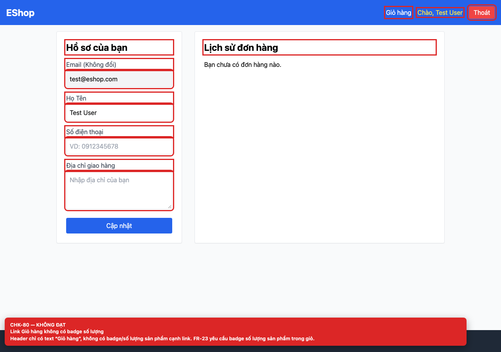

# BUG-GUI-32 — Link “Giỏ hàng” trên header không có badge số lượng

**GitHub Issue:** chưa publish — draft tại [`issues/BUG-GUI-32.md`](../issues/BUG-GUI-32.md)

## Tóm tắt

Link “Giỏ hàng” trên header không có badge số lượng. Bug được phát hiện khi thực thi checklist GUI Task 1 trên màn hình `/login, /register, /forgot-password, /profile`.

| Mục | Giá trị |
| --- | --- |
| Feature / rule | FR-23 — Navigation |
| Checklist | CHK-80 |
| Màn hình | `/login, /register, /forgot-password, /profile` |
| Môi trường | Chromium 158 / Playwright 1.65; backend `http://localhost:3000`; web `http://localhost:5173`; viewport 1280×900 (mobile 360×800 khi có kiểm tra responsive). |
| Severity / Priority | **Minor** / Medium |
| Lặp lại | 1/1 trên build hiện tại |

## Các bước tái hiện

1. Mở bất kỳ màn hình auth nào.
2. Quan sát link “Giỏ hàng” trên header.

| Mốc | Expected | Actual |
| --- | --- | --- |
| Sau thao tác | Link “Giỏ hàng” hiển thị badge số lượng sản phẩm (FR-23). | Header chỉ có text “Giỏ hàng”; không có badge hay số lượng cạnh link. |

## Bằng chứng



## Nguyên nhân đối chiếu mã nguồn

**[`frontend-web/src/App.jsx:22`](https://github.com/SoftwareTesting-Group13/eshop-sut-homework/blob/85af3ba875c88283615e22cb108f13e2fccaf0e9/frontend-web/src/App.jsx#L22)–[L23](https://github.com/SoftwareTesting-Group13/eshop-sut-homework/blob/85af3ba875c88283615e22cb108f13e2fccaf0e9/frontend-web/src/App.jsx#L23)**

```jsx
      <nav className="flex gap-4 items-center">
        <Link to="/cart" className="hover:underline">Giỏ hàng</Link>
```

Link cart chỉ render text, không dùng `cart.length` để hiển thị badge.

## Đề xuất sửa

Đọc `cart` từ `useCart()` và render badge số lượng cạnh link “Giỏ hàng”.

## Ghi chú

Screenshot được chụp trên SUT đang chạy tại `http://localhost:5173`; code block lấy trực tiếp từ source tại commit [`85af3ba`](https://github.com/SoftwareTesting-Group13/eshop-sut-homework/blob/85af3ba875c88283615e22cb108f13e2fccaf0e9).
