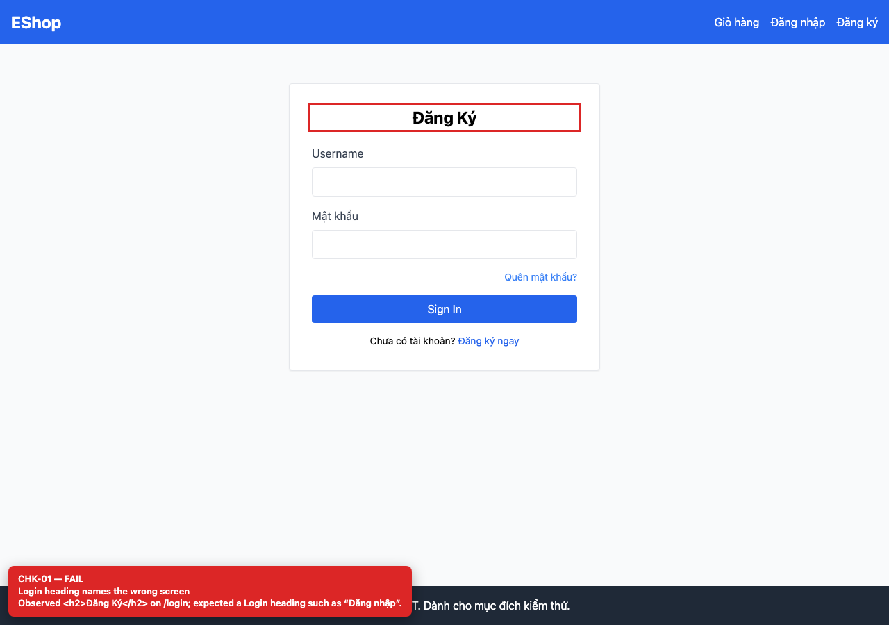

# [BUG-GUI-01] Tiêu đề trang Đăng nhập ghi “Đăng Ký” thay vì “Đăng nhập”

**Severity:** Minor · **Priority:** Medium · **FR:** FR-02 — Đăng nhập · **Screen:** `/login`

## Mô tả

Tiêu đề là `<h2>Đăng Ký</h2>`; trang không có `<h1>`. Người dùng có thể tưởng đang ở màn hình đăng ký.

## Các bước tái hiện

1. Mở `http://localhost:5173/login` trong cửa sổ chưa đăng nhập.
2. Đọc tiêu đề trên card đăng nhập, ngay phía trên hai ô nhập.

## Expected

Tiêu đề mô tả đúng màn hình Đăng nhập (ví dụ “Đăng nhập”) và là một thẻ `<h1>`.

## Actual

Tiêu đề là `<h2>Đăng Ký</h2>`; trang không có `<h1>`. Người dùng có thể tưởng đang ở màn hình đăng ký.

## Checklist IDs

CHK-01

## Nguyên nhân

**[`frontend-web/src/pages/Login.jsx:24`](https://github.com/SoftwareTesting-Group13/eshop-sut-homework/blob/85af3ba875c88283615e22cb108f13e2fccaf0e9/frontend-web/src/pages/Login.jsx#L24)**

```jsx
      <h2 className="text-2xl font-bold mb-6 text-center">Đăng Ký</h2>
```

Chuỗi tiêu đề bị copy từ màn hình Register và không được sửa lại.

## Đề xuất sửa

Đổi tiêu đề thành “Đăng nhập” và dùng `<h1>` cho tiêu đề trang; thêm kiểm tra heading vào test auth.

## Screenshots




> Screenshot dùng raw URL trên nhánh `ncuong`; cần push nhánh này trước khi publish issue.
