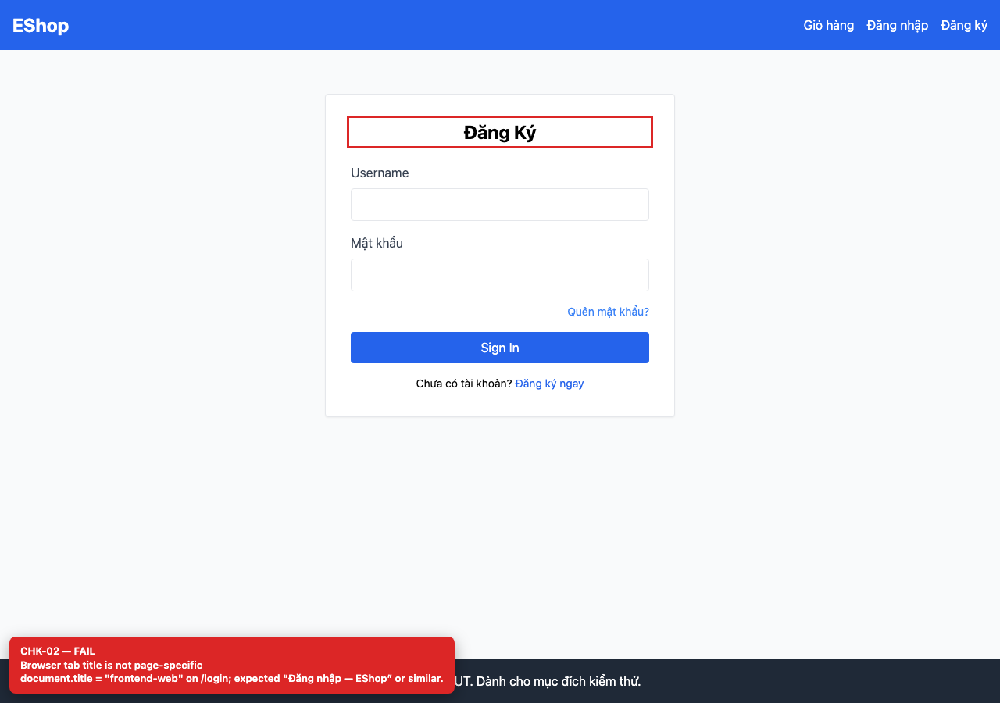
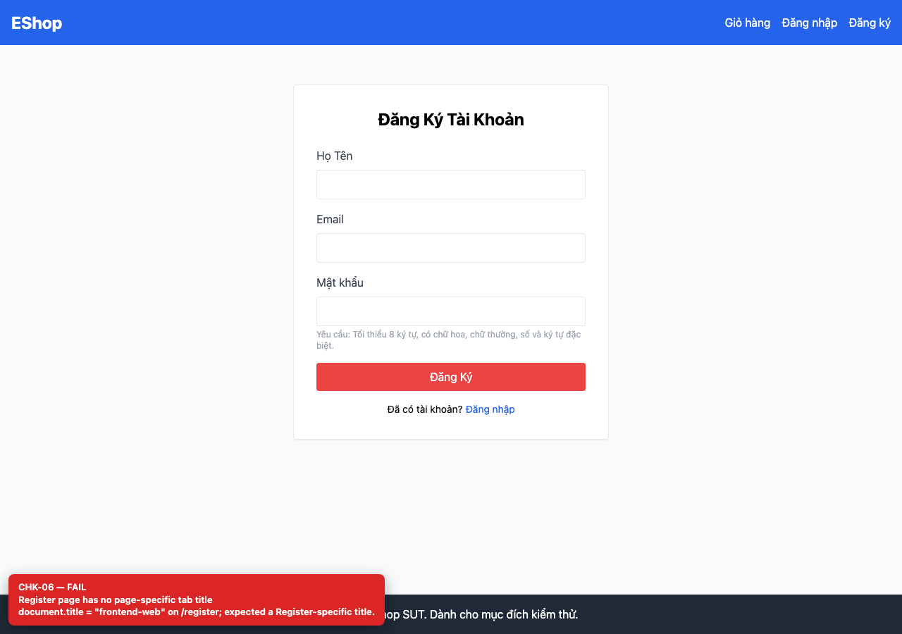
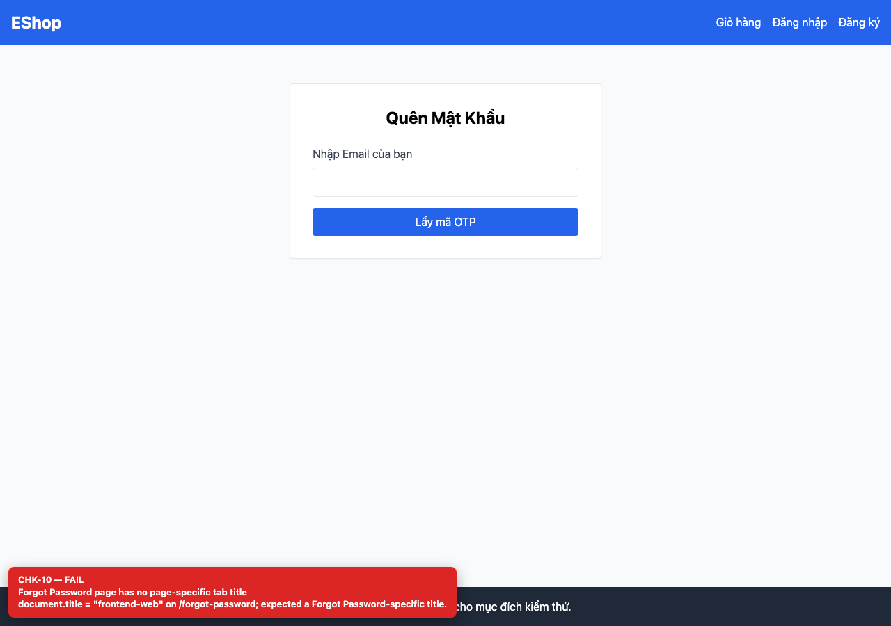
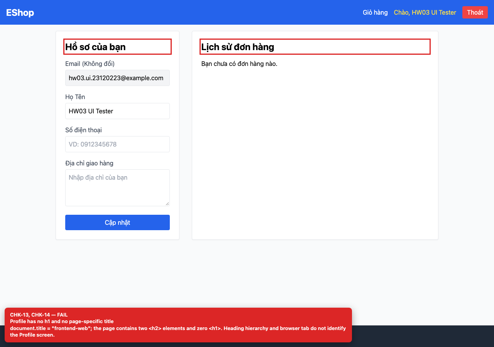

## Summary

All pages share the browser tab title “frontend-web”.

## Environment

- SUT: EShop (`frontend-web`)
- URL: http://localhost:5173
- Browser: Chromium 158 (Playwright 1.65)
- Viewport: 1280×900 desktop; 360×800 mobile for responsive checks
- FR: FR-01..04 · IA-01 · All auth screens
- Checklist IDs: CHK-02, CHK-06, CHK-10, CHK-14

## Steps to reproduce

1. Open /login, /register, /forgot-password and /profile in separate tabs.
2. Compare the browser tab titles.

## Expected

Each tab has a unique, descriptive title (for example “Đăng nhập — EShop”).

## Actual

Every tab is titled “frontend-web”; users with several tabs cannot tell them apart and bookmarks are indistinguishable.

## Evidence

## Root cause

frontend-web/index.html:7 static <title>; no per-route document.title update.

## Suggested fix

Set document.title in each page (or use react-helmet / a route-title hook).
