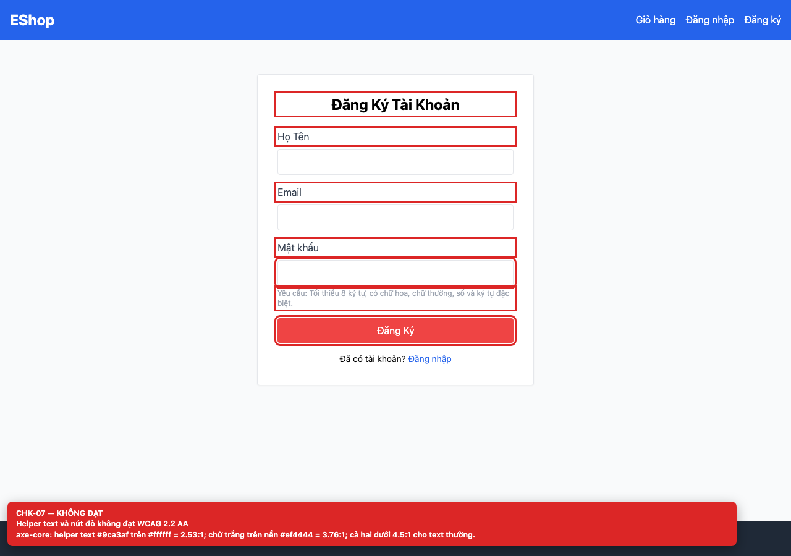
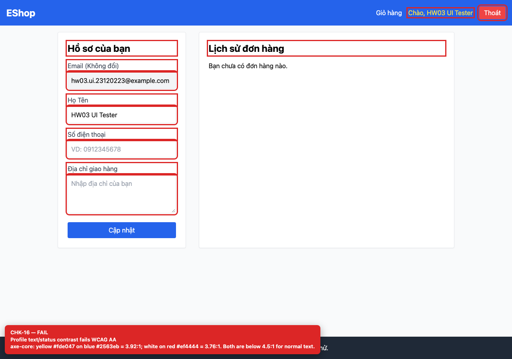

## Summary

Text and button contrast fails WCAG 2.2 AA in several places.

## Environment

- SUT: EShop (`frontend-web`)
- URL: http://localhost:5173
- Browser: Chromium 158 (Playwright 1.65)
- Viewport: 1280×900 desktop; 360×800 mobile for responsive checks
- FR: FR-01, FR-04 · IA-01 · Register, Profile
- Checklist IDs: CHK-07, CHK-16

## Steps to reproduce

1. Open /register and /profile.
2. Run axe-core or compute the contrast of the helper text, red CTA, yellow username and red logout button.

## Expected

Normal text has at least 4.5:1 contrast against its background.

## Actual

axe-core reports 2.53:1 for the register helper text, 3.76:1 for white on the red button, 3.92:1 for the yellow username on blue, and 3.76:1 for the red logout button.

## Evidence

## Root cause

frontend-web/src/pages/Register.jsx:64-66, 72; frontend-web/src/App.jsx:26-29.

## Suggested fix

Darken the grey helper text and the red surfaces, or use dark text on light backgrounds; re-run axe-core after the change.
