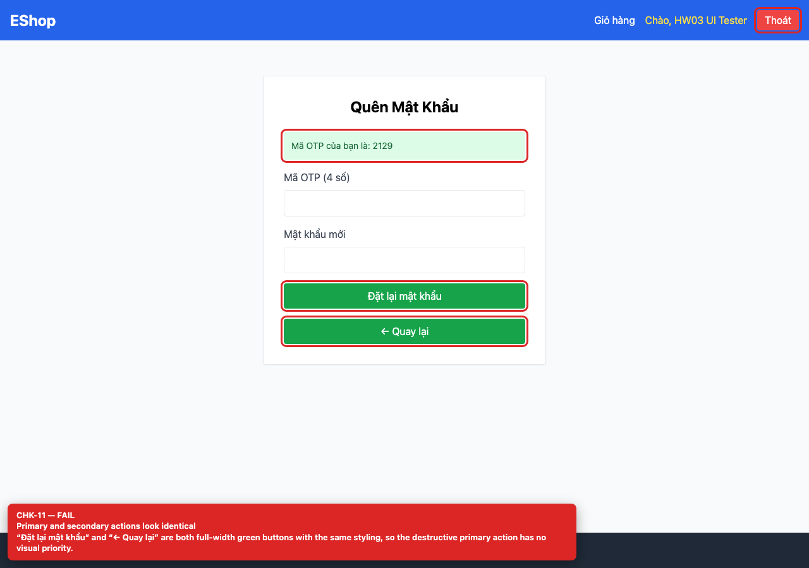

## Summary

Forgot-password step 2 primary and back buttons look identical.

## Environment

- SUT: EShop (`frontend-web`)
- URL: http://localhost:5173
- Browser: Chromium 158 (Playwright 1.65)
- Viewport: 1280×900 desktop; 360×800 mobile for responsive checks
- FR: FR-03 · IA-01 · Forgot Password
- Checklist IDs: CHK-11

## Steps to reproduce

1. Open /forgot-password, enter a valid email and request the OTP.
2. Compare “Đặt lại mật khẩu” and “← Quay lại”.

## Expected

The primary action is visually dominant and the secondary/back action is clearly subordinate.

## Actual

Both are full-width green buttons with identical bg-green-600 styling; users can click the wrong one.

## Evidence

## Root cause

frontend-web/src/pages/ForgotPassword.jsx:90-95.

## Suggested fix

Render the back action as a text/outline button and keep the primary action filled.
