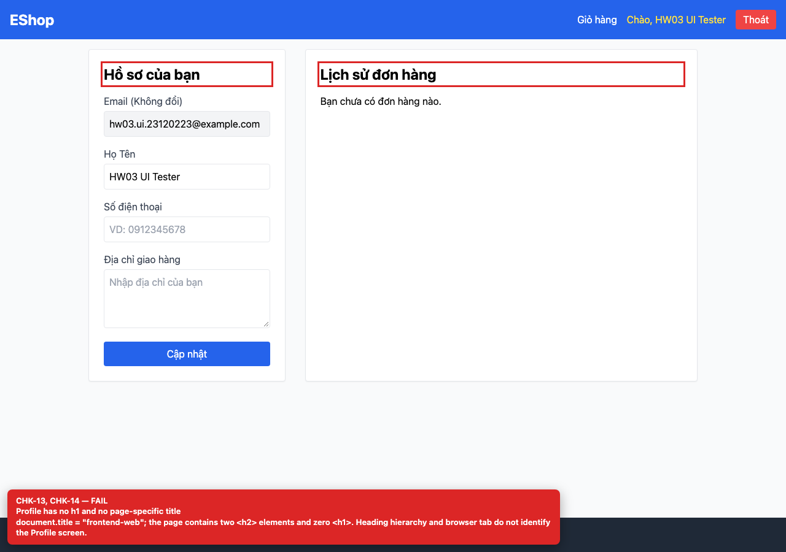

## Summary

Profile page has no h1 and two h2 headings.

## Environment

- SUT: EShop (`frontend-web`)
- URL: http://localhost:5173
- Browser: Chromium 158 (Playwright 1.65)
- Viewport: 1280×900 desktop; 360×800 mobile for responsive checks
- FR: FR-04 · IA-01 · Profile
- Checklist IDs: CHK-13

## Steps to reproduce

1. Open /profile while logged in.
2. Inspect the heading outline or run axe-core.

## Expected

One h1 for the page and h2 for the two sections.

## Actual

0 h1 and two h2 elements (“Hồ sơ của bạn”, “Lịch sử đơn hàng”); axe-core reports “page-has-heading-one”.

## Evidence

## Root cause

frontend-web/src/pages/Profile.jsx:113, 167.

## Suggested fix

Use an h1 for the page title and h2 for the section titles.
