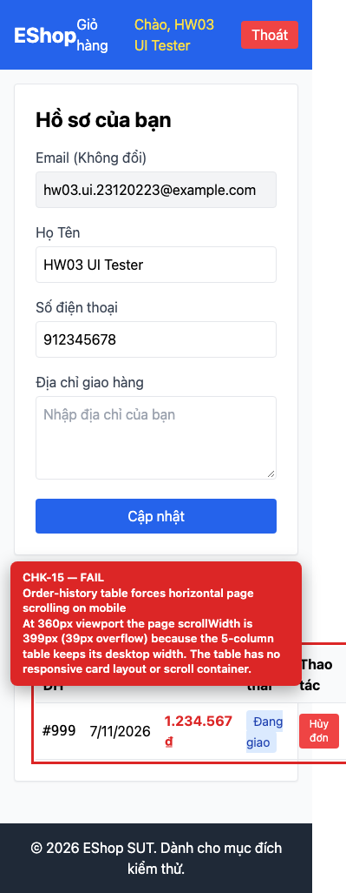

## Summary

Order-history table forces horizontal page scrolling on mobile.

## Environment

- SUT: EShop (`frontend-web`)
- URL: http://localhost:5173
- Browser: Chromium 158 (Playwright 1.65)
- Viewport: 1280×900 desktop; 360×800 mobile for responsive checks
- FR: FR-04 · IA-01 · Profile
- Checklist IDs: CHK-15

## Steps to reproduce

1. Open /profile at a 360px viewport with at least one order.
2. Measure document.documentElement.scrollWidth.

## Expected

The table adapts (scroll container or card layout) and the page has no horizontal scroll.

## Actual

Page scrollWidth is 399px vs clientWidth 360px (39px overflow); the 5-column table keeps its desktop width and is clipped.

## Evidence

## Root cause

frontend-web/src/pages/Profile.jsx:171-212 — no responsive wrapper or card layout.

## Suggested fix

Wrap the table in overflow-x-auto with a min-width, or render order cards below the md breakpoint.
