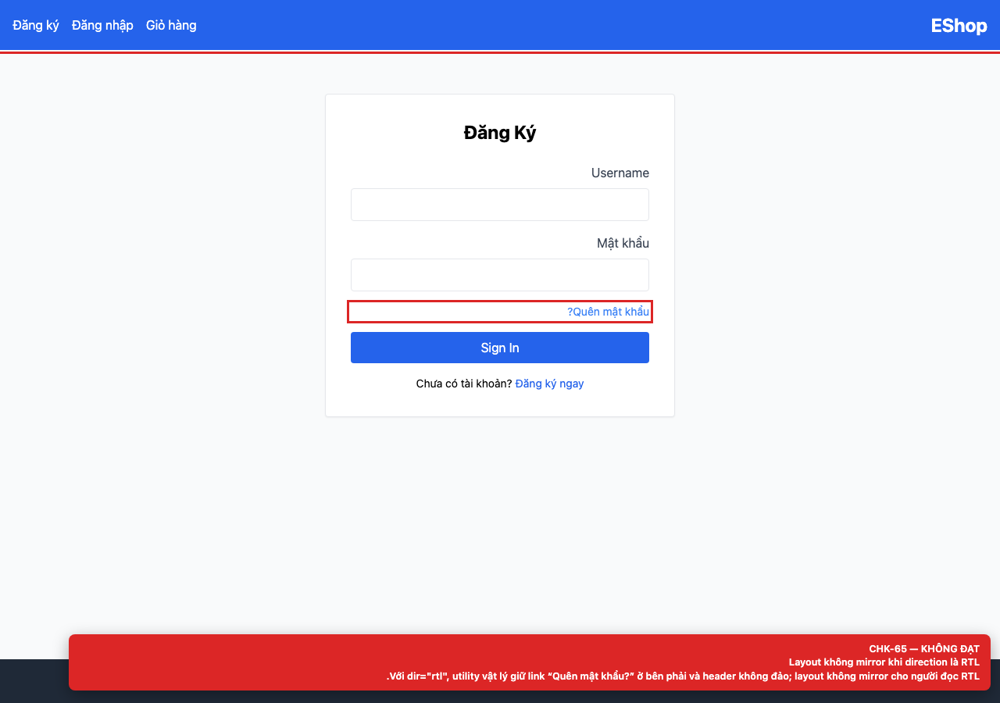

# [BUG-GUI-07] Layout không mirror khi document direction là RTL

**Severity:** Minor · **Priority:** Low · **FR:** FR-21 — Tiêu chuẩn giao diện chung · **Screen:** `/login, /register, /forgot-password, /profile`

## Mô tả

Utility vật lý giữ link “Quên mật khẩu?” ở bên phải và header không đảo; layout không mirror.

## Các bước tái hiện

1. Mở `/login`.
2. Đặt `document.documentElement.dir = 'rtl'` và quan sát header, link “Quên mật khẩu?” và thứ tự các phần tử.

## Expected

Alignment, thứ tự và spacing được mirror cho người đọc RTL.

## Actual

Utility vật lý giữ link “Quên mật khẩu?” ở bên phải và header không đảo; layout không mirror.

## Checklist IDs

CHK-65

## Nguyên nhân

**[`frontend-web/src/pages/Login.jsx:48`](https://github.com/SoftwareTesting-Group13/eshop-sut-homework/blob/85af3ba875c88283615e22cb108f13e2fccaf0e9/frontend-web/src/pages/Login.jsx#L48)–[L51](https://github.com/SoftwareTesting-Group13/eshop-sut-homework/blob/85af3ba875c88283615e22cb108f13e2fccaf0e9/frontend-web/src/pages/Login.jsx#L51)**

```jsx
            
        <div className="text-right text-sm -mt-2">
          <a href="/forgot-password" className="text-blue-500 hover:underline">Quên mật khẩu?</a>
        </div>
```

Dùng `text-right` thay vì `text-end`.

**[`frontend-web/src/App.jsx:20`](https://github.com/SoftwareTesting-Group13/eshop-sut-homework/blob/85af3ba875c88283615e22cb108f13e2fccaf0e9/frontend-web/src/App.jsx#L20)–[L29](https://github.com/SoftwareTesting-Group13/eshop-sut-homework/blob/85af3ba875c88283615e22cb108f13e2fccaf0e9/frontend-web/src/App.jsx#L29)**

```jsx
    <header className="bg-blue-600 text-white p-4 flex justify-between items-center">
      <Link to="/" className="text-2xl font-bold">EShop</Link>
      <nav className="flex gap-4 items-center">
        <Link to="/cart" className="hover:underline">Giỏ hàng</Link>
        {user ? (
          <div className="flex gap-4 items-center">
            <Link to="/profile" className="hover:underline text-yellow-300">
              <span dangerouslySetInnerHTML={{ __html: `Chào, ${user.name}` }} />
            </Link>
            <button onClick={logout} className="bg-red-500 px-3 py-1 rounded">Thoát</button>
```

Header dùng `justify-between`, `gap-4` và thứ tự vật lý; không có logical property.

## Đề xuất sửa

Dùng logical utilities (`text-start`/`text-end`, `ms`/`me`) và thêm RTL smoke test.

## Screenshots




> Screenshot dùng raw URL trên nhánh `ncuong`; cần push nhánh này trước khi publish issue.
