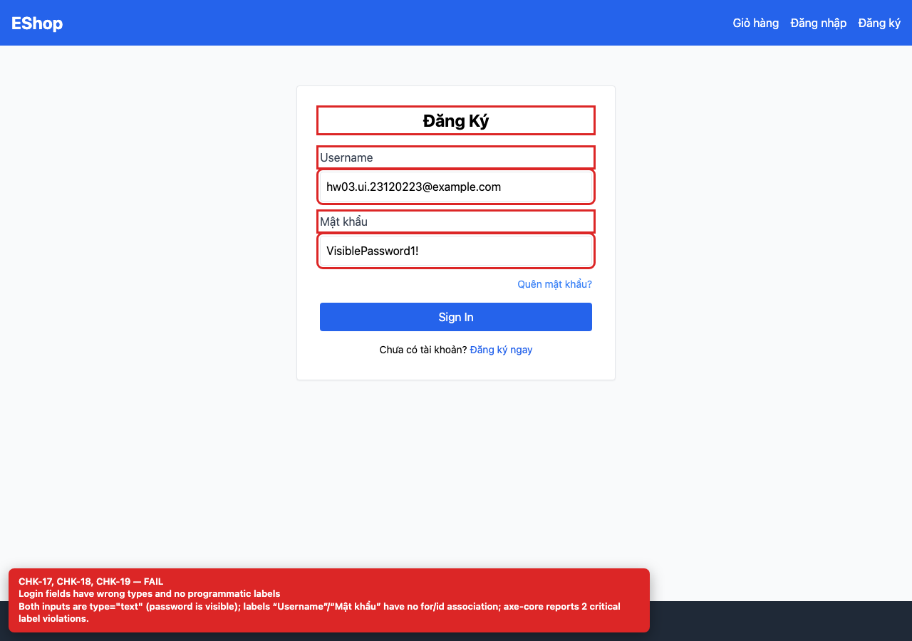

## Summary

Login password is visible and the email field has no email semantics.

## Environment

- SUT: EShop (`frontend-web`)
- URL: http://localhost:5173
- Browser: Chromium 158 (Playwright 1.65)
- Viewport: 1280×900 desktop; 360×800 mobile for responsive checks
- FR: FR-02 · IA-02 · Login
- Checklist IDs: CHK-17, CHK-18

## Steps to reproduce

1. Open /login.
2. Type into both fields and inspect the input types.

## Expected

The email field is type=email and the password field is type=password.

## Actual

Both fields are type=text; the password is visible on screen and the label says “Username” although the backend expects an email.

## Evidence

## Root cause

frontend-web/src/pages/Login.jsx:29-45.

## Suggested fix

Use type=email, type=password and label the first field “Email”.
