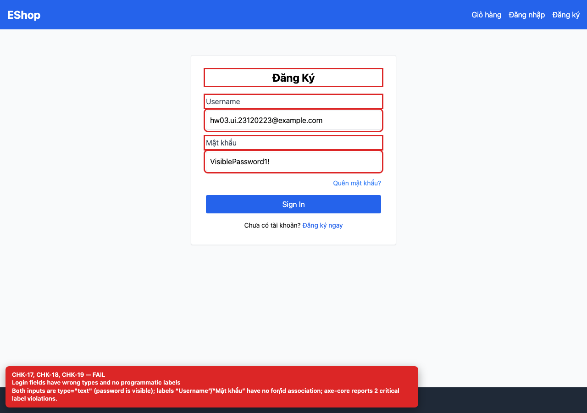
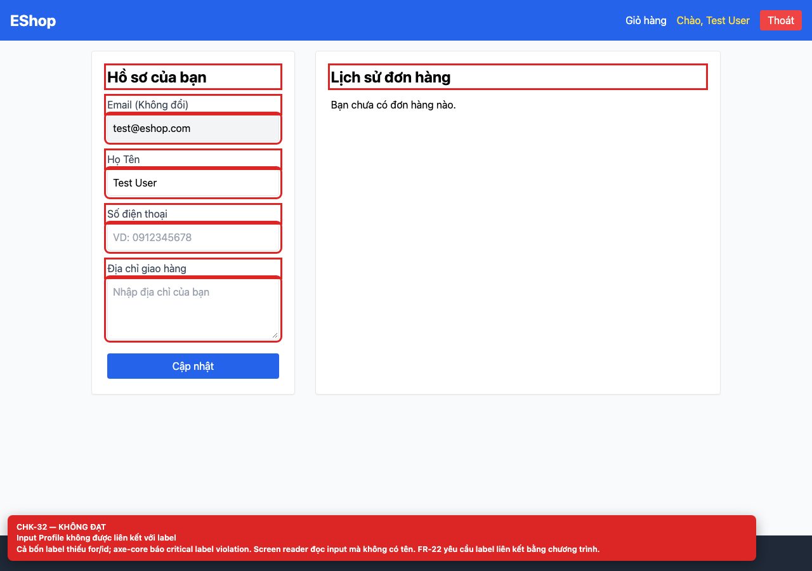

## Summary

Form inputs lack programmatic label associations.

## Environment

- SUT: EShop (`frontend-web`)
- URL: http://localhost:5173
- Browser: Chromium 158 (Playwright 1.65)
- Viewport: 1280×900 desktop; 360×800 mobile for responsive checks
- FR: FR-01..04 · IA-02 · Login, Register, Forgot Password, Profile
- Checklist IDs: CHK-19, CHK-32

## Steps to reproduce

1. Open each auth screen.
2. Run axe-core or inspect label htmlFor / input id / aria-label.

## Expected

Every input has an accessible name from a label, aria-label or aria-labelledby.

## Actual

All labels are plain text without htmlFor and all inputs lack id/aria-label; axe-core reports critical “label” violations on every screen.

## Evidence

## Root cause

Login.jsx:28-45, Register.jsx:36-66, ForgotPassword.jsx:48-86, Profile.jsx:116-155.

## Suggested fix

Add id to each input and htmlFor to its label (or aria-label for icon-only controls).
