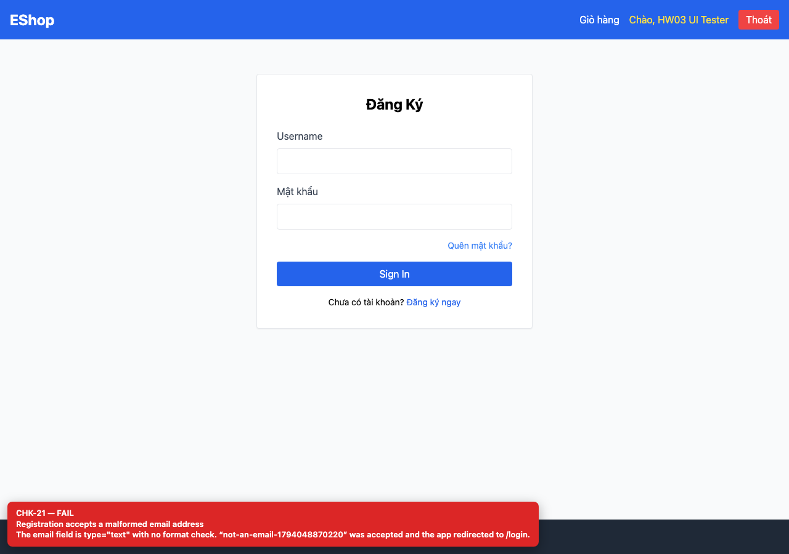
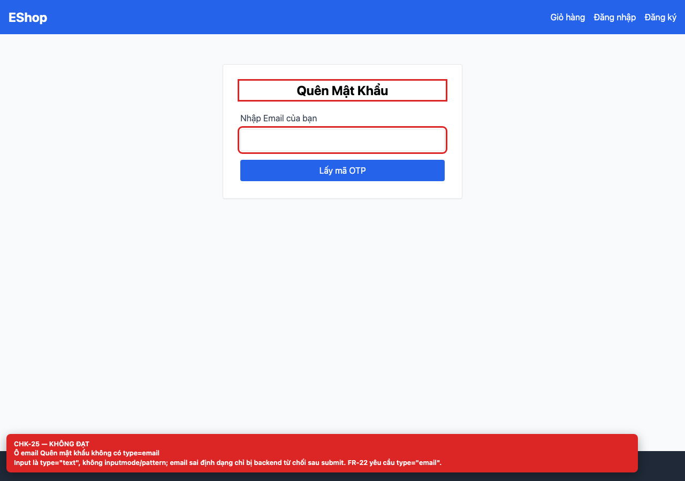
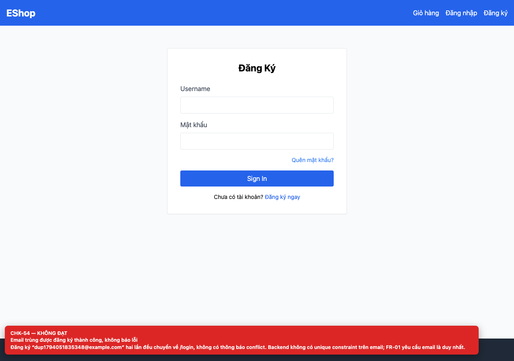

# [BUG-GUI-10] Không kiểm tra định dạng email và không chặn email trùng

**Severity:** Major · **Priority:** High · **FR:** FR-01 — Đăng ký; FR-03 — Quên mật khẩu · **Screen:** `/register, /forgot-password`

## Mô tả

Email sai định dạng được chấp nhận và chuyển về `/login`; đăng ký trùng email cũng thành công, không báo lỗi. Backend không có unique constraint trên `email`.

## Các bước tái hiện

1. Đăng ký với email `not-an-email-<timestamp>`.
2. Đăng ký cùng một email hợp lệ hai lần.
3. Yêu cầu OTP với email sai định dạng.

## Expected

Email sai định dạng bị chặn ngay trên form; email trùng trả về thông báo conflict dễ hiểu (FR-01).

## Actual

Email sai định dạng được chấp nhận và chuyển về `/login`; đăng ký trùng email cũng thành công, không báo lỗi. Backend không có unique constraint trên `email`.

## Checklist IDs

CHK-21, CHK-25, CHK-54

## Nguyên nhân

**[`frontend-web/src/pages/Register.jsx:47`](https://github.com/SoftwareTesting-Group13/eshop-sut-homework/blob/85af3ba875c88283615e22cb108f13e2fccaf0e9/frontend-web/src/pages/Register.jsx#L47)–[L53](https://github.com/SoftwareTesting-Group13/eshop-sut-homework/blob/85af3ba875c88283615e22cb108f13e2fccaf0e9/frontend-web/src/pages/Register.jsx#L53)**

```jsx
          <input
            type="text"
            value={email}
            onChange={(e) => setEmail(e.target.value)}
            className="w-full border p-2 rounded"
            required
          />
```

Input email dùng `type="text"`; không có kiểm tra format trước khi POST.

**[`frontend-web/src/pages/ForgotPassword.jsx:49`](https://github.com/SoftwareTesting-Group13/eshop-sut-homework/blob/85af3ba875c88283615e22cb108f13e2fccaf0e9/frontend-web/src/pages/ForgotPassword.jsx#L49)–[L55](https://github.com/SoftwareTesting-Group13/eshop-sut-homework/blob/85af3ba875c88283615e22cb108f13e2fccaf0e9/frontend-web/src/pages/ForgotPassword.jsx#L55)**

```jsx
            <input
              type="text"
              value={email}
              onChange={(e) => setEmail(e.target.value)}
              className="w-full border p-2 rounded"
              required
            />
```

Input email dùng `type="text"`; lỗi format chỉ lộ ra từ backend sau submit.

**[`backend/server.js:20`](https://github.com/SoftwareTesting-Group13/eshop-sut-homework/blob/85af3ba875c88283615e22cb108f13e2fccaf0e9/backend/server.js#L20)–[L30](https://github.com/SoftwareTesting-Group13/eshop-sut-homework/blob/85af3ba875c88283615e22cb108f13e2fccaf0e9/backend/server.js#L30)**

```jsx
app.post("/api/register", (req, res) => {
  const { name, email, password } = req.body;
  db.run(
    "INSERT INTO users (name, email, password) VALUES (?, ?, ?)",
    [name, email, password],
    function (err) {
      if (err) return res.status(500).json({ error: err.message });
      res.json({ message: "User registered successfully", id: this.lastID });
    },
  );
});
```

`/api/register` INSERT thẳng, không validate email và không bắt lỗi unique.

**[`backend/database.js:50`](https://github.com/SoftwareTesting-Group13/eshop-sut-homework/blob/85af3ba875c88283615e22cb108f13e2fccaf0e9/backend/database.js#L50)–[L61](https://github.com/SoftwareTesting-Group13/eshop-sut-homework/blob/85af3ba875c88283615e22cb108f13e2fccaf0e9/backend/database.js#L61)**

```jsx
        db.run(`CREATE TABLE users (
            id INTEGER PRIMARY KEY AUTOINCREMENT,
            name TEXT,
            email TEXT,
            password TEXT,
            role TEXT DEFAULT 'user',
            login_attempts INTEGER DEFAULT 0,
            locked_until DATETIME,
            reset_token TEXT,
            shipping_address TEXT,
            phone TEXT
        )`);
```

Cột `email` không có ràng buộc `UNIQUE`.

## Đề xuất sửa

Dùng `type="email"` và kiểm tra format; thêm `UNIQUE(email)` và trả HTTP 409 với thông báo thân thiện.

## Screenshots








> Screenshot dùng raw URL trên nhánh `ncuong`; cần push nhánh này trước khi publish issue.
