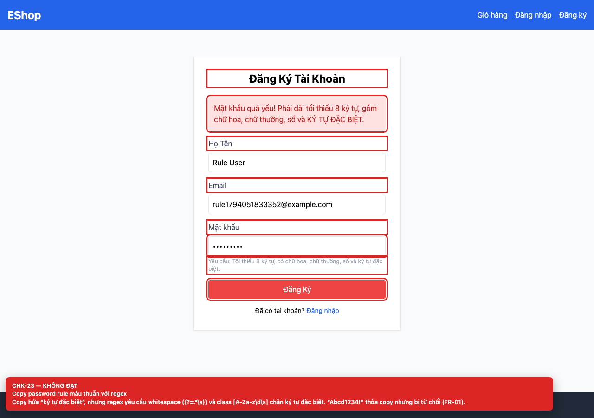

# [BUG-GUI-11] Nội dung mô tả password rule mâu thuẫn với regex thực tế

**Severity:** Major · **Priority:** High · **FR:** FR-01 — Đăng ký; FR-03 — Đặt lại mật khẩu · **Screen:** `/register, /forgot-password`

## Mô tả

Mật khẩu bị từ chối. Regex yêu cầu whitespace `(?=.*\s)` và character class `[A-Za-z\d\s]` chặn ký tự đặc biệt. Cùng regex được dùng ở màn hình reset.

## Các bước tái hiện

1. Mở `/register`.
2. Nhập `Abcd1234!` (chữ hoa, chữ thường, số, ký tự đặc biệt, 9 ký tự) và submit.

## Expected

Mật khẩu được chấp nhận vì copy nói cần ký tự đặc biệt (FR-01).

## Actual

Mật khẩu bị từ chối. Regex yêu cầu whitespace `(?=.*\s)` và character class `[A-Za-z\d\s]` chặn ký tự đặc biệt. Cùng regex được dùng ở màn hình reset.

## Checklist IDs

CHK-23

## Nguyên nhân

**[`frontend-web/src/pages/Register.jsx:15`](https://github.com/SoftwareTesting-Group13/eshop-sut-homework/blob/85af3ba875c88283615e22cb108f13e2fccaf0e9/frontend-web/src/pages/Register.jsx#L15)–[L18](https://github.com/SoftwareTesting-Group13/eshop-sut-homework/blob/85af3ba875c88283615e22cb108f13e2fccaf0e9/frontend-web/src/pages/Register.jsx#L18)**

```jsx
    const flawedStrongPasswordRegex = /^(?=.*[a-z])(?=.*[A-Z])(?=.*\d)(?=.*\s)[A-Za-z\d\s]{8,}$/;

    if (!flawedStrongPasswordRegex.test(password)) {
      setError('Mật khẩu quá yếu! Phải dài tối thiểu 8 ký tự, gồm chữ hoa, chữ thường, số và KÝ TỰ ĐẶC BIỆT.');
```

Regex yêu cầu `\s` và chỉ cho phép chữ, số, whitespace.

**[`frontend-web/src/pages/ForgotPassword.jsx:26`](https://github.com/SoftwareTesting-Group13/eshop-sut-homework/blob/85af3ba875c88283615e22cb108f13e2fccaf0e9/frontend-web/src/pages/ForgotPassword.jsx#L26)–[L29](https://github.com/SoftwareTesting-Group13/eshop-sut-homework/blob/85af3ba875c88283615e22cb108f13e2fccaf0e9/frontend-web/src/pages/ForgotPassword.jsx#L29)**

```jsx
    const flawedStrongPasswordRegex = /^(?=.*[a-z])(?=.*[A-Z])(?=.*\d)(?=.*\s)[A-Za-z\d\s]{8,}$/;
    if (!flawedStrongPasswordRegex.test(newPassword)) {
      alert('Mật khẩu quá yếu! Phải dài tối thiểu 8 ký tự, gồm chữ hoa, chữ thường, số và KÝ TỰ ĐẶC BIỆT.');
      return;
```

Copy regex y nguyên sang màn hình đặt lại mật khẩu.

## Đề xuất sửa

Thay bằng regex đúng (ví dụ `/^(?=.*[a-z])(?=.*[A-Z])(?=.*\d)(?=.*[^A-Za-z0-9])\S{8,}$/`) và giữ copy đồng bộ.

## Screenshots




> Screenshot dùng raw URL trên nhánh `ncuong`; cần push nhánh này trước khi publish issue.
