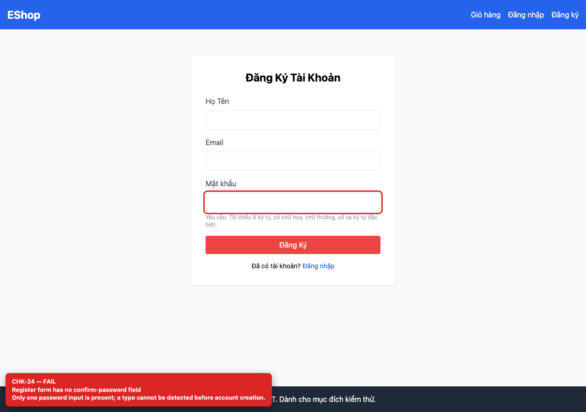
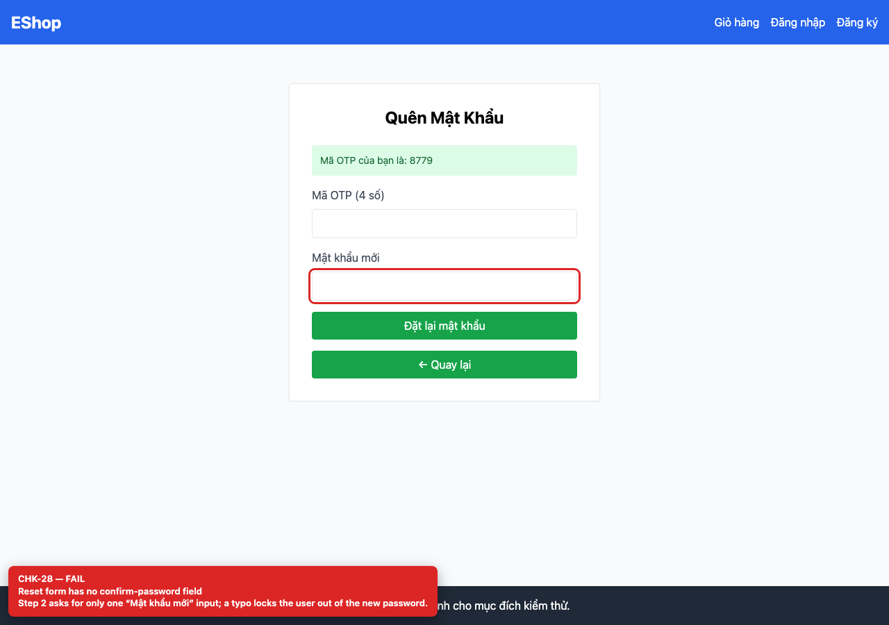

# [BUG-GUI-12] Form đăng ký và đặt lại mật khẩu thiếu trường xác nhận mật khẩu

**Severity:** Minor · **Priority:** Medium · **FR:** FR-01 — Đăng ký; FR-03 — Đặt lại mật khẩu · **Screen:** `/register, /forgot-password`

## Mô tả

Mỗi form chỉ có một input mật khẩu; lỗi gõ nhầm không được phát hiện trước khi tạo tài khoản hoặc đổi mật khẩu.

## Các bước tái hiện

1. Mở `/register` và bước 2 của `/forgot-password`.
2. Đếm số input mật khẩu trên mỗi form.

## Expected

Có trường xác nhận mật khẩu và chặn khi hai trường không khớp (FR-01, FR-03).

## Actual

Mỗi form chỉ có một input mật khẩu; lỗi gõ nhầm không được phát hiện trước khi tạo tài khoản hoặc đổi mật khẩu.

## Checklist IDs

CHK-24, CHK-28

## Nguyên nhân

**[`frontend-web/src/pages/Register.jsx:55`](https://github.com/SoftwareTesting-Group13/eshop-sut-homework/blob/85af3ba875c88283615e22cb108f13e2fccaf0e9/frontend-web/src/pages/Register.jsx#L55)–[L67](https://github.com/SoftwareTesting-Group13/eshop-sut-homework/blob/85af3ba875c88283615e22cb108f13e2fccaf0e9/frontend-web/src/pages/Register.jsx#L67)**

```jsx
        <div>
          <label className="block text-gray-700 mb-2">Mật khẩu</label>
          <input
            type="password"
            value={password}
            onChange={(e) => setPassword(e.target.value)}
            className="w-full border p-2 rounded"
            required
          />
          <p className="text-xs text-gray-400 mt-1">
            Yêu cầu: Tối thiểu 8 ký tự, có chữ hoa, chữ thường, số và ký tự đặc biệt.
          </p>
        </div>
```

Chỉ có một input `Mật khẩu`.

**[`frontend-web/src/pages/ForgotPassword.jsx:78`](https://github.com/SoftwareTesting-Group13/eshop-sut-homework/blob/85af3ba875c88283615e22cb108f13e2fccaf0e9/frontend-web/src/pages/ForgotPassword.jsx#L78)–[L87](https://github.com/SoftwareTesting-Group13/eshop-sut-homework/blob/85af3ba875c88283615e22cb108f13e2fccaf0e9/frontend-web/src/pages/ForgotPassword.jsx#L87)**

```jsx
          <div>
            <label className="block text-gray-700 mb-2">Mật khẩu mới</label>
            <input
              type="password"
              value={newPassword}
              onChange={(e) => setNewPassword(e.target.value)}
              className="w-full border p-2 rounded"
              required
            />
          </div>
```

Chỉ có một input `Mật khẩu mới`.

## Đề xuất sửa

Thêm input xác nhận mật khẩu và kiểm tra khớp trước khi submit.

## Screenshots






> Screenshot dùng raw URL trên nhánh `ncuong`; cần push nhánh này trước khi publish issue.
