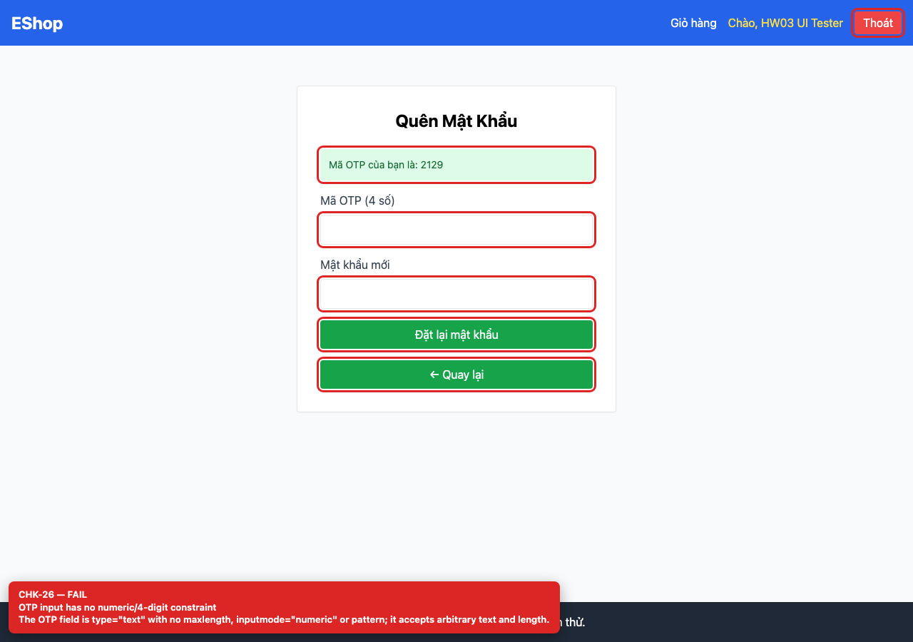
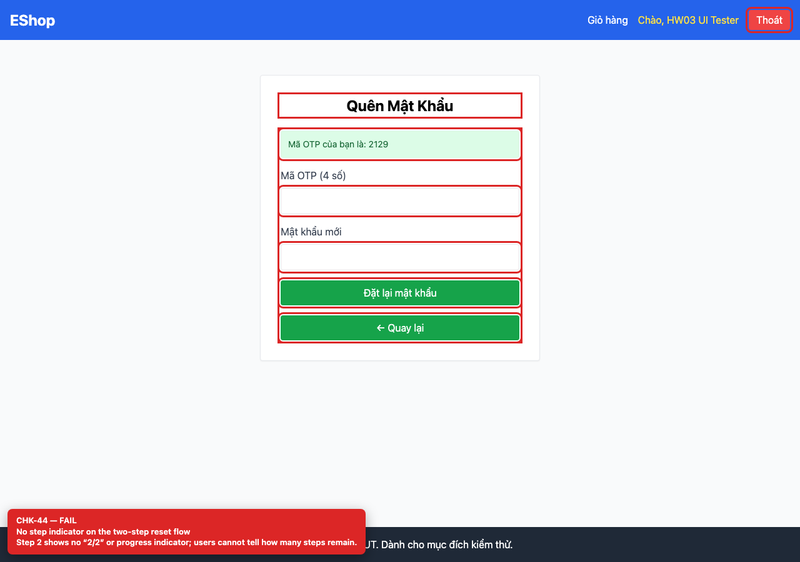

# [BUG-GUI-13] OTP chỉ có 4 chữ số, input không giới hạn và bước 2 thiếu step indicator

**Severity:** Major · **Priority:** High · **FR:** FR-03 — Quên mật khẩu; FR-22 — Form · **Screen:** `/forgot-password`

## Mô tả

Backend sinh OTP 4 chữ số (`1000`–`9999`); label ghi “Mã OTP (4 số)”; input là `type="text"`, không `maxlength`, `inputmode` hay `pattern`; không có step indicator.

## Các bước tái hiện

1. Mở `/forgot-password`, nhập email đã đăng ký và lấy OTP.
2. Đọc độ dài OTP, kiểm tra `maxlength`/`inputmode`/`pattern` của input và tìm step indicator.

## Expected

OTP 6 chữ số (FR-03, SEC-07); input giới hạn đúng 6 chữ số; có chỉ báo “Bước 1/2”, “Bước 2/2” (FR-03, FR-22).

## Actual

Backend sinh OTP 4 chữ số (`1000`–`9999`); label ghi “Mã OTP (4 số)”; input là `type="text"`, không `maxlength`, `inputmode` hay `pattern`; không có step indicator.

## Checklist IDs

CHK-26, CHK-44

## Nguyên nhân

**[`backend/server.js:72`](https://github.com/SoftwareTesting-Group13/eshop-sut-homework/blob/85af3ba875c88283615e22cb108f13e2fccaf0e9/backend/server.js#L72)**

```jsx
    const resetToken = Math.floor(1000 + Math.random() * 9000).toString();
```

`Math.floor(1000 + Math.random() * 9000)` chỉ sinh 4 chữ số.

**[`frontend-web/src/pages/ForgotPassword.jsx:63`](https://github.com/SoftwareTesting-Group13/eshop-sut-homework/blob/85af3ba875c88283615e22cb108f13e2fccaf0e9/frontend-web/src/pages/ForgotPassword.jsx#L63)–[L96](https://github.com/SoftwareTesting-Group13/eshop-sut-homework/blob/85af3ba875c88283615e22cb108f13e2fccaf0e9/frontend-web/src/pages/ForgotPassword.jsx#L96)**

```jsx
      {step === 2 && (
        <form onSubmit={handleReset} className="space-y-4">
          <div className="bg-green-100 text-green-800 p-3 rounded text-sm mb-4">
            {message}
          </div>
          <div>
            <label className="block text-gray-700 mb-2">Mã OTP (4 số)</label>
            <input
              type="text"
              value={resetToken}
              onChange={(e) => setResetToken(e.target.value)}
              className="w-full border p-2 rounded"
              required
            />
          </div>
          <div>
            <label className="block text-gray-700 mb-2">Mật khẩu mới</label>
            <input
              type="password"
              value={newPassword}
              onChange={(e) => setNewPassword(e.target.value)}
              className="w-full border p-2 rounded"
              required
            />
          </div>

              
          <button type="submit" className="w-full bg-green-600 text-white py-2 rounded">
            Đặt lại mật khẩu
          </button>
          <button type="button" onClick={() => setStep(1)} className="w-full bg-green-600 text-white py-2 rounded">
            ← Quay lại
          </button>
        </form>
```

Label ghi “4 số”; input không có ràng buộc; không render step indicator.

## Đề xuất sửa

Sinh OTP 6 chữ số, dùng `inputmode="numeric"`, `maxLength=6`, `pattern="[0-9]{6}"` và thêm indicator “Bước 1/2”/“Bước 2/2”.

## Screenshots






> Screenshot dùng raw URL trên nhánh `ncuong`; cần push nhánh này trước khi publish issue.
