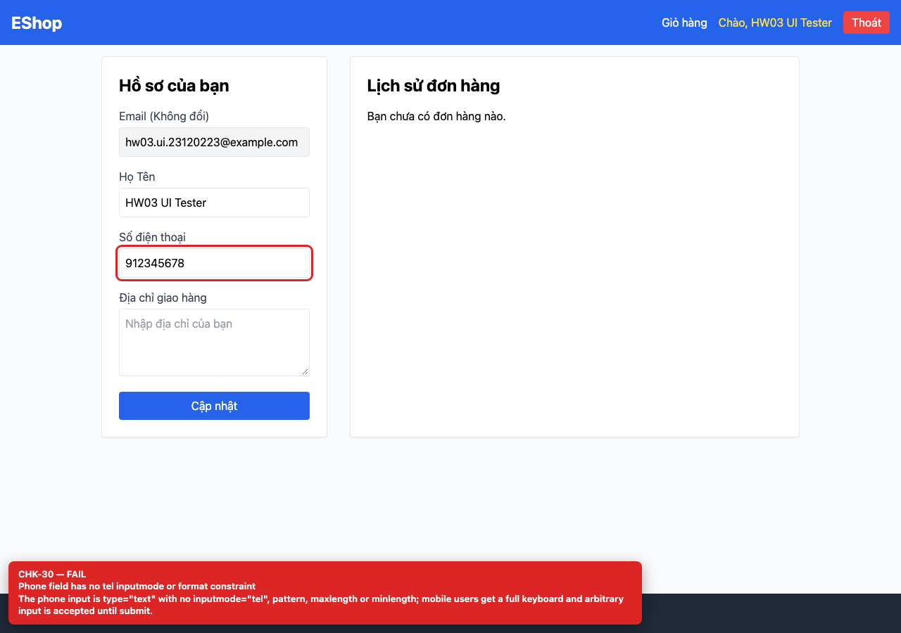

## Summary

Phone validation rejects valid Vietnamese numbers and uses a blocking alert.

## Environment

- SUT: EShop (`frontend-web`)
- URL: http://localhost:5173
- Browser: Chromium 158 (Playwright 1.65)
- Viewport: 1280×900 desktop; 360×800 mobile for responsive checks
- FR: FR-04 · IA-02 · Profile
- Checklist IDs: CHK-30, CHK-31

## Steps to reproduce

1. Log in and open /profile.
2. Enter the placeholder value 0912345678 and click “Cập nhật”.

## Expected

The phone number is accepted and the profile is saved.

## Actual

An alert says “Số điện thoại không hợp lệ. Vui lòng nhập đúng 9-10 chữ số.” The regex /^[1-9][0-9]{8,9}$/ rejects every number starting with 0, which is the normal Vietnamese mobile prefix.

## Evidence

## Root cause

Profile.jsx:43-46.

## Suggested fix

Use a Vietnamese phone rule such as /^0\d{9,10}$/ (or a library), add inputmode=tel, and show an inline error instead of alert().
