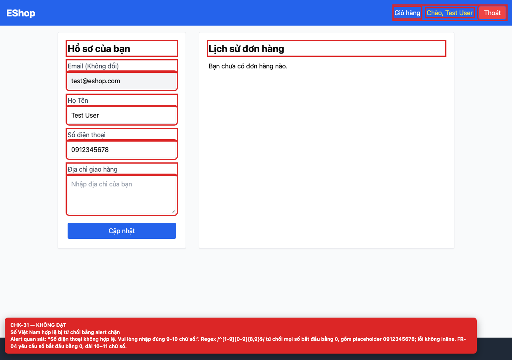

# [BUG-GUI-14] Regex số điện thoại từ chối số Việt Nam hợp lệ và dùng alert chặn

**Severity:** Blocker · **Priority:** High · **FR:** FR-04 — Hồ sơ cá nhân · **Screen:** `/profile`

## Mô tả

Alert “Số điện thoại không hợp lệ...” hiện ra. Regex `/^[1-9][0-9]{8,9}$/` từ chối mọi số bắt đầu bằng `0`, gồm cả placeholder `0912345678`; lỗi dùng `alert()` thay vì inline.

## Các bước tái hiện

1. Đăng nhập và mở `/profile`.
2. Nhập số `0912345678` (đúng placeholder) và bấm “Cập nhật”.

## Expected

Số bắt đầu bằng `0`, dài 10–11 chữ số được chấp nhận và lưu hồ sơ (FR-04).

## Actual

Alert “Số điện thoại không hợp lệ...” hiện ra. Regex `/^[1-9][0-9]{8,9}$/` từ chối mọi số bắt đầu bằng `0`, gồm cả placeholder `0912345678`; lỗi dùng `alert()` thay vì inline.

## Checklist IDs

CHK-31

## Nguyên nhân

**[`frontend-web/src/pages/Profile.jsx:40`](https://github.com/SoftwareTesting-Group13/eshop-sut-homework/blob/85af3ba875c88283615e22cb108f13e2fccaf0e9/frontend-web/src/pages/Profile.jsx#L40)–[L46](https://github.com/SoftwareTesting-Group13/eshop-sut-homework/blob/85af3ba875c88283615e22cb108f13e2fccaf0e9/frontend-web/src/pages/Profile.jsx#L46)**

```jsx
  const handleUpdate = async (e) => {
    e.preventDefault();

    if (!/^[1-9][0-9]{8,9}$/.test(phone)) {
      alert("Số điện thoại không hợp lệ. Vui lòng nhập đúng 9-10 chữ số.");
      return;
    }
```

Regex bắt đầu bằng `[1-9]` và dùng `alert()`.

## Đề xuất sửa

Dùng `/^0\d{9,10}$/` (hoặc thư viện validate), thêm `inputmode="tel"` và hiển thị lỗi inline.

## Screenshots




> Screenshot dùng raw URL trên nhánh `ncuong`; cần push nhánh này trước khi publish issue.
