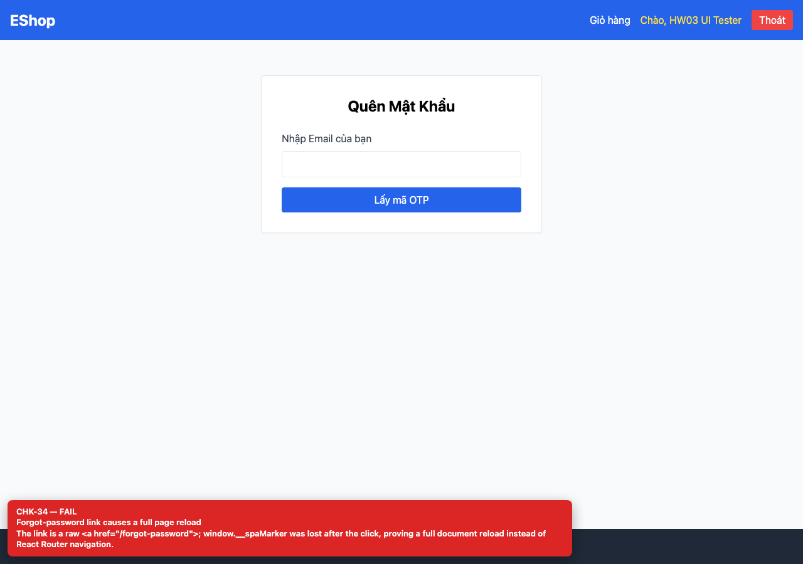

## Summary

Forgot-password link performs a full page reload.

## Environment

- SUT: EShop (`frontend-web`)
- URL: http://localhost:5173
- Browser: Chromium 158 (Playwright 1.65)
- Viewport: 1280×900 desktop; 360×800 mobile for responsive checks
- FR: FR-02 · IA-03 · Login
- Checklist IDs: CHK-34

## Steps to reproduce

1. Open /login.
2. Set window.__spaMarker = 'kept', click “Quên mật khẩu?” and inspect the marker.

## Expected

React Router navigation without a document reload.

## Actual

The marker is lost; the link is a raw <a href="/forgot-password"> and the whole SPA reloads.

## Evidence

## Root cause

Login.jsx:50.

## Suggested fix

Use <Link to="/forgot-password"> from react-router-dom.
