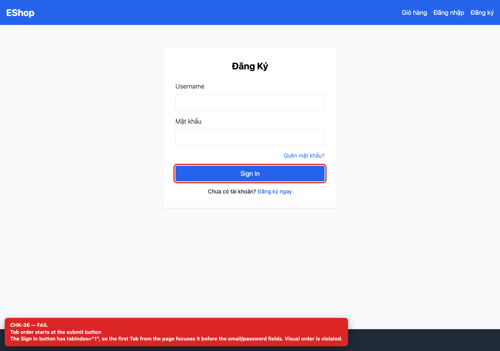

# [BUG-GUI-16] Tab order bắt đầu ở nút Sign In vì `tabIndex=1`

**Severity:** Major · **Priority:** High · **FR:** FR-21 — Tiêu chuẩn giao diện chung · **Screen:** `/login`

## Mô tả

Tab đầu tiên focus vào nút “Sign In” vì nút có `tabIndex={1}`; người dùng bàn phím bỏ qua hai ô nhập và thứ tự thị giác bị đảo.

## Các bước tái hiện

1. Mở `/login`.
2. Focus vào body và bấm Tab một lần; ghi lại phần tử được focus.

## Expected

Tab đầu tiên vào ô email, sau đó mật khẩu, link quên mật khẩu, nút submit, link đăng ký.

## Actual

Tab đầu tiên focus vào nút “Sign In” vì nút có `tabIndex={1}`; người dùng bàn phím bỏ qua hai ô nhập và thứ tự thị giác bị đảo.

## Checklist IDs

CHK-36

## Nguyên nhân

**[`frontend-web/src/pages/Login.jsx:53`](https://github.com/SoftwareTesting-Group13/eshop-sut-homework/blob/85af3ba875c88283615e22cb108f13e2fccaf0e9/frontend-web/src/pages/Login.jsx#L53)–[L59](https://github.com/SoftwareTesting-Group13/eshop-sut-homework/blob/85af3ba875c88283615e22cb108f13e2fccaf0e9/frontend-web/src/pages/Login.jsx#L59)**

```jsx
        <button
          type="submit"
          className="w-full bg-blue-600 text-white py-2 rounded hover:bg-blue-700"
          tabIndex={1}
        >
          Sign In
        </button>
```

`tabIndex={1}` trên button submit.

## Đề xuất sửa

Bỏ `tabIndex`; để DOM order quyết định tab order.

## Screenshots




> Screenshot dùng raw URL trên nhánh `ncuong`; cần push nhánh này trước khi publish issue.
